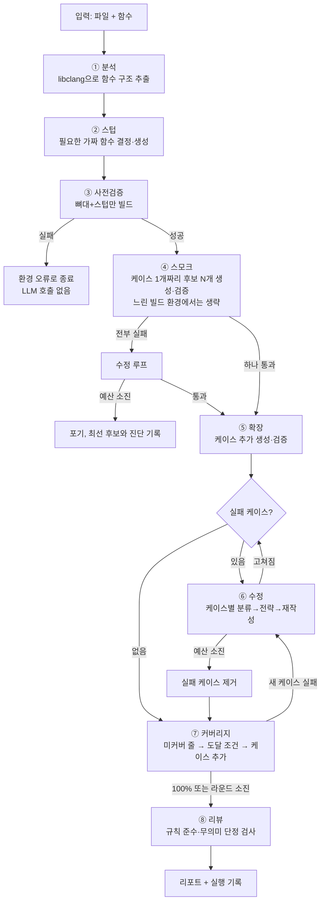
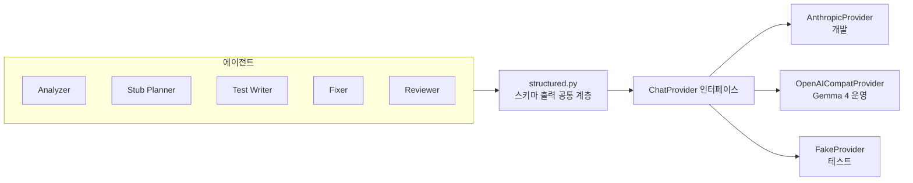
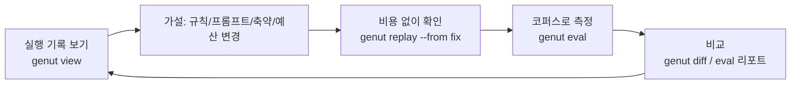

# GenUT 설계 문서

> 이 문서는 GenUT(Generate Unit Tests)의 설계를 설명합니다. C 코드나 테스트 도구를 잘 모르는 사람도 흐름을 이해할 수 있도록 썼고, 구현자가 그대로 따라 만들 수 있을 만큼 구체적으로 적었습니다. 코드 구현은 이 문서를 함께 검토하고 합의한 뒤에 시작합니다.

**문서 버전**: 0.6 (초안, 2026-10-22)
**그림**: HTML 판(`docs/design.html`)에는 시스템 구성도, 흐름도, 에이전트 협업도, 검증 깔때기, 케이스 상태 머신, 로그 축약 파이프라인, 커버리지 루프, 공통/프로덕트 저장소 그림 8장이 들어 있습니다.
**상태**: 검토 중

---

## 목차

1. [한눈에 보기](#1-한눈에-보기)
2. [용어집](#2-용어집)
3. [전체 흐름](#3-전체-흐름)
4. [역할별 에이전트](#4-역할별-에이전트)
5. [규칙 md 작성 가이드](#5-규칙-md-작성-가이드)
6. [정적 분석](#6-정적-분석)
7. [빌드·실행 실패 대응](#7-빌드실행-실패-대응)
8. [로그 축약과 크래시 브리프](#8-로그-축약과-크래시-브리프)
9. [LLM 교체 구조](#9-llm-교체-구조)
10. [스텁 도구 연동](#10-스텁-도구-연동)
11. [사용·관찰·튜닝](#11-사용관찰튜닝)
12. [설정 레퍼런스](#12-설정-레퍼런스)
13. [구현 단계와 검증 계획](#13-구현-단계와-검증-계획)
14. [열린 질문](#14-열린-질문)

---

## 1. 한눈에 보기

### GenUT가 하는 일

GenUT는 C 함수 하나를 가리키면 그 함수를 검증하는 **단위 테스트를 자동으로 만들고, 직접 빌드하고 실행해서 통과하는 것만 남겨 주는** 도구입니다.

- 유저 스페이스 C/C++ 프로젝트에는 **GoogleTest(gtest)** 테스트를 만듭니다.
- 리눅스 커널 코드에는 **KUnit** 테스트를 만듭니다.

사람이 하는 일은 두 가지뿐입니다.

1. "이 파일의 이 함수를 테스트해 줘"라고 지정한다.
2. 꼭 지켜야 할 규칙을 짧은 md 파일에 적어 둔다. (예: "테스트 이름은 `test_<함수명>_<상황>`으로", "실제 하드웨어 레지스터는 절대 건드리지 말 것")

나머지는 GenUT 안의 여러 **에이전트**(각자 역할이 정해진 LLM 작업자)가 알아서 합니다. 코드를 읽고, 필요한 스텁을 만들고, 테스트를 쓰고, 빌드하고, 실행하고, 실패하면 원인을 분석해서 고치고, 그래도 안 되면 그 케이스만 버리고 나머지를 살립니다.

### 입력과 출력

| 입력 | 출력 |
|---|---|
| 소스 파일 경로 (+ 선택적으로 함수 이름) | 빌드되고 실행에 통과한 테스트 파일 |
| `compile_commands.json` (빌드 플래그 정보) | 필요 시 스텁 파일 |
| 규칙 md (`rules/`) | 리포트: 통과한 케이스, 버린 케이스와 이유, "소스 버그 의심" 목록 |
| 빌드/실행 환경 (CMake 또는 커널 실행 스크립트) | 실행 기록 (모든 판단과 로그, 나중에 들여다보고 튜닝하는 용도) |

### 30초 사용 예

```bash
# 처음 한 번: 설정 파일과 규칙 템플릿 생성, 환경 점검
genut init
genut doctor

# 테스트 생성
genut gen --backend gtest --file src/ring_buffer.c --func rb_push

# 결과 확인
genut show latest        # 터미널 요약
genut view latest        # HTML 뷰어 생성 후 브라우저로 열기
```

터미널에는 진행 상황이 단계별로 보입니다.

```
[1/8] 분석      rb_push(struct rb *, const void *, size_t) · 호출 3개 · 스텁 필요 1개 (rb_alloc_slot)
[2/8] 스텁      rb_alloc_slot → 스텁 생성
[3/8] 사전검증  뼈대 빌드 OK (2.1s)
[4/8] 스모크    후보 1/1 통과
[5/8] 확장      케이스 6개 생성 → 통과 4 · 실패 2
[6/8] 수정      round 1: fix_case(test_rb_push_full) ✓ · drop_case(test_rb_push_null_buf: 소스 버그 의심)
[7/8] 커버리지  라인 92% (27/29) → 미커버 :51 :63 → 케이스 1개 추가 → 100%
[8/8] 리뷰      지적 0건
완료  통과 6 · 제거 1 · 커버리지 100% · 소요 52s · 토큰 24k   → .genut/runs/20261022-143012-rb_push/
```

### 핵심 설계 원칙 요약

| 원칙 | 한 줄 설명 |
|---|---|
| 순서는 코드가, 판단은 LLM이 | 무엇을 언제 할지는 Python 상태 머신이 정하고, LLM은 좁은 질문에만 답한다 |
| 규칙만 사람이 쓴다 | 사람은 `rules/*.md`에 꼭 지킬 것만 적고, 나머지는 에이전트가 판단한다 |
| 원시 로그는 LLM에 주지 않는다 | 컴파일 오류, 테스트 로그, 커널 크래시는 전부 코드가 먼저 구조화·축약한다 |
| 케이스 단위로 전진한다 | 통과한 테스트 케이스는 절대 잃지 않고, 실패한 케이스만 고치거나 버린다 |
| 모델은 바꿔 끼운다 | 개발은 Claude로, 운영은 사내 Gemma 4로. 설계는 Gemma 4 수준을 기준으로 한다 |
| 모든 실행은 되돌아볼 수 있다 | 모든 프롬프트·응답·판단·로그를 실행 기록에 남기고 HTML로 본다 |
| 측정 없이 튜닝 없음 | 같은 코퍼스로 성공률을 재고, 규칙·프롬프트 변경의 효과를 숫자로 비교한다 |
| 공통과 프로덕트를 가른다 | 한 번 셋업한 GenUT로 여러 프로덕트를 다룬다. 쌓이는 정보는 프로덕트 무관(공통)과 프로덕트별로 분리 저장하고 섞지 않는다 |

---

## 2. 용어집

처음 보는 용어가 있으면 여기서 찾아보세요. 이 문서에서는 아래 뜻으로만 씁니다.

| 용어 | 뜻 |
|---|---|
| **단위 테스트** | 함수 하나(또는 아주 작은 단위)가 의도대로 동작하는지 확인하는 작은 프로그램. "입력 X를 주면 출력 Y가 나와야 한다"를 코드로 적은 것 |
| **테스트 케이스** | 단위 테스트 안의 한 가지 상황. 예: "빈 버퍼에 push하면 성공한다", "가득 찬 버퍼에 push하면 -ENOSPC를 돌려준다". GenUT는 케이스를 하나씩 독립적으로 다룬다 |
| **gtest** | GoogleTest. 유저 스페이스 C/C++용 테스트 프레임워크. `TEST(Suite, Name) { EXPECT_EQ(a, b); }` 형태 |
| **KUnit** | 리눅스 커널 안에서 돌아가는 테스트 프레임워크. `KUNIT_EXPECT_EQ(test, a, b)` 형태. 커널을 빌드해서 실행해야 한다 |
| **스텁(stub)** | 테스트 대상 함수가 호출하는 다른 함수를 가짜로 바꿔 끼운 것. 예: 실제 하드웨어를 읽는 `read_reg()` 대신 정해진 값을 돌려주는 가짜 `read_reg()`. 이 프로젝트는 gtest용, KUnit용 자체 스텁 도구를 각각 가지고 있다 |
| **compile_commands.json** | "이 파일을 컴파일할 때 이런 플래그를 썼다"를 파일별로 적어 둔 JSON. CMake는 옵션 하나로, 커널은 `make compile_commands.json`으로 만든다. 정적 분석기가 소스를 정확히 읽으려면 이게 필요하다 |
| **libclang** | clang 컴파일러의 분석 기능을 라이브러리로 쓰는 것. 소스를 "진짜 컴파일러가 이해하는 방식"으로 읽어 함수 시그니처, 타입, 호출 관계를 알려 준다 |
| **정적 분석** | 코드를 실행하지 않고 읽어서 구조를 파악하는 것. GenUT는 libclang으로 한다 |
| **KTAP** | KUnit이 결과를 출력하는 텍스트 형식. `ok 1 test_name` / `not ok 2 test_name` 같은 줄로 되어 있다 |
| **oops / panic** | 커널이 치명적 오류를 만났을 때 찍는 로그. 호출 스택(Call Trace), 레지스터 값 등이 길게 나온다. 사람도 읽기 어렵다 |
| **KASAN / UBSAN** | 커널 메모리 오류(해제 후 사용, 범위 초과 등)와 정의되지 않은 동작을 잡아 주는 디버그 기능. 켜 두면 크래시 원인이 로그에 명시된다 |
| **LLM** | 대형 언어 모델. 이 프로젝트에서는 Claude(개발용)와 Gemma 4(운영용) |
| **에이전트** | 특정 역할(분석, 작성, 수정 등)을 맡은 LLM 작업자. 역할마다 다른 지시문과 입력·출력 형식을 가진다 |
| **오케스트레이터** | 에이전트들을 순서대로 부르고, 결과를 보고 다음 행동을 정하는 Python 코드. LLM이 아니다 |
| **Provider** | LLM API를 감싼 어댑터. Claude용, OpenAI 호환(Gemma 4)용, 테스트용 가짜가 있다 |
| **후보(candidate)** | 같은 요청으로 여러 번 생성한 테스트 파일 중 하나. 여러 후보를 만들어 모두 빌드해 보고 통과한 것을 고른다 |
| **Preflight(사전검증)** | 테스트 본문 없이 뼈대와 스텁만으로 빌드가 되는지 먼저 확인하는 단계. 환경 문제와 생성 문제를 분리한다 |
| **실행 기록(run)** | `genut gen` 한 번의 모든 산출물과 로그가 담긴 디렉터리 |

---

## 3. 전체 흐름

### 3.1 그림으로 보기



### 3.2 단계별 설명

각 단계마다 "무엇을 하는지", "누가 하는지(코드인지 LLM인지)", "실패하면 어떻게 되는지"를 적었습니다.

#### ① 분석

- **무엇**: 대상 함수의 시그니처, 파라미터 타입(구조체면 필드까지), 호출하는 함수 목록, 읽고 쓰는 전역 변수, 필요한 include, static 여부, `#ifdef` 조건을 뽑는다. 그리고 호출하는 함수 각각에 대해 "테스트를 링크할 때 정의가 있는가"를 판정한다(6장).
- **누가**: 거의 전부 코드(libclang). 마지막에 Analyzer 에이전트가 보고서를 읽고 "테스트 가능한가, 주의할 점은 무엇인가"를 짧게 덧붙인다.
- **실패하면**: compile_commands.json에서 플래그를 못 찾거나 파싱이 깨지면 여기서 멈추고 원인을 안내한다. Analyzer가 "테스트 불가"(예: 인라인 어셈블리만 있는 함수)로 판정하면 사유를 남기고 종료한다.

#### ② 스텁

- **무엇**: 1단계에서 "정의 없음"으로 판정된 심볼과, 규칙상 반드시 가짜로 바꿔야 하는 심볼(하드웨어 접근 등)을 스텁 도구로 만든다.
- **누가**: Stub Planner 에이전트가 "무엇을 스텁할지"를 정하고, 코드가 스텁 도구를 호출한다. 스텁 도구의 사용법은 `docs/stub-tools/*.md`에서 읽는다(10장).
- **실패하면**: 스텁 도구가 실패한 심볼은 보고서에 남기고, 그 심볼을 호출하는 경로는 "테스트 범위 축소" 대상으로 표시한다.

#### ③ 사전검증 (Preflight)

- **무엇**: 테스트 케이스가 하나도 없는 빈 테스트 파일(include, 스위트 선언, 스텁 연결만 있음)을 실제로 빌드한다.
- **누가**: 코드.
- **왜**: 여기서 실패하면 LLM이 아무리 잘 써도 빌드가 안 된다. 환경 문제(헤더 경로, 링크 설정, 스크립트 오류)를 LLM 비용을 쓰기 전에 걸러 낸다.
- **실패하면**: `infra_error`로 종료하고 빌드 로그를 그대로 보여 준다. 이건 사람이 고쳐야 할 문제다.

#### ④ 스모크

- **무엇**: 가장 단순한 케이스 하나("정상 입력이면 성공을 돌려준다" 수준)만 담은 테스트 파일을 N개 생성하고 검증한다.
- **누가**: Test Writer 에이전트가 생성, 코드가 검증.
- **왜**: 케이스 여러 개를 한 번에 쓰면 어디서 깨졌는지 알기 어렵다. 먼저 "이 함수를 호출하는 최소 코드"가 빌드되고 돌아가는 것을 확정한 뒤 그 위에 쌓는다.
- **실패하면**: 수정 루프(⑥)로 들어간다. 예산을 다 써도 안 되면 포기하고 가장 진전된 후보(빌드까지 된 것 > 컴파일 오류가 적은 것)와 진단을 남긴다.

#### ⑤ 확장

- **무엇**: 스모크로 확정된 파일에 케이스를 추가한다. 규칙 md에 적힌 커버리지 기준(예: "경계값, NULL 입력, 오류 반환 경로를 각각 1개 이상")을 따른다.
- **누가**: Test Writer 에이전트.
- **실패하면**: 실패한 케이스만 ⑥으로 간다. 통과한 케이스는 보존된다.

#### ⑥ 수정

- **무엇**: 실패 케이스마다 (a) 코드가 실패를 분류하고(컴파일 오류 종류, 단정 실패, 크래시 등) (b) Fixer 에이전트가 정해진 전략 중 하나를 고르고 (c) 그 케이스를 다시 쓴다. 7장에서 자세히 다룬다.
- **누가**: 분류는 코드, 전략 선택과 재작성은 Fixer 에이전트, 검증은 코드.
- **실패하면**: 케이스당 수정 횟수(기본 2회)를 넘기면 그 케이스를 제거한다. 전체 반복 횟수(기본 4회)를 넘기면 남은 실패 케이스를 모두 제거한다. 제거 사유는 리포트에 남는다.

#### ⑦ 커버리지

- **무엇**: 통과 케이스로 실행한 결과에서 대상 함수의 **미커버 줄**을 뽑고, 줄마다 "도달 조건"(가장 가까운 분기의 조건식과 방향)을 붙여 Test Writer에게 그 줄을 실행시키는 케이스를 요청한다. 목표는 라인 커버리지 100%다. 7.6에서 자세히 다룬다.
- **누가**: 커버리지 수집·미커버 줄·도달 조건은 코드, 케이스 생성은 Test Writer, 도달 불가 판정은 Analyzer.
- **실패하면**: 새 케이스가 실패하면 ⑥으로 간다. `max_coverage_rounds`(기본 3)를 넘기면 남은 미커버 줄을 "도달 불가 사유"와 함께 리포트에 남기고 다음 단계로 간다.

#### ⑧ 리뷰

- **무엇**: 통과한 테스트가 규칙을 지키는지, "항상 참인 단정"처럼 의미 없는 테스트가 아닌지, 수정 과정에서 단정을 무력화해 억지로 통과시킨 것이 아닌지, 커버리지용 케이스가 단정 없이 줄만 밟는 것은 아닌지 검사한다.
- **누가**: Reviewer 에이전트.
- **실패하면**: 지적된 케이스를 1회 수정하거나 제거한다.

### 3.3 왜 이렇게 나눴나

- **LLM 호출 전에 걸러 낸다**: ①②③은 LLM이 거의 개입하지 않는다. 환경 문제로 LLM을 반복 호출하는 낭비를 막는다.
- **작게 시작해서 키운다**: ④→⑤ 순서 덕분에 "빌드 자체가 안 되는 문제"와 "특정 케이스의 논리 문제"를 분리해서 다룬다.
- **케이스는 독립적이다**: ⑤⑥⑦에서 케이스 하나가 실패해도 다른 케이스는 영향을 받지 않는다. 최종 결과는 "통과한 케이스의 집합"이다.
- **커버리지는 마지막에 채운다**: 먼저 규칙의 최소 케이스로 빌드·통과를 확보하고, 그 위에서 미커버 줄만 겨냥한 케이스를 추가한다. 처음부터 100%를 요구하면 실패 원인이 섞인다.

---

## 4. 역할별 에이전트

### 4.1 왜 역할을 나누나

LLM 하나에 "이 함수 테스트 만들어서 빌드까지 통과시켜"라고 하면 다음 문제가 생깁니다.

- 한 번에 생각할 것이 너무 많아 품질이 떨어진다. 특히 Gemma 4 같은 중형 모델에서 심하다.
- 어디서 잘못됐는지 추적하기 어렵다.
- 프롬프트 하나를 고치면 다른 부분이 망가진다.

역할을 나누면 각 에이전트는 **작은 입력을 받아 정해진 형식의 작은 출력**을 냅니다. 입력과 출력은 모두 구조화(JSON 스키마)되어 있어 코드가 검증하고 기록할 수 있습니다.

### 4.2 역할 목록

| 역할 | 받는 것 | 내는 것 | 지켜야 할 것 |
|---|---|---|---|
| **Analyzer** | 코드가 만든 분석 보고서 | 테스트 가능 여부, 주의 사항(예: "두 번째 인자는 반드시 정렬된 배열"), 추천 케이스 목록 | 보고서에 없는 사실을 지어내지 않는다. 불확실하면 "확인 필요"로 표시 |
| **Stub Planner** | 호출 심볼 목록 + 링크 범위 판정 + 스텁 도구 md | 스텁할 심볼 목록과 각 스텁의 기본 동작(반환값 등) | "정의 없음" 심볼은 반드시 포함. 규칙 md의 "반드시 스텁" 목록 준수 |
| **Test Writer** | 분석 보고서 + 스텁 사용법 + 규칙 md + (확장 단계에서) 현재 통과 케이스 | 테스트 케이스 목록(이름, 목적, 소스) | 규칙 md 준수. 통과 케이스는 글자 하나 바꾸지 않는다. 케이스는 서로 독립 |
| **Fixer** | 실패 케이스 소스 + 분류 결과 + 축약 진단/크래시 브리프 + 권장 전략 | 전략(열거형) + 이유 + 새 케이스 소스 | 열거된 전략만 선택. 단정을 지워서 통과시키지 않는다. 소스 버그가 의심되면 `drop_case`와 함께 사유를 적는다 |
| **Reviewer** | 최종 테스트 파일 + 규칙 md + 수정 이력 | 지적 목록(케이스, 규칙 위반/무의미 단정/단정 무력화, 설명) | 지적은 구체적 근거와 함께. 통과를 위해 단정이 약화된 흔적을 찾는다 |
| **Orchestrator** | (LLM 아님) | | 위 에이전트를 순서대로 호출하고 예산을 관리한다 |

### 4.3 에이전트 호출의 공통 구조

모든 에이전트 호출은 같은 틀을 따릅니다.

```
시스템 프롬프트 = 역할 설명(짧게) + 공통 규칙 md + 백엔드 규칙 md + (해당 시) 스텁 도구 md
유저 프롬프트   = 이번 호출의 입력(구조화 텍스트) + 출력 형식(JSON 스키마)
응답           = JSON (스키마 검증 → 실패 시 오류 메시지와 함께 최대 2회 재요청)
```

호출마다 프롬프트와 응답 전문이 실행 기록에 저장되어 나중에 그대로 볼 수 있습니다(11장).

### 4.4 Gemma 4를 위한 배려

- 역할 설명은 짧게, 예시는 하나만. 긴 시스템 프롬프트는 중형 모델에서 지시 누락을 만든다.
- 선택은 열거형으로. "어떻게 고칠지 자유롭게 말해 봐" 대신 "다음 다섯 가지 중 하나를 골라".
- 출력은 전체 케이스 소스. 부분 패치(search/replace)는 정확한 문자열 일치가 필요해 중형 모델이 자주 실패한다. 케이스 하나는 수십 줄이라 전체를 다시 쓰는 비용이 작다.
- 후보 다중 생성. 사내 API는 호출 비용이 낮으므로 온도를 약간 올려 N개를 만들고 전부 검증한다.

---

## 5. 규칙 md 작성 가이드

### 5.1 어떤 것을 규칙으로 쓰나

규칙 md는 **사람이 GenUT에 주는 유일한 지시문**입니다. "꼭 지켜야 할 것"만 적고, 나머지는 에이전트가 판단하게 둡니다.

| 규칙으로 써야 하는 것 | 에이전트에 맡겨도 되는 것 |
|---|---|
| 네이밍 규칙 (`test_<func>_<situation>`) | 케이스를 몇 개 만들지 |
| 절대 금지 (실제 하드웨어 접근, 전역 상태 변경, sleep) | 어떤 경계값을 시험할지 |
| 반드시 스텁해야 하는 심볼/패턴 (`readl`, `writel`, `*_hw_*`) | 스텁 반환값을 무엇으로 할지 |
| 메모리 관리 규칙 (KUnit: `kunit_kzalloc`만 사용) | 구조체 초기화 방식 |
| 커버리지 최소 기준 (정상 1 + 오류 경로 1 + 경계 1) | 그 이상의 케이스 |
| 테스트 파일 위치와 이름 (`tests/<src>_test.cc`) | |
| 리뷰에서 거부할 패턴 (`EXPECT_TRUE(true)`) | |

### 5.2 파일 구성

```
$GENUT_HOME/rules/            # 공통: 모든 프로덕트에 적용
├── common.md    # 두 백엔드 공통. 네이밍, 금지, 커버리지 기준, 출력 형식
├── gtest.md     # gtest 전용. fixture 사용 여부, 매처 선호, 파일 위치
└── kunit.md     # KUnit 전용. 메모리 규칙, 스위트/모듈 매크로

<프로덕트 루트>/.genut/rules/   # 프로덕트 추가 규칙. 공통 뒤에 덧붙이며 충돌 시 프로덕트 우선
├── common.md
├── gtest.md
└── kunit.md
```

프롬프트에는 "공통 규칙"과 "이 프로덕트 규칙"을 구분해 넣습니다(11.5). 스텁 도구 사용법 md(`stub-tools/`)는 규칙과 별개로 Stub Planner와 Test Writer에게만 들어갑니다.

### 5.3 작성 요령

- **한국어로**: 규칙 md는 한국어로 쓴다. 프롬프트에 그대로 삽입되며, 역할 지시문(영어)과 섞여도 동작하도록 설계한다. 효과는 `genut eval`로 확인한다.
- **짧게**: 전체 규칙이 모델 컨텍스트의 일부를 차지한다. common + 백엔드 합쳐 100줄 이내를 권장한다.
- **예시 하나씩**: "이렇게 쓰라"는 좋은 예 하나가 긴 설명보다 낫다.
- **금지는 명시적으로**: "하지 말 것" 목록은 Reviewer가 그대로 검사 항목으로 쓴다.
- **바꾸면 측정**: 규칙을 바꾼 뒤 `genut eval`로 성공률 변화를 확인한다(11장).

### 5.4 예시 (`rules/kunit.md` 일부)

```markdown
# KUnit 규칙

## 반드시
- 메모리 할당은 kunit_kzalloc(test, ...)만 사용한다. kmalloc/kfree 직접 호출 금지.
- 테스트 이름: test_<함수명>_<상황>. 예: test_rb_push_when_full
- 스위트 이름: <소스파일명>_test_suite
- static 함수 접근은 스텁 도구가 제공하는 방식을 따른다 (docs/stub-tools/kunit-stub.md 참고).

## 절대 금지
- readl/writel/ioremap 등 MMIO 직접 호출. 반드시 스텁 도구로 대체.
- msleep/udelay. 시간 의존 테스트는 만들지 않는다.
- 전역 변수 직접 수정. 필요하면 setup/teardown 에서 복원.

## 커버리지 최소
- 정상 경로 1개, 오류 반환 경로 1개, NULL 또는 경계값 1개.
```

---

## 6. 정적 분석

### 6.1 목표

LLM이 "추측"할 여지를 최대한 없애는 것이 목표입니다. 테스트가 빌드에 실패하는 가장 흔한 이유는 include 누락, 잘못된 타입, 정의 없는 심볼 호출입니다. 이 세 가지는 모두 코드가 정확히 계산할 수 있습니다.

### 6.2 compile_commands.json: 두 백엔드 공통 입력

| | gtest (CMake) | KUnit (커널) |
|---|---|---|
| 생성 방법 | `cmake -DCMAKE_EXPORT_COMPILE_COMMANDS=ON` | `make compile_commands.json` (커널 5.10+) |
| 담긴 것 | 소스별 컴파일 명령 전체 | 소스별 컴파일 명령 전체 (gcc 전용 플래그 다수) |
| 문제 | 거의 없음 | libclang이 모르는 gcc 전용 옵션이 많아 그대로 쓰면 파싱 실패 |

**커널 플래그 정제기**(`flag_sanitizer.py`)가 커널 명령에서 libclang이 받아들이는 것만 남깁니다.

- 유지: `-I`, `-isystem`, `-D`, `-U`, `-include`, `-std=`, `-nostdinc`, `--target=`, `-m32/-m64`, `-f` 중 clang이 아는 것
- 제거: `-mno-fp-ret-in-387`, `-fconserve-stack`, `-mindirect-branch=*`, `-fno-allow-store-data-races`, `-Wno-*` 중 clang이 모르는 것, `-o`, 입력 파일 이름 등
- 제거 목록은 `flag_sanitizer.yaml`로 관리해 코드 수정 없이 추가할 수 있다. 정제 결과로도 파싱이 실패하면 오류 메시지에서 "unknown argument"를 찾아 그 플래그를 자동으로 빼고 1회 재시도한다.

**테스트 파일의 플래그**: 새로 만들 테스트 파일은 아직 compile DB에 없습니다. 대상 소스와 같은 디렉터리의 항목(커널은 같은 Makefile 아래) 플래그를 빌려 씁니다.

**폴백**: compile_commands.json이 없으면 커널은 `.<file>.o.cmd` 파일을 직접 파싱합니다. CMake 프로젝트는 생성 방법을 안내하고 멈춥니다.

### 6.3 추출하는 정보

| 항목 | 예 | 쓰임 |
|---|---|---|
| 시그니처 | `int rb_push(struct rb *rb, const void *data, size_t len)` | 호출 코드 작성 |
| 파라미터 타입 정의 | `struct rb { u8 *buf; size_t head, tail, cap; }` 필드까지 | 구조체 초기화 코드 작성, 예시 초기화 제공 |
| 열거형/매크로 상수 | `RB_OK = 0, RB_FULL = -1` | 기대값 작성 |
| 반환값 의미 | 소스 안의 `return -ENOSPC;` 등 반환 지점 목록 | 오류 경로 케이스 설계 |
| 호출 심볼 | `rb_alloc_slot`, `memcpy`, `pr_err` | 스텁 판단 |
| 전역 참조 | `static struct rb_stats stats;` 읽기/쓰기 | 상태 격리 주의 |
| include 줄 | 선언이 있는 헤더 경로를 역추적해 `#include "rb.h"` 로 확정 | include 누락 방지 |
| static 여부 | `static int rb_alloc_slot(...)` | 대상 함수나 호출 심볼이 static이면 스텁 도구의 static 접근 기능 사용 대상으로 표시 |
| 전처리 조건 | `#ifdef CONFIG_RB_DEBUG` 안에 있음 | 빌드 설정 경고 |
| 길이·복잡도 | 줄 수, 분기 수 | 케이스 수 추천, 예산 조정 |
| C++ 요소 (gtest만) | `namespace`, 클래스, 멤버 함수, 오버로드, 템플릿 여부 | 자유 함수와 static 멤버 함수를 먼저 지원. 인스턴스 멤버 함수는 생성자 시그니처와 필요한 멤버 상태를 함께 추출(후속 단계) |

### 6.4 링크 범위 판정 (linkscope)

테스트가 "링크 단계"에서 실패하는 이유는 거의 항상 **정의가 없는 심볼을 호출**하기 때문입니다. 호출 심볼마다 다음 중 하나로 판정합니다.

| 판정 | 뜻 | 조치 |
|---|---|---|
| `same_tu` | 대상 소스 파일 안에 정의가 있음 | 그대로 사용 |
| `linkable` | 같은 빌드 타깃(CMake 라이브러리, 커널 오브젝트)에 정의가 있음 | 그대로 사용하되 부작용(하드웨어 등)이 있으면 규칙에 따라 스텁 |
| `external` | libc, 커널 코어 API 등 항상 링크되는 것 | 그대로 사용 |
| `undefined` | 어디에도 정의가 없거나 테스트 빌드에 포함되지 않음 | **스텁 필수** |
| `must_stub` | 규칙 md의 "반드시 스텁" 패턴에 해당 | **스텁 필수** |

판정 근거(어느 파일에서 정의를 찾았는지)도 기록해 뷰어에서 볼 수 있게 합니다.

### 6.5 분석 보고서 (LLM에 들어가는 형태)

LLM에는 위 정보가 **토큰 예산 안에서 압축된 구조화 텍스트**로 들어갑니다. 예:

```
## 대상
int rb_push(struct rb *rb, const void *data, size_t len)   @ src/ring_buffer.c:42-71
비static · CONFIG 조건 없음 · 29줄 · 분기 4

## 타입
struct rb { u8 *buf; size_t head; size_t tail; size_t cap; }   @ include/rb.h:12
예시 초기화: struct rb rb = { .buf = kunit_kzalloc(test, 64, GFP_KERNEL), .cap = 64 };

## 반환 지점
-EINVAL  (rb == NULL || data == NULL)        :45
-ENOSPC  (rb_free_space(rb) < len)           :51
0        (정상)                               :70

## 호출
rb_free_space  same_tu(static)   rb_alloc_slot  undefined → 스텁 필요
memcpy         external          pr_err         external

## include
#include "rb.h"
```

보고서가 예산을 넘으면 우선순위가 낮은 항목(전처리 조건, 복잡도, 긴 구조체의 뒷부분 필드)부터 줄입니다.

---

## 7. 빌드·실행 실패 대응

이 장이 성공률을 결정합니다. 실패를 **막고, 빨리 잡고, 정확히 진단하고, 좁게 고치는** 네 층으로 다룹니다.

### 7.1 막기: LLM 호출 전에

- **Preflight** (3장 ③): 뼈대만으로 빌드. 환경 문제를 LLM 루프 밖으로 뺀다.
- **사실 확정** (6장): include, 시그니처, 타입, 상수, 스텁 필수 심볼을 코드가 계산해 프롬프트에 넣는다.
- **뼈대 제공**: 백엔드별 최소 뼈대(include 블록, 스위트 선언, 스텁 연결, 모듈 매크로)는 코드가 채운다. LLM은 케이스 본문만 쓴다.

### 7.2 빨리 잡기: 단계별 검증

빌드는 비싸다. 특히 커널 빌드는 분 단위다. 그래서 검증을 네 단계로 나누고 앞 단계가 깨끗할 때만 다음으로 갑니다.

| 단계 | 하는 일 | 걸리는 시간 | 잡는 것 |
|---|---|---|---|
| 1. 의미 검사 | libclang으로 테스트 파일을 같은 플래그로 파싱 (빌드 없음) | 초 단위 | include 누락, 오타, 타입 불일치, 선언 없는 식별자 |
| 2. 컴파일 | 오브젝트 파일만 생성 | 초~수십 초 | 1단계가 놓친 컴파일 오류 |
| 3. 링크 | 실행 파일/모듈 생성 | 초~분 | 정의 없는 심볼 |
| 4. 실행 | 테스트 실행 | 초~분 | 단정 실패, 크래시, 타임아웃 |

1단계는 LLM 응답 직후 바로 돌릴 수 있어서, 흔한 실수의 대부분을 몇 초 안에 되돌려 줍니다.

### 7.3 정확히 진단하기

#### 진단 구조화

컴파일러 출력은 길고 반복적입니다. 코드가 다음으로 바꿉니다.

```
Diagnostic:
  file: tests/ring_buffer_test.c   line: 23   col: 9   severity: error
  message: use of undeclared identifier 'RB_MAX'
  notes: ["did you mean 'RB_CAP'?"]
  snippet: |
    21 |   struct rb rb = make_rb(test, 64);
    22 |   u8 data[8] = {0};
    23 |   KUNIT_EXPECT_EQ(test, rb_push(&rb, data, RB_MAX), -ENOSPC);
       |                                            ^
    24 | }
```

- 같은 메시지 중복 제거
- 첫 오류에서 연쇄된 후속 오류 절단(첫 오류 뒤 같은 줄 근처의 오류는 생략)
- 상위 K개(기본 5)만 전달
- 진단을 **케이스에 귀속**: 어느 케이스 함수 안의 줄인지 찾아 그 케이스의 실패로 기록

#### 실패 분류

코드가 규칙(정규식 + 구조)으로 실패를 분류하고, 분류마다 **전용 수정 프롬프트**와 **권장 시작 전략**을 붙입니다. LLM은 "무슨 종류의 실패인가"를 추론할 필요 없이 "이 종류의 실패를 어떻게 고칠까"만 생각합니다.

| 분류 | 신호 | 권장 시작 전략 | 전용 프롬프트 요지 |
|---|---|---|---|
| `missing_include` | `file not found`, `unknown type name` + 선언이 다른 헤더에 있음 | `fix_case` | "다음 include를 추가하라: ..." (코드가 후보 헤더를 찾아 줌) |
| `undeclared_identifier` | `use of undeclared identifier` | `fix_case` | 비슷한 이름 후보와 상수 목록 제공 |
| `type_mismatch` | `incompatible pointer types`, `too many arguments` | `fix_case` | 정확한 시그니처와 타입 정의 재제공 |
| `undefined_reference` | 링크 단계 `undefined reference to` | `add_stub` | 스텁 도구로 해당 심볼 스텁 추가 |
| `assertion_failed` | 단정 실패 + 기대값/실제값 파싱됨 | `fix_case` (조건부) | 소스의 반환 지점과 대조해 "기대값이 틀렸는지, 소스가 틀렸는지" 판단 |
| `timeout` | 실행 시간 초과 | `drop_case` | 무한 루프/대기 가능성. 1회만 `fix_case` 시도 |
| `crash` | 세그폴트, oops, KASAN 등 (8장) | `fix_case` 1회 → `drop_case` | 크래시 브리프 기반 |
| `infra_error` | 스크립트 실패, 도구 없음, preflight 실패 | 종료 | 사람에게 안내 |

분류 규칙은 `classify.yaml`에 두어 패턴을 코드 수정 없이 추가할 수 있습니다.

#### 단정 실패의 특별 취급

단정 실패는 "테스트가 틀렸을 수도, 소스가 틀렸을 수도" 있습니다. 기본 입장은 **테스트가 틀렸을 가능성이 높다**입니다(소스는 보통 이미 동작하는 코드이므로). 하지만 다음 조건이면 소스 버그를 의심합니다.

- 소스의 반환 지점 목록(6장)으로 보아 기대값이 명백히 소스 의도와 일치하는데 실제값이 다를 때
- 같은 케이스를 두 번 고쳤는데도 실제값이 소스 의도와 계속 다를 때

이때 Fixer는 `drop_case`를 선택하고 `suspected_bug: true`와 사유를 적습니다. 리포트의 "소스 버그 의심" 목록에 올라가며, 사람이 확인할 가치가 있는 발견입니다. 기대값을 실제값으로 바꿔서 억지로 통과시키는 것은 Reviewer가 거부합니다.

### 7.4 좁게 고치기

#### 케이스 단위 단조 진행

테스트 파일은 **독립 케이스의 집합**입니다. 각 케이스는 상태를 가집니다.

```
new → (검증) → pass
             → fail  → (수정) → pass
                              → fail → (수정 한도) → dropped
             → crash → (격리·수정 1회) → pass / dropped
                     → suspected_bug (단정 실패가 소스 문제로 판단될 때)
```

규칙:
- `pass`가 된 케이스는 이후 어떤 재작성에서도 **글자 하나 바뀌지 않는다**. Fixer 프롬프트에 "다음 케이스는 그대로 유지"라고 명시하고, 응답을 받은 뒤 코드가 diff로 확인한다. 바뀌었으면 원본으로 되돌린다.
- 재작성 단위는 케이스 하나. 파일 전체를 다시 쓰더라도 바뀌는 부분은 그 케이스뿐이다.
- 최종 산출물은 `pass` 케이스만 담은 파일이다.

#### 전략 사다리

Fixer가 고를 수 있는 전략은 다섯 가지이고, 올라갈수록 "덜 고치고 더 포기"합니다.

| 전략 | 뜻 | 언제 |
|---|---|---|
| `fix_case` | 케이스 소스를 고친다 | 컴파일 오류, 기대값 오류 |
| `add_stub` | 스텁을 추가/수정하고 케이스를 그에 맞게 고친다 | 미정의 참조, 스텁 반환값 때문에 생긴 크래시 |
| `drop_case` | 이 케이스를 버린다 | 수정 한도 초과, 소스 버그 의심, 크래시 재발 |
| `narrow_scope` | 테스트 범위를 줄인다(예: 특정 경로는 다루지 않음) | 스텁 불가 심볼을 거치는 경로 |
| `give_up` | 이 함수 전체를 포기한다 | 스모크조차 통과 못 함, 예산 소진 |

분류기가 권장 시작 전략을 주고, Fixer는 그보다 **아래로 내려갈 수 없습니다**(예: 권장이 `add_stub`이면 `fix_case`는 선택 불가). 이 제약이 "같은 수정을 반복하며 예산을 태우는" 패턴을 막습니다.

#### 예산

| 예산 | 기본값 | 넘으면 |
|---|---|---|
| 케이스당 수정 횟수 `max_case_fixes` | 2 | 그 케이스 `dropped` |
| 전체 수정 라운드 `max_iterations` | 4 | 남은 실패 케이스 모두 `dropped` |
| 함수당 토큰 `max_tokens_per_function` | 60,000 | 즉시 종료, 현재까지 `pass` 케이스로 마무리 |
| 함수당 빌드 횟수 `max_builds_per_function` | gtest 20 / KUnit 8 | 같음. 느린 빌드 환경의 실질 예산(7.7) |
| 함수당 시간 `max_seconds_per_function` | gtest 900 / KUnit 4,800 | 같음 |
| 커버리지 라운드 `max_coverage_rounds` | 3 | 미커버 줄을 사유와 함께 리포트에 남기고 리뷰로 |

### 7.5 gtest 특화

- `--gtest_output=json`으로 케이스별 결과와 실패 메시지(기대값/실제값 포함)를 구조화해 받는다.
- `--gtest_filter=Suite.Case`로 케이스 격리.
- 설정으로 ASan/UBSan을 켜면 세그폴트가 "어디서 어떤 메모리 오류"인지 메시지로 바뀐다.

### 7.6 라인 커버리지 100% 목표

목표는 대상 함수의 **라인 커버리지 100%**입니다. 빌드가 비싸므로 커버리지는 별도 실행 없이 **모든 실행에서 함께 수집**합니다.

| | gtest | KUnit |
|---|---|---|
| 수집 방법 | 테스트 타깃을 `--coverage`(gcc) 또는 `-fprofile-instr-generate -fcoverage-mapping`(clang)으로 빌드, 실행 후 gcov/llvm-cov로 lcov 형식 생성 | 커널에 `CONFIG_GCOV_KERNEL=y`, 대상 파일에 `GCOV_PROFILE_<obj> := y` (사용자가 준비). 실행 스크립트가 게스트의 `/sys/kernel/debug/gcov`에서 데이터를 꺼내 lcov 형식 `coverage.info`로 `--coverage-out`에 저장 |
| GenUT가 읽는 것 | lcov 트레이스파일(`SF:`, `DA:`, `BRDA:` 줄) | 같음 |
| 계산 범위 | 대상 함수의 줄 범위(분석 단계에서 확정)만 | 같음 |

**커버리지 확장 단계(⑦)의 동작**

1. 통과 케이스로 실행한 결과에서 대상 함수의 미커버 줄을 뽑는다.
2. 코드가 미커버 줄마다 **도달 조건**을 붙인다: 가장 가까운 분기문(`if`, `switch`, `?:`, 루프)의 조건식과 어느 쪽 분기인지, 그 조건에 등장하는 파라미터·스텁 반환값·전역.
   ```
   미커버 :51  (rb_free_space(rb) < len) 참 분기 → -ENOSPC 반환
            필요: rb_free_space 가 len 보다 작게. rb.cap=8, rb.head=0, rb.tail=7 이면 free=1
   미커버 :63  (slot == NULL) 참 분기 → -ENOMEM 반환
            필요: 스텁 rb_alloc_slot 이 NULL 반환
   ```
3. Test Writer에게 "다음 줄들을 실행시키는 케이스를 만들라"고 요청한다. 한 라운드에 미커버 줄 전부를 한 번에 요청해 빌드 1회로 끝낸다.
4. 새 케이스는 평소와 같이 검증·수정 루프(⑥)를 거친다.
5. 100%가 되거나 `max_coverage_rounds`(기본 3)를 넘으면 종료한다.

**도달 불가 판정**: 라운드를 거쳐도 남는 줄은 Analyzer가 다음 중 하나로 분류해 리포트에 적는다.

| 분류 | 뜻 |
|---|---|
| `unreachable_defensive` | `BUG_ON`, `WARN_ON`, 방어적 NULL 검사처럼 정상 입력으로 도달할 수 없는 줄 |
| `needs_stub_behavior` | 스텁이 특정 값을 돌려줘야 도달하는데 현재 스텁 도구로 표현할 수 없는 경우 |
| `config_dependent` | `#ifdef`로 현재 빌드 설정에서 컴파일되지 않는 줄 (커버리지 계산에서 제외) |
| `unknown` | 사람이 확인 |

리포트에는 "라인 커버리지 97% (58/60), 미커버 :45 unreachable_defensive, :63 needs_stub_behavior"처럼 적어 100%에 못 미친 이유가 항상 남게 합니다.

**Reviewer 연계**: 커버리지를 올리려고 만든 케이스는 "줄만 밟고 아무것도 단정하지 않는" 테스트가 되기 쉽습니다. Reviewer가 각 케이스에 의미 있는 단정이 최소 1개 있는지 검사합니다.

### 7.7 느린 빌드 환경 대응 (KUnit, QEMU 약 8분)

KUnit 빌드·실행은 QEMU에서 1회 약 8분이 걸립니다. 빌드 횟수가 곧 소요 시간이므로 다음을 적용합니다.

- **예산을 빌드 횟수로 표현**: `max_builds_per_function`(KUnit 기본 8). 시작 시 "예상 최대 64분"을 터미널에 보여 준다.
- **빌드 전에 최대한 걸러 내기**: 1단계 의미 검사(초 단위)를 통과한 후보만 빌드한다. 후보가 여러 개면 의미 검사를 통과한 것만 남기고, 그 케이스들을 한 파일에 합쳐 **한 번에** 빌드한다.
- **스모크 단계 생략**: 사전검증 빌드 시간이 `slow_build_threshold_sec`(기본 120초)를 넘으면 스모크(④)를 건너뛰고 확장(⑤) 케이스를 바로 만든다. 의미 검사가 스모크의 역할(빌드 오류 조기 발견)을 대신한다.
- **사전검증 캐시**: 뼈대+스텁 해시가 이전 실행과 같으면 사전검증 빌드를 건너뛴다.
- **크래시 격리 제한**: `max_isolation_runs` KUnit 기본 2. 1차 용의자("마지막으로 시작된 케이스")만 재실행하고, 재현되지 않으면 용의자를 제거하고 넘어간다.
- **수정 라운드 묶기**: 한 라운드에서 실패한 케이스를 모두 고친 뒤 한 번에 빌드한다. 케이스별로 빌드하지 않는다.
- **커버리지는 항상 함께 수집**: 별도 커버리지 실행이 없다.

예상 빌드 횟수(KUnit, 정상 경로): 사전검증 1 + 확장 1 + 수정 1~2 + 커버리지 1~2 = 4~6회, 약 32~48분.

---

## 8. 로그 축약과 크래시 브리프

### 8.1 문제

KUnit 실행 로그는 커널 부팅 메시지, 다른 스위트 결과, 디버그 출력이 섞여 수만 줄이 되기도 합니다. 크래시가 나면 oops 덤프(호출 스택, 레지스터, 코드 바이트)가 수백 줄 추가됩니다. 이걸 그대로 LLM에 주면 (a) 컨텍스트를 넘기고 (b) 중요한 한 줄이 묻히고 (c) 중형 모델은 호출 스택을 제대로 읽지 못합니다.

### 8.2 로그 축약기

실행 로그는 **파일로만** 받습니다(stdout으로 받지 않음). 코드가 다음 순서로 필요한 부분만 뽑습니다.

**1단계: 우리 스위트만 남기기**
KTAP 형식에서 `# Subtest: <우리 스위트 이름>` 블록만 추출. 다른 스위트, 부팅 메시지 제거.

**2단계: 케이스별 결과와 실패 상세**
```
ok 1 test_rb_push_normal
not ok 2 test_rb_push_when_full
    # test_rb_push_when_full: EXPECTATION FAILED at tests/rb_test.c:34
    Expected rb_push(&rb, data, 8) == -ENOSPC, but
        rb_push(&rb, data, 8) == 0 (0x0)
        -ENOSPC == -28 (0xffffffe4)
```
이 블록은 거의 그대로 유지합니다. 기대값·실제값이 수정의 핵심 단서입니다.

**3단계: 크래시 브리프** (8.3)

**4단계: 크래시 직전 꼬리**
크래시 마커 직전 N줄(기본 30)의 dmesg. 우리 코드가 찍은 `pr_err` 등이 여기 있을 때가 많습니다.

**토큰 상한 조립**: 위 네 덩어리를 우선순위대로 넣되 상한(기본 4,000 토큰)을 넘지 않게 합니다. 넘치면 4→3→2 순으로 줄입니다. 1은 항상 유지.

**제거 대상**: `Code:` 바이트 덤프, 레지스터 덤프(`RAX: ... RBX: ...`), 같은 줄 반복(`[... N times]`로 접음), 타임스탬프.

스크립트가 `--filter suite.case`를 지원하면 처음부터 적게 출력하게 합니다.

### 8.3 크래시 브리프

원시 oops 대신 코드가 만든 **크래시 브리프**를 LLM에 줍니다.

```
## 크래시 브리프
분류: null_deref
위치: src/ring_buffer.c:58  `slot->len = len;`       ← 책임 프레임
호출 체인 (대상/테스트 프레임만):
  test_rb_push_when_full  (tests/rb_test.c:34)
  → rb_push               (src/ring_buffer.c:58)
관련 심볼: slot ← rb_alloc_slot() 반환값 (스텁, 현재 NULL 반환)
가설: 스텁 rb_alloc_slot이 NULL을 돌려주는데 rb_push가 결과를 검사 없이 역참조한다.
      스텁이 유효한 kunit_kzalloc 객체를 돌려주게 하거나, 이 경로를 NULL 처리 케이스로 바꾼다.
```

만드는 방법:

| 단계 | 하는 일 |
|---|---|
| 분류 | 마커로 분류: `BUG: kernel NULL pointer dereference` → `null_deref`, `KASAN: use-after-free` → `kasan_uaf`, `KASAN: slab-out-of-bounds` → `kasan_oob`, `kernel BUG at file:line` → `bug_on`, `WARNING: ... at file:line` → `warn_on`, `general protection fault` → `gpf`, `possible circular locking` → `lockdep`, kunit try-catch 타임아웃 → `hang_timeout`, 그 외 `unknown` |
| 책임 프레임 | `Call Trace:` 에서 **테스트 파일 또는 대상 소스 파일에 속한 첫 프레임**을 찾는다. 커널 코어 프레임(`__kasan_report`, `do_page_fault` 등)은 건너뛴다 |
| 심볼화 | 프레임이 `func+0x1a/0x40` 형태면 `scripts/faddr2line vmlinux func+0x1a/0x40`로 file:line을 얻는다. `decode_stacktrace.sh`가 있으면 로그 전체를 먼저 통과시킨다. 디버그 정보가 없으면 함수 이름까지만 |
| 소스 연결 | 책임 줄의 소스를 가져오고, 그 줄에서 역참조되는 식(`slot->len`)을 찾아 그 변수가 어디서 왔는지(파라미터, 스텁 반환값, 전역) 6장의 분석 결과로 연결한다 |
| 가설 | 분류별 템플릿에 관련 심볼을 채운다 |

분류별 1순위 가설:

| 분류 | 1순위 가설 | 권장 조치 |
|---|---|---|
| `null_deref` | 스텁이 NULL 반환, 또는 구조체 포인터 필드 미초기화 | 스텁 반환값 설정 / 초기화 추가 |
| `kasan_uaf` | 해제된 객체 사용. 테스트가 직접 해제했거나 스텁이 해제 | kunit 관리 할당으로 전환 |
| `kasan_oob` | 배열/버퍼 크기 부족 | 할당 크기를 구조체 cap에 맞춤 |
| `bug_on` / `warn_on` | 소스가 전제 조건을 단정. 테스트 입력이 전제를 깼음 | 해당 file:line의 조건을 읽고 입력 수정 |
| `gpf` | 쓰레기 포인터. 초기화되지 않은 구조체 | 전체 초기화 |
| `lockdep` | 락을 잡은 채 호출, 또는 스텁이 락 해제 안 함 | 스텁에 락 해제 추가 / 케이스 제거 |
| `hang_timeout` | 무한 루프 또는 대기 | 1회 수정 후 제거 |

### 8.4 케이스 격리

크래시가 나면 커널(또는 프로세스)이 죽어서 **어느 케이스에서 났는지** 로그만으로 모를 때가 많습니다.

1. KTAP에서 마지막으로 `ok`/`not ok`가 찍힌 케이스 다음 케이스를 1차 용의자로 본다.
2. 확실하지 않으면 Runner의 `case_filter`로 **용의자 케이스만** 다시 실행한다. 재현되면 확정.
3. 재현되지 않으면(순서 의존) 남은 케이스를 하나씩 실행한다. 비용이 크므로 `max_isolation_runs`(기본 4)로 제한한다.
4. 범인 케이스에 `fix_case` 1회 → 실패하면 `drop_case`.

### 8.5 환경 권고

크래시 분석 난이도는 커널 빌드 설정에 크게 좌우됩니다. 문서와 `genut doctor`에서 다음을 권고합니다.

- `CONFIG_KASAN=y`, `CONFIG_UBSAN=y`: 메모리 오류 원인이 로그에 명시됨
- `CONFIG_DEBUG_INFO=y`: 호출 스택을 file:line으로 바꿀 수 있음
- `CONFIG_KUNIT_ALL_TESTS=n` + `kunit.filter_glob`: 우리 스위트만 실행
- `CONFIG_GCOV_KERNEL=y` + 대상 파일 `GCOV_PROFILE_<obj> := y`: 라인 커버리지 수집(7.6)
- gtest: `-fsanitize=address,undefined` (설정으로 선택)

---

## 9. LLM 교체 구조

### 9.1 요구

- 개발·테스트: Claude (Anthropic Messages API)
- 운영: 사내 Gemma 4 (OpenAI 호환 엔드포인트, 9~12B급, 32k~128k 컨텍스트, function calling과 JSON schema 지원)
- 설정 한 줄로 교체. 교체 후에도 성공률이 유지되도록 **설계 기준은 Gemma 4**.

### 9.2 계층



에이전트는 `ChatProvider`만 알고, Provider가 Claude인지 Gemma인지 모릅니다.

### 9.3 ChatProvider 인터페이스

```python
@dataclass
class Capabilities:
    native_tools: bool      # function calling 지원
    json_schema: bool       # JSON schema 제약 출력 지원
    max_context: int        # 토큰
    supports_n: bool        # 한 요청에 n개 샘플 생성

class ChatProvider(Protocol):
    capabilities: Capabilities
    def chat(self, messages, *, response_schema=None, temperature=0.2, n=1) -> list[Response]
    def count_tokens(self, messages) -> int
```

### 9.4 구조화 출력 공통 계층 (`structured.py`)

에이전트의 모든 출력은 pydantic 모델입니다. 이 계층이 모델을 JSON으로 받아 오는 방법을 Provider 능력에 따라 고릅니다.

1. `json_schema` 지원 → 스키마를 넘겨 제약 디코딩. 거의 실패하지 않음.
2. 미지원 → 프롬프트에 스키마와 예시를 넣고 응답에서 JSON 블록을 추출. 파싱·검증 실패 시 오류 메시지를 붙여 최대 2회 재요청.
3. 그래도 실패 → 해당 에이전트 호출 실패로 기록하고 오케스트레이터가 재시도 또는 다음 전략으로.

Gemma 4가 둘 다 지원하므로 1번이 기본이지만, 2번 경로도 FakeProvider로 항상 테스트해 둡니다(다른 모델로 바꿀 때를 대비).

### 9.5 Gemma 4 기준 설계가 코드에 미치는 영향

| 항목 | 설계 |
|---|---|
| 컨텍스트 | 호출당 입력을 보통 8k 토큰 이내로 유지. 분석 보고서·로그는 예산 안에서 축약 |
| 프롬프트 캐싱 | 없다고 가정. 시스템 프롬프트를 짧게 |
| 지시 따르기 | 역할당 지시 10개 이내. 출력은 스키마로 강제 |
| 추론 | 분류·판정은 코드가 미리 해 준다. LLM은 "이 분류의 실패를 고치는" 좁은 일만 |
| 샘플링 | `candidates` 기본값을 Gemma에서는 3으로. Gemma 4 서빙은 한 요청에 n개 샘플을 지원하지 않으므로 반복 호출하며, `parallel_candidates`로 동시 요청 가능 |
| 비용 | 사내 API라 호출 수보다 **벽시계 시간**이 제약. 병렬 호출 옵션(`parallel_candidates`) |
| 프롬프트 언어 | 역할 지시문은 영어 기본(중형 모델은 영어 지시를 더 잘 따름). 규칙 md는 한국어로 쓰고 프롬프트에 그대로 삽입. `prompt_language = "ko"`로 역할 지시문까지 한국어로 바꿀 수 있으며 `genut eval`로 두 설정을 비교한다 |

### 9.6 교체 절차

```toml
[llm]
provider = "openai_compat"
[llm.openai_compat]
base_url = "http://gemma4.internal/v1"
model = "gemma-4-12b"
api_key_env = "GENUT_LLM_KEY"
max_context = 32768
```

바꾼 뒤 `genut doctor`로 연결과 능력(스키마 출력 지원 여부)을 확인하고, `genut eval`로 성공률을 Claude 기준치와 비교합니다.

---

## 10. 스텁 도구 연동

### 10.1 전제

gtest용과 KUnit용 **자체 스텁 도구가 각각 따로** 있습니다. 사용법은 사용자가 `gtest-stub.md`, `kunit-stub.md`로 제공하며, **GenUT를 셋업할 때 두 md가 모두 제공됩니다**. 공통 md는 `$GENUT_HOME/stub-tools/`에 두고, 프로덕트마다 다른 스텁 도구를 쓰면 `<프로덕트 루트>/.genut/stub-tools/`에 둔 것이 우선합니다(11.5). 개발 단계에서는 연동 지점만 정의하고 NoopStub으로 테스트하며, 어댑터 구현은 md를 받은 뒤 합니다.

두 스텁 도구 모두 **static 함수에 접근할 수 있습니다**. 따라서 static 대상 함수를 직접 호출하거나 static 호출 심볼을 스텁하는 방법은 GenUT가 따로 만들지 않고 스텁 도구에 맡깁니다. 구체적인 사용법(어떤 선언을 넣는지, 어떤 매크로를 쓰는지)은 md에서 가져와 `describe()`와 Test Writer 프롬프트에 넣습니다.

### 10.2 어댑터 인터페이스

```python
class StubAdapter(Protocol):
    def plan_stubs(self, fn: FunctionInfo, deps: list[CallSite],
                   must_stub: list[str]) -> StubPlan
        # 어떤 심볼을 어떤 기본 동작으로 스텁할지. Stub Planner 에이전트 결과를 받아 정리

    def generate(self, plan: StubPlan, out_dir: Path) -> StubArtifacts
        # 스텁 도구 실행. 결과:
        #   files: 생성된 파일 목록
        #   includes: 테스트 파일에 넣을 #include 줄
        #   link_flags / build_hooks: 빌드에 추가할 것
        #   usage_snippet: "테스트에서 스텁 반환값을 이렇게 설정한다" 예시 (LLM 프롬프트용)

    def describe(self) -> str
        # 스텁 도구 md의 핵심 요약. Stub Planner / Test Writer 프롬프트에 들어감
```

### 10.3 md가 들어오면 하는 일

1. md를 읽고 도구 호출 방식(CLI/라이브러리), 입력(심볼 목록? 헤더?), 출력(파일 위치, 형식), 테스트에서 스텁을 제어하는 방법을 파악한다.
2. 백엔드별 `stub_adapter.py`를 구현한다.
3. `describe()`가 돌려줄 요약을 md에서 뽑는다. 길면 프롬프트 예산에 맞게 줄인다.
4. 6장 링크 범위 판정의 `undefined`/`must_stub` 심볼이 자동으로 `plan_stubs`에 들어가게 연결한다.
5. 샘플 프로젝트에서 스텁 포함 e2e 테스트를 추가한다.

### 10.4 md가 없는 동안

`NoopStubAdapter`가 동작합니다. 스텁이 없으므로 `undefined` 심볼이 있는 함수는 `narrow_scope` 또는 `untestable`로 처리되고, 리포트에 "스텁 도구 연동 필요"로 표시됩니다. static 대상 함수는 설정 `static_access = "include_source"`일 때만 소스 파일 include 방식으로 접근하고, 기본값(`stub_tool`)에서는 "스텁 도구 연동 필요"로 표시됩니다. 순수 함수(외부 호출이 없거나 `external`뿐인 함수)는 완전히 동작합니다.

---

## 11. 사용·관찰·튜닝

### 11.1 명령어

| 명령 | 하는 일 |
|---|---|
| `genut init` | 대화형으로 `genut.toml` 생성. compile DB·스크립트 경로를 탐지해 제안. `rules/` 기본 템플릿 복사 |
| `genut doctor` | libclang, compile DB, 실행 스크립트, Provider 연결, 스키마 출력 지원, 커버리지 도구(gcov/llvm-cov), 샘플 preflight를 점검. KUnit이면 `test_file` 경로가 커널 트리 안에 있고 같은 디렉터리 Makefile에 오브젝트가 등록되어 있는지, Kconfig 심볼과 `CONFIG_GCOV_KERNEL`이 `.config`에 켜져 있는지, 대상 파일에 `GCOV_PROFILE`이 설정되어 있는지도 확인. 문제를 한국어로 설명하고 해결 방법 안내 |
| `genut gen --file F [--func NAME] [--backend gtest\|kunit] [--out PATH]` | 테스트 생성. 함수를 생략하면 파일의 모든 비static 함수를 **순차**로 처리. 항상 새 파일을 만들며 기존 테스트와 병합하지 않는다 |
| `genut show <run\|latest>` | 터미널 요약 |
| `genut view <run\|latest>` | HTML 뷰어 생성 (단일 파일, 브라우저로 열기) |
| `genut diff <run1> <run2>` | 두 실행 비교 |
| `genut replay <run> --from <stage>` | 기록된 LLM 응답을 재사용해 특정 단계부터 재실행 |
| `genut eval [--corpus PATH]` | 코퍼스 전체 성공률 측정, HTML 리포트 |
| `genut product add\|list\|remove` | 프로덕트 등록 관리 (11.5) |
| `genut knowledge list\|promote\|demote\|edit` | 축적 지식 관리 (11.5) |

모든 toml 설정은 CLI 플래그로 덮어쓸 수 있습니다: `--candidates 3 --max-iterations 6 --provider openai_compat --log-token-budget 6000`.

### 11.2 실행 기록 디렉터리

`genut gen` 한 번마다 프로덕트의 `.genut/runs/` 아래 하나씩 생깁니다. 나중에 무엇이든 되짚어 볼 수 있게 **모든 것**을 남깁니다.

```
<프로덕트 루트>/.genut/runs/20261022-143012-rb_push/
├── run.json             # 설정 스냅샷, provider/model, 규칙 md 해시, 결과 요약, 시간, 토큰
├── trace.jsonl          # 시간순 이벤트: 단계 시작/종료, 에이전트 호출, 도구 호출, 판정, 예산 상태
├── analysis.md          # 분석 보고서 (LLM에 들어간 그대로)
├── linkscope.json       # 심볼별 링크 판정과 근거
├── prompts/
│   ├── 01-analyzer.md   # 시스템 + 유저 프롬프트 + 응답 원문 + 파싱 결과
│   ├── 02-stub_planner.md
│   ├── 03-test_writer-c1.md
│   └── ...
├── stubs/               # 생성된 스텁 파일
├── candidates/
│   ├── 1/
│   │   ├── test.c       # 이 후보의 테스트 파일
│   │   ├── check.json   # 1단계 의미 검사 진단
│   │   ├── build.log    # 원본 빌드 로그
│   │   ├── build.json   # 구조화 진단
│   │   ├── run.log      # 원본 실행 로그 (수만 줄이어도 그대로)
│   │   ├── run.reduced.md   # 축약본 (LLM에 들어간 것)
│   │   └── cases.json   # 케이스별 상태와 실패 정보
│   └── 2/ ...
├── fixes/
│   ├── r1-test_rb_push_when_full.md   # 분류, 권장 전략, Fixer 선택, 전/후 diff, 검증 결과
│   └── ...
├── crash/
│   └── c2-r1.md         # 크래시 브리프 + 원시 oops 전문
├── review.md            # Reviewer 지적과 처리
└── final/
    ├── ring_buffer_test.c
    ├── stubs/
    └── report.md
```

### 11.3 HTML 뷰어 (`genut view`)

의존성 없는 단일 HTML 파일로, 실행 하나를 다음처럼 보여 줍니다.

- **상단 요약**: 함수, 결과(통과/제거/의심), 소요 시간, 토큰, 사용한 모델, 규칙 md 버전
- **타임라인**: 7단계를 가로로. 각 단계를 펼치면
  - 에이전트 호출: 프롬프트 전문과 응답 전문(접힘), 파싱된 결과
  - 도구 호출: 빌드/실행 명령, 종료 코드, 소요 시간
  - 판정: 왜 다음 단계로 갔는지 / 왜 수정 루프에 들어갔는지
- **케이스 보드**: 케이스별로 상태 변화(`new → fail → fix → pass`)를 칸으로. 칸을 누르면 그 시점의 소스, 진단, 분류, 전략, diff
- **진단 패널**: 구조화 진단과 원본 로그를 나란히. "축약본에서 빠진 부분"도 볼 수 있게 원본에 링크
- **크래시 패널**: 크래시 브리프와 원시 oops, 심볼화 결과
- **예산 게이지**: 반복/토큰/시간이 얼마나 남았었는지

뷰어는 `trace.jsonl`과 디렉터리의 파일만 읽어 렌더링하므로, 기록 형식이 안정되면 뷰어는 독립적으로 개선할 수 있습니다.

### 11.4 튜닝 루프

규칙·프롬프트·예산을 바꾸고 효과를 확인하는 순환입니다.



| 도구 | 쓰임 |
|---|---|
| `genut replay <run> --from fix` | 기록된 LLM 응답을 캐시로 써서 LLM 비용 없이 특정 단계부터 재실행. 축약기 설정, 분류 규칙, 예산을 바꾼 효과를 바로 확인 |
| `genut gen --dry-run` | LLM을 부르지 않고 각 단계 프롬프트만 만들어 `prompts/`에 기록. 프롬프트를 눈으로 검토 |
| `genut gen --stop-after smoke` | 지정 단계 후 멈춤. 중간 산출물 검토 |
| `genut gen --interactive` | 단계마다 멈추고 사람이 분석 보고서·스텁·후보를 편집한 뒤 계속 |
| `genut eval` | 코퍼스 전체에 대해 생성/빌드/통과율, 실패 분류 분포, 평균 반복·토큰. HTML 리포트. `run.json`에 규칙 md 해시와 프롬프트 버전이 있어 "어떤 변경이 성공률을 바꿨는지" 추적 가능 |

코드 수정 없이 파일 편집만으로 바꿀 수 있는 것:

| 파일 | 범위 | 내용 |
|---|---|---|
| `rules/*.md` | 공통 + 프로덕트 | 사람의 규칙 |
| `$GENUT_HOME/prompts/<role>.md` | 공통 | 역할별 프롬프트 템플릿 (없으면 패키지 기본값) |
| `$GENUT_HOME/knowledge/*.md`, `.genut/knowledge/product.md` | 공통 / 프로덕트 | 축적된 지식 노트 |
| `src/genut/verify/classify.yaml` | 패키지 | 실패 분류 패턴과 권장 전략 |
| `src/genut/verify/logs/reduce.yaml` | 패키지 | 축약 우선순위, 제거 패턴, 토큰 상한 |
| `src/genut/analysis/flag_sanitizer.yaml` + `$GENUT_HOME/knowledge/flag_sanitizer.learned.yaml` | 패키지 + 공통 | 커널 플래그 제거 목록 |
| `config.toml` / `product.toml` | 공통 / 프로덕트 | 예산, 후보 수, 경로 |

### 11.5 여러 프로덕트 운영: 공통 정보와 프로덕트 정보의 분리

GenUT는 한 번 셋업하면 여러 프로덕트의 코드에 대해 테스트를 생성합니다. 생성하면서 쌓이는 정보는 **프로덕트와 무관하게 쓰이는 것**과 **그 프로덕트에서만 쓰여야 하는 것**이 섞이면 안 됩니다. 섞이면 A 프로덕트의 헤더 경로나 심볼 이름이 B 프로덕트 프롬프트에 들어가 오히려 성공률을 떨어뜨립니다.

#### 두 저장 위치

| 범위 | 위치 | 담는 것 |
|---|---|---|
| **공통(global)** | `$GENUT_HOME/` (기본 `~/.genut/`) | LLM provider 설정, 예산 기본값, 공통 규칙, 역할 프롬프트 튜닝본, 공통 스텁 도구 md, 프로덕트 무관 지식, 실패 패턴→수정 사례, 커널 플래그 정제 학습 목록, 모델별 성공률 기준치 |
| **프로덕트(product)** | `<프로덕트 루트>/.genut/` | 프로덕트 설정(백엔드, compile DB, 스크립트, test_file), 프로덕트 추가 규칙, 프로덕트 전용 스텁 md(있으면), 프로덕트 지식, 링크 범위·사전검증 캐시, 소스 버그 의심 목록, 실행 기록, 평가 코퍼스 |

```
$GENUT_HOME/
├── config.toml              # 공통 설정
├── products.toml            # 등록된 프로덕트 이름 → 루트 경로
├── rules/                   # common.md, gtest.md, kunit.md (공통)
├── prompts/                 # 역할 프롬프트 (사용자 튜닝본, 없으면 패키지 기본)
├── stub-tools/              # 공통 스텁 도구 md
├── knowledge/
│   ├── global.md            # 프로덕트 무관 지식
│   ├── fix_patterns.yaml    # 실패 분류+메시지 패턴 → 성공한 수정
│   └── flag_sanitizer.learned.yaml
└── evals/baselines/         # 모델별 기준 성공률

<프로덕트 루트>/.genut/
├── product.toml             # 프로덕트 설정
├── rules/                   # 프로덕트 추가 규칙
├── stub-tools/              # 프로덕트 전용 스텁 md (있으면 공통 대신 사용)
├── knowledge/
│   ├── product.md           # 프로덕트 지식
│   ├── linkscope.cache.json
│   ├── preflight.cache.json
│   └── suspected_bugs.md
├── runs/
└── evals/corpus/
```

프로덕트는 `genut product add <이름> --root <경로>`로 등록하고, `genut gen`은 현재 디렉터리가 속한 프로덕트를 자동으로 찾습니다(`--product`로 지정 가능).

#### 읽을 때: 겹쳐 올리기

설정, 규칙, 지식 모두 **공통 → 프로덕트** 순으로 겹쳐 올립니다. 같은 항목이 양쪽에 있으면 프로덕트가 이깁니다.

- 설정: 내장 기본값 < `$GENUT_HOME/config.toml` < `product.toml` < CLI 플래그
- 규칙: 공통 규칙 뒤에 프로덕트 규칙을 덧붙임. 프롬프트에는 "공통 규칙"과 "이 프로덕트 규칙"으로 구분해 넣음
- 지식: 프롬프트에 `global.md`와 `product.md`를 각각 토큰 예산 안에서 넣음. **다른 프로덕트의 지식은 절대 로드하지 않음**
- 스텁 md: 프로덕트 `stub-tools/`가 있으면 그것, 없으면 공통

#### 쓸 때: 범위를 정하는 규칙

쌓이는 정보는 누가 쓰느냐에 따라 범위가 정해집니다.

| 정보 | 누가 쓰나 | 범위 | 이유 |
|---|---|---|---|
| 링크 범위 캐시, 사전검증 캐시 | 코드 | 프로덕트 | 경로·심볼이 프로덕트 고유 |
| 소스 버그 의심 목록 | 코드 | 프로덕트 | 그 소스의 사실 |
| 커널 플래그 정제 학습 목록 | 코드 | 공통 | 툴체인 특성이지 프로덕트 특성이 아님 |
| 실패 패턴 → 수정 사례 | 코드 + Note Keeper | 둘 다 | 패턴은 공통, 수정 내용에 프로덕트 심볼이 있으면 프로덕트 |
| 자유 서술 지식 노트 | Note Keeper 에이전트 | 둘 다 | 아래 검증 규칙으로 결정 |

**Note Keeper**는 실행이 끝난 뒤 실행 기록을 보고 "다음에 도움이 될 사실"을 뽑아 노트로 남기는 에이전트입니다. 노트마다 `scope: global | product`와 근거를 함께 냅니다. 코드가 다음 규칙으로 검증합니다.

1. 노트에 프로덕트 루트 아래 경로, 프로덕트 분석에서 나온 심볼·타입 이름, 프로덕트 설정값이 하나라도 있으면 **무조건 프로덕트**로 강등한다.
2. 공통 노트는 "어떤 프로덕트에서도 참"이어야 한다. 처음에는 **공통 후보**로 프로덕트 지식에 저장되고, 다른 프로덕트에서도 같은 노트(내용 해시)가 생기면 자동으로 공통으로 승격된다(`auto_promote_after_products`, 기본 2). 사람이 `genut knowledge promote <id>`로 바로 승격할 수도 있다.
3. 노트는 짧은 한 문장 + 근거 실행 ID. 예:
   - 공통: "KUnit에서 `kunit_kzalloc` 결과를 구조체 포인터 필드에 넣지 않으면 null_deref가 난다 (runs: alpha/…, beta/…)"
   - 프로덕트: "`drivers/foo/foo.c`의 `foo_init`은 `foo_hw_reset` 스텁이 0을 반환해야 정상 경로로 간다 (run: 20261022-…)"

#### 관리 명령

| 명령 | 하는 일 |
|---|---|
| `genut product add <이름> --root <경로>` / `list` / `remove` | 프로덕트 등록·목록·해제 |
| `genut knowledge list [--scope global\|product]` | 노트 목록과 근거 |
| `genut knowledge promote <id>` / `demote <id>` | 범위 변경 |
| `genut knowledge edit [--scope …]` | 편집기로 열기 |
| `genut doctor` | 공통/프로덕트 설정 겹침 결과와 실제로 로드되는 규칙·지식·스텁 md 파일 목록을 보여 줌 |

---

## 12. 설정 레퍼런스

설정은 공통 파일과 프로덕트 파일 두 개로 나뉩니다(11.5). 값은 기본값입니다.

```toml
# $GENUT_HOME/config.toml — 모든 프로덕트 공통 (기본 ~/.genut/)
[llm]
provider = "anthropic"            # "anthropic" | "openai_compat" | "fake"
model = "claude-sonnet-5-5"
temperature = 0.2
prompt_language = "en"            # 역할 지시문 언어 ("en" | "ko"). 규칙 md는 한국어 그대로 삽입

[llm.anthropic]
api_key_env = "ANTHROPIC_API_KEY"

[llm.openai_compat]
base_url = "http://gemma4.internal/v1"
model = "gemma-4-12b"
api_key_env = "GENUT_LLM_KEY"
max_context = 32768
supports_json_schema = true
supports_n = false

[budget]                          # 기본값. 프로덕트 설정에서 덮어쓸 수 있음
candidates = 1                    # 후보 수 (Gemma 권장 3)
parallel_candidates = false
max_iterations = 4                # 전체 수정 라운드
max_case_fixes = 2                # 케이스당 수정 횟수
max_isolation_runs = 4            # 크래시 격리 재실행 횟수 (KUnit 권장 2)
max_builds_per_function = 20      # 빌드 횟수 상한 (KUnit 권장 8)
max_seconds_per_function = 900    # KUnit 권장 4800
max_tokens_per_function = 60000
max_coverage_rounds = 3           # 커버리지 확장 라운드
slow_build_threshold_sec = 120    # 사전검증이 이보다 느리면 스모크 생략
log_token_budget = 4000           # 축약 로그 상한
analysis_token_budget = 3000      # 분석 보고서 상한
knowledge_token_budget = 1500     # 공통 지식 + 프로덕트 지식 합계 상한

[coverage]
enabled = true
target_line_percent = 100
tool = "gcov"                     # "gcov" | "llvm-cov" (gtest 전용. KUnit은 스크립트가 lcov 형식으로 제공)

[knowledge]
auto_promote_after_products = 2   # 같은 노트가 몇 개 프로덕트에서 나오면 공통으로 승격
```

```toml
# <프로덕트 루트>/.genut/product.toml — 이 프로덕트 전용
[product]
name = "foo-driver"
backend = "kunit"                 # "gtest" | "kunit"

[gtest]
compile_commands = "build/compile_commands.json"
cmake_source_dir = "."
cmake_build_dir = "build"
gtest_root = ""                   # 비우면 find_package
output_dir = "tests/generated"    # 최종 테스트 파일 위치 (CLI --out 으로 덮어쓰기)
sanitizers = []                   # ["address", "undefined"]
test_timeout_sec = 60

[kunit]
compile_commands = "/path/to/linux/compile_commands.json"
kernel_src = "/path/to/linux"
test_file = "drivers/foo/foo_test.c"        # 사용자가 Makefile/Kconfig에 미리 등록한 경로 (kernel_src 기준, CLI --out 으로 덮어쓰기)
run_script = "scripts/kunit_build_run.sh"   # 계약: <test_file> [--filter suite.case] --log <path> [--coverage-out <dir>]
vmlinux = ""                      # 비우면 심볼화 생략
test_timeout_sec = 600
static_access = "stub_tool"       # "stub_tool" (스텁 도구가 static 접근 제공) | "include_source" (NoopStub용 폴백)

[analysis]
include_struct_fields = true
max_struct_fields = 30

[budget]                          # 공통 기본값 중 이 프로덕트에서 바꿀 것만
max_builds_per_function = 8
max_seconds_per_function = 4800
max_isolation_runs = 2
candidates = 3
```

### KUnit 실행 스크립트 계약

사용자가 제공하는 스크립트는 다음을 지켜야 합니다. 자세한 내용은 `docs/kunit-script.md`에 둡니다.

| 항목 | 내용 |
|---|---|
| 전제 | 테스트 파일 경로(`[kunit] test_file`)가 **GenUT 실행 전에** 사용자에 의해 해당 디렉터리의 Makefile과 Kconfig에 등록되어 있어야 한다. GenUT는 커널 트리의 빌드 설정을 수정하지 않으며, 그 경로에 테스트 파일을 쓰기만 한다 |
| 호출 | `<script> <test_file> [--filter <suite>.<case>] --log <path> [--coverage-out <dir>]` |
| 하는 일 | 이미 등록된 테스트 파일을 포함해 커널(또는 모듈)을 빌드하고 QEMU에서 실행 (1회 약 8분) |
| 커버리지 | `--coverage-out <dir>`가 주어지면 실행 후 게스트의 `/sys/kernel/debug/gcov` 데이터를 lcov 형식 `<dir>/coverage.info`로 저장. `CONFIG_GCOV_KERNEL`과 대상 파일의 `GCOV_PROFILE` 설정은 사용자가 준비 |
| 종료 코드 | 0 = 실행 완료(테스트 결과는 로그로 판단), 10 = 빌드 실패, 20 = 실행 실패(부팅 불가 등), 그 외 = 스크립트 오류 |
| 출력 | 전체 로그는 `--log` 파일에. stdout은 짧은 진행 메시지만 |
| 빌드 실패 시 | 컴파일러 출력이 로그 파일에 그대로 포함되어야 함 (진단 파서가 읽음) |

---

## 13. 구현 단계와 검증 계획

### 13.1 단계

각 단계는 "테스트 추가 → 테스트 통과 → 영문 커밋"으로 끝납니다(CLAUDE.md 규칙). 단계가 끝나면 CLAUDE.md의 빌드/테스트 명령과 구조 설명을 갱신합니다.

| # | 단계 | 산출물 | 검증 |
|---|---|---|---|
| 1 | 스켈레톤 | pyproject, 패키지, config(`$GENUT_HOME`/프로덕트 겹침 해석), CLI(`init`,`doctor`,`gen`,`show`,`product`), trace, budget, state | 설정 겹침 우선순위·프로덕트 자동 탐지·CLI 파싱·trace 기록 단위 테스트 |
| 2 | LLM 계층 | provider 인터페이스, Fake/Anthropic/OpenAI-compat, `structured.py` | 스키마 출력 native/폴백/복구 경로를 FakeProvider로 테스트 |
| 3 | 분석기 | compile_db, flag_sanitizer, parser, extractor, linkscope, summarizer | c_samples 픽스처로 추출 결과 테스트, 실제 커널 플래그 샘플로 정제 테스트 |
| 4 | 검증 기반 | diagnostics, classify, staged(의미 검사), reduce | gcc/clang 출력 샘플로 파싱·분류 테스트, 축약 상한 준수 테스트 |
| 5 | 규칙·에이전트 | rules, Agent base, Analyzer, Test Writer | FakeProvider로 전 과정 |
| 6 | gtest 백엔드 | cmake_runner, preflight, backend, NoopStub | sample_project e2e (cmake/gtest 있을 때만) |
| 7 | 수정 루프 + 관찰 도구 | Fixer, 스모크→확장, 후보 다중, 격리, 빌드 횟수 예산, 느린 빌드 대응(스모크 생략·사전검증 캐시), `view`, `replay`, `--dry-run`, `--stop-after` | FakeProvider 시나리오(1회 실패 후 성공, drop_case, give_up), 뷰어 렌더링 테스트 |
| 8 | 커버리지 확장 | lcov 파서, 대상 함수 줄 범위 계산, 미커버 줄→도달 조건 추출, 커버리지 라운드, 도달 불가 분류, gtest 커버리지 빌드 플래그 | lcov 픽스처로 파싱·조건 추출 테스트, sample_project에서 100% 도달 e2e |
| 9 | KUnit 백엔드 | script_runner(`--coverage-out` 포함), ktap, crash, symbolize, backend, `docs/kunit-script.md` | KTAP/oops/KASAN 로그 픽스처로 축약·분류·책임 프레임 테스트, 가짜 스크립트로 계약 테스트 |
| 10 | Reviewer + 평가 | reviewer(커버리지용 케이스의 단정 검사 포함), evals/corpus, `genut eval` | Claude 기준치 측정 |
| 11 | 스텁 어댑터 | 백엔드별 `stub_adapter.py` (셋업 시 제공되는 md 기반) | 스텁 포함 e2e |
| 12 | C++ 인스턴스 멤버 함수 | 생성자·멤버 상태 추출, gtest fixture 생성 | C++ 샘플 e2e |
| 13 | 지식 노트 | Note Keeper, 범위 검증 규칙, 공통 후보→자동 승격, `knowledge` 명령, fix_patterns | 프로덕트 식별자 포함 노트가 공통으로 가지 않는지, 두 프로덕트 동일 노트 승격, 다른 프로덕트 지식 미로드 테스트 |
| 14 | Gemma 4 튜닝 | 프롬프트·N·예산 조정 | eval 비교 |

### 13.2 자체 테스트 전략

| 종류 | 대상 | 조건 |
|---|---|---|
| 단위 (`tests/unit`) | 모든 파서·분류기·축약기·예산·상태 머신 | 항상 실행. 외부 도구 불필요 (고정 픽스처) |
| 에이전트 시나리오 | FakeProvider로 오케스트레이터 흐름 | 항상 실행 |
| 통합 (`tests/integration`) | 샘플 CMake 프로젝트 e2e | cmake, gtest, libclang 있을 때만 (`@pytest.mark.integration`) |
| 평가 (`evals/`) | 실제 LLM으로 코퍼스 성공률 | 수동 실행. API 키 필요 |

### 13.3 샘플 프로젝트와 픽스처

- `tests/fixtures/c_samples/`: 분석기용 소형 C 파일(구조체 파라미터, static 호출, 전역, `#ifdef`, 미정의 심볼 각각 1개 이상)
- `tests/fixtures/sample_project/`: CMake + 작은 라이브러리(링 버퍼, 문자열 유틸, 상태 머신). e2e와 평가 코퍼스 겸용
- `tests/fixtures/logs/`: 실제 형태의 gcc/clang 오류, KTAP 성공/실패, oops(null_deref), KASAN(uaf/oob), BUG_ON, lockdep 로그
- `tests/fixtures/coverage/`: gcov/llvm-cov가 만든 lcov 트레이스파일 샘플 (부분 커버·전체 커버)
- `tests/fixtures/cpp_samples/`: 자유 함수, static 멤버, 인스턴스 멤버 함수가 있는 C++ 파일

---

## 14. 열린 질문

검토 중 결정이 필요한 항목입니다. 답이 정해지면 본문에 반영하고 아래 "결정된 항목"으로 옮깁니다. 번호는 유지합니다.

**현재 열린 질문은 없습니다.** 검토 중 새 질문이 생기면 14번부터 번호를 붙여 여기에 추가합니다.

### 결정된 항목

| # | 질문 | 결정 | 반영 위치 |
|---|---|---|---|
| 1 | KUnit 테스트 파일 배치와 Kconfig/Makefile 반영 | 테스트 파일 경로는 사용자가 설정(`[kunit] test_file`)으로 지정한다. Kconfig/Makefile 등록은 GenUT 실행 전에 사용자가 한다. GenUT는 커널 빌드 설정을 수정하지 않는다 | 11.1 doctor 점검, 12장 설정·스크립트 계약 |
| 2 | static 함수 접근 방식 | gtest·KUnit 스텁 도구 모두 static 함수에 접근할 수 있으므로 스텁 도구에 맡긴다. GenUT는 static 여부만 표시하고 접근 코드는 스텁 도구 md의 방식을 따른다. `include_source`는 NoopStub용 폴백으로만 남긴다 | 5.4 예시, 6.3, 10.1, 10.4, 12장 `static_access` |
| 5 | 규칙 md 언어 | 규칙 md는 한국어로 쓴다. 역할 지시문은 영어 기본이며 `prompt_language`로 한국어 전환 가능. 혼용 효과는 eval로 비교한다 | 5.3, 9.5, 12장 `prompt_language` |
| 3 | 스텁 도구 md 제공 시점 | GenUT를 대상 프로젝트에 셋업할 때 두 md가 모두 제공된다. 개발 단계는 NoopStub | 10.1, 13장 11단계 |
| 4 | 기존 테스트 파일과의 관계 | 항상 새 파일을 만든다. 병합하지 않는다 | 12장 `output_dir`/`test_file` |
| 6 | Gemma 4 n 샘플링 | 미지원. 후보는 반복 호출로 만들고 `parallel_candidates`로 동시 요청 | 9.5, 12장 `supports_n = false` |
| 7 | 평가 코퍼스 | 샘플 프로젝트로 시작한다 | 13.3 |
| 8 | 커버리지 기준 | 대상 함수 **라인 커버리지 100%**를 목표로 한다. 못 미치면 사유를 분류해 리포트에 남긴다 | 3장 ⑦, 7.6, 12장 `[coverage]` |
| 9 | 커널 빌드 환경 | QEMU, 빌드+실행 1회 약 8분. 빌드 횟수를 예산으로 관리하고 스모크 생략·사전검증 캐시·라운드 묶기로 횟수를 줄인다 | 7.7, 12장 `max_builds_per_function` |
| 10 | gtest 대상 언어 | C 위주이나 C++도 있다. 자유 함수·static 멤버를 먼저, 인스턴스 멤버 함수는 12단계 | 6.3, 13장 12단계 |
| 11 | 동시 실행 | 순차 실행. 병렬은 하지 않는다 | 11.1 |
| 12 | 언어 | 리포트·뷰어·doctor 메시지·코드 주석 모두 한국어. 커밋 메시지는 CLAUDE.md에 따라 영어 | CLAUDE.md |
| 13 | 여러 프로덕트 운영 | 공통 정보는 `$GENUT_HOME`, 프로덕트 정보는 `<루트>/.genut/`에 분리 저장. 읽을 때 공통→프로덕트 순으로 겹치고, 쓸 때는 범위 규칙과 Note Keeper 검증으로 섞이지 않게 한다 | 1장 원칙, 5.2, 10.1, 11.5, 12장, 13장 1·13단계 |
