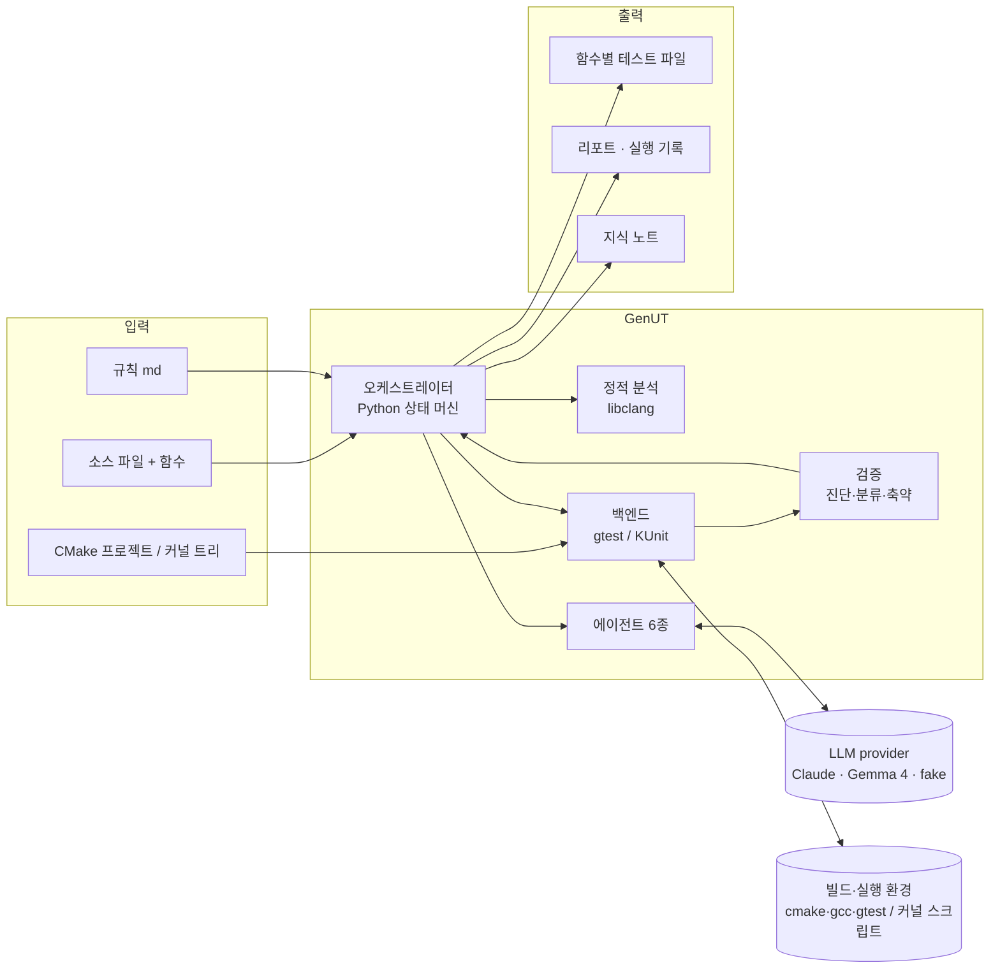
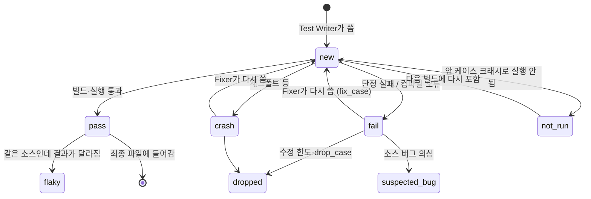
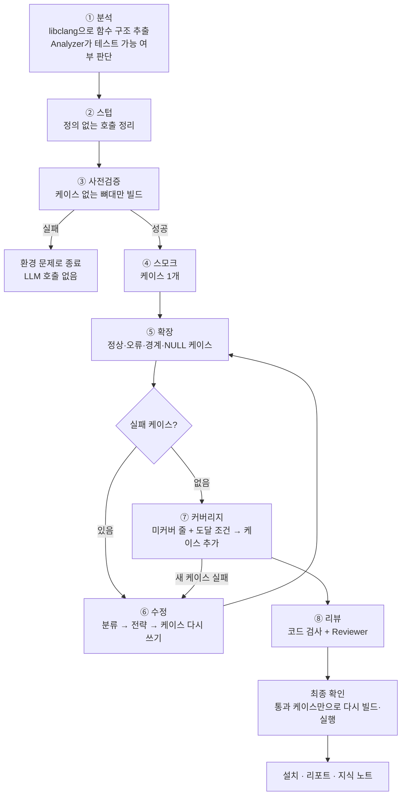
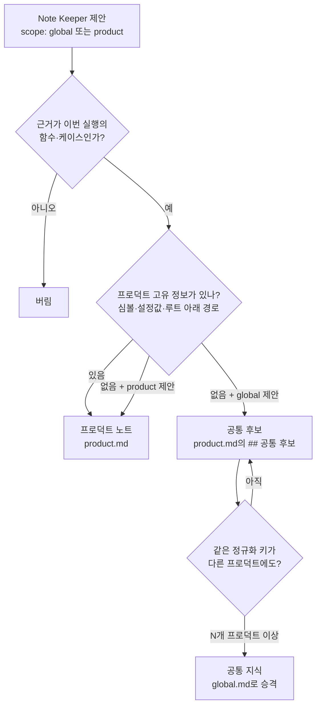
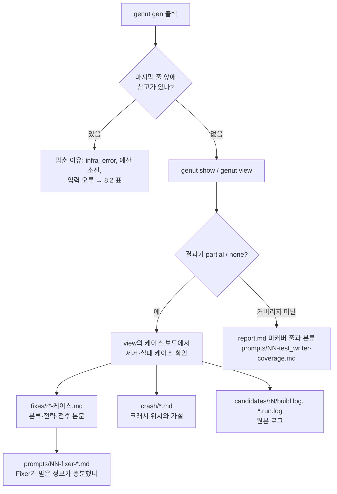
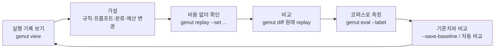

# GenUT 사용 가이드

GenUT가 **무엇으로 이루어져 있고**, **어떤 순서로 테스트를 만드는지**, **어떻게 설치·설정해서 쓰는지**, 그리고 **문제가 생겼을 때 어떻게 디버깅하고 튜닝하는지**를 처음 보는 사람도 따라갈 수 있게 정리한 문서입니다. 설계의 이유와 세부 규칙은 [`docs/design.md`](design.md)(설계 문서)에, KUnit 실행 스크립트 계약은 [`docs/kunit-script.md`](kunit-script.md)에 있습니다. 그림이 든 HTML 판은 [`docs/guide.html`](guide.html)입니다.

> **이 문서의 예시는 모두 실제 실행 결과입니다.** 저장소의 샘플 프로젝트(`tests/fixtures/sample_project`)를 복사해 `genut` 명령을 처음부터 끝까지 실행하고, 터미널 출력과 실행 기록 파일을 그대로 옮겼습니다. 빌드·실행·커버리지·크래시 분석은 실제 도구(MSYS2 gcc 16, CMake 4.4, GoogleTest 1.18, gdb)가 했습니다. LLM만 비용과 재현성을 위해 **응답을 미리 적어 둔 가짜 provider**(`llm.provider = "fake"`)를 썼습니다. 실제 LLM을 쓰면 응답 내용은 달라지지만 흐름과 산출물의 형태는 같습니다. 긴 경로는 `~/work/sample`(프로젝트), `~/.genut`(GenUT 홈)처럼 줄였습니다.

## 목차

1. [GenUT 한눈에 보기](#1-genut-한눈에-보기)
2. [구조: 무엇이 어떻게 나뉘어 있나](#2-구조-무엇이-어떻게-나뉘어-있나)
3. [동작: 테스트가 만들어지는 8단계](#3-동작-테스트가-만들어지는-8단계)
4. [환경 셋업: 무엇을 어디에 추가하나](#4-환경-셋업-무엇을-어디에-추가하나)
5. [명령어 사용법](#5-명령어-사용법)
6. [따라 하기: 샘플 프로젝트로 gtest 생성](#6-따라-하기-샘플-프로젝트로-gtest-생성)
7. [따라 하기: KUnit 백엔드](#7-따라-하기-kunit-백엔드)
8. [디버깅: 문제가 생겼을 때 어디를 보나](#8-디버깅-문제가-생겼을-때-어디를-보나)
9. [튜닝: 성공률과 비용 개선](#9-튜닝-성공률과-비용-개선)
10. [알려진 한계](#10-알려진-한계)
- [부록 A. 설정 레퍼런스](#부록-a-설정-레퍼런스)
- [부록 B. 용어집](#부록-b-용어집)

---

## 1. GenUT 한눈에 보기

GenUT는 C/C++ 소스 파일과 함수 이름을 주면 **그 함수의 단위 테스트를 자동으로 만들어 주는 도구**입니다.

| 대상 코드 | 만드는 테스트 | 빌드·실행 방법 |
|---|---|---|
| 유저 스페이스 C/C++ | GoogleTest(gtest) | GenUT가 전용 CMake 빌드 디렉터리를 구성해 직접 빌드·실행 |
| 리눅스 커널 C | KUnit | 사용자가 준비한 실행 스크립트(커널 빌드 + QEMU 실행)를 정해진 인자로 호출 |

**입력**: 소스 파일, 대상 함수(생략하면 파일의 모든 비static 함수와 공개 멤버 함수), 사람이 쓴 규칙 md, 프로젝트 빌드 정보(CMake 또는 커널 compile DB).
**출력**: 함수마다 테스트 파일 하나(통과한 케이스만 들어 있음), 결과 리포트, 실행의 모든 것을 담은 실행 기록, 다음 생성에 쓰일 지식 노트.

### 핵심 원칙 다섯 가지

| 원칙 | 뜻 |
|---|---|
| **순서는 코드가, 판단은 LLM이** | 단계 진행·빌드·실행·판정은 파이썬 코드(오케스트레이터)가 하고, LLM은 "케이스를 써라", "이 실패를 어떻게 고칠까" 같은 좁은 질문에만 정해진 JSON 형식으로 답합니다. |
| **통과한 것만 남긴다** | 실제로 빌드되고 실행되어 통과한 케이스만 최종 파일에 들어갑니다. 일부만 통과해도 통과분은 버리지 않습니다. |
| **케이스 단위로 고친다** | 실패한 케이스 하나만 다시 씁니다. 이미 통과한 케이스는 글자 하나 바뀌지 않습니다. |
| **원시 로그 대신 구조화된 정보** | 수만 줄 빌드 로그 대신 "분류 + 핵심 진단 + 크래시 위치"만 LLM에 줍니다. 원본은 실행 기록에 그대로 남깁니다. |
| **프로덕트 소스 트리를 더럽히지 않는다** | 작업은 전용 빌드 디렉터리와 `~/.genut`에서 하고, 소스 트리에는 최종 테스트 파일만 씁니다. |

### 지금 구현된 것과 아직 없는 것

| 구분 | 내용 |
|---|---|
| 구현됨 | 정적 분석(libclang), 8단계 생성 흐름, gtest 백엔드(실제 빌드·실행·gcov 커버리지·gdb 크래시 분석), KUnit 백엔드(스크립트 계약), C++ 멤버 함수, 수정 루프와 전략 사다리, 코드 리뷰 검사와 Reviewer, 라인 커버리지 라운드, 최종 확인·설치, 지식 노트(Note Keeper)와 범위 규칙, `view`·`replay`·`diff`·`eval`·`finalize`·`knowledge` 명령 |
| 아직 없음 | **스텁 도구 연동**(셋업 때 받을 스텁 도구 md가 필요). 그래서 지금은 정의가 없는 심볼을 스텁할 수 없고, static 함수는 KUnit `include_source` 방식이 아니면 테스트 불가로 끝납니다. 단계별 대화형 편집(`--interactive`), 실제 커널·QEMU 환경 검증, 사내 Gemma 4 튜닝 |

---

## 2. 구조: 무엇이 어떻게 나뉘어 있나

### 2.1 시스템 구성



LLM과 대화하는 것은 에이전트뿐이고, 빌드·실행 환경과 대화하는 것은 백엔드뿐입니다. 둘 사이를 오케스트레이터가 잇습니다.

### 2.2 소스 코드 구성 (`src/genut/`)

| 패키지 / 모듈 | 하는 일 |
|---|---|
| `cli.py` | `genut` 명령. 모든 사용자 메시지는 한국어 |
| `config.py`, `context.py`, `products.py`, `paths.py` | 설정 겹쳐 올리기, `$GENUT_HOME`과 프로덕트 찾기 |
| `orchestrator.py`, `finalize.py` | 8단계 진행, 수정 루프, 최종 확인·설치, `genut finalize` |
| `state.py`, `budget.py` | 실행 상태(함수·케이스·공유 영역), 예산(빌드·시간·토큰) |
| `analysis/` | compile DB 읽기, gcc 플래그 정리, libclang 추출, 링크 범위 판정, 분석 보고서 |
| `agents/` | 에이전트와 역할 지시문(`prompts/en`, `prompts/ko`) |
| `llm/` | provider(anthropic, openai_compat, fake), 구조화 출력, 프롬프트 조립기(컨텍스트 한도), 토큰 세기 |
| `verify/` | 진단 구조화, 실패 분류(`classify.yaml`), 의미 검사, 코드 리뷰 검사, 로그 축약·크래시 브리프 |
| `backends/gtest/`, `backends/kunit/` | 테스트 파일 뼈대, 빌드·실행·커버리지·설치 |
| `coverage.py` | lcov/gcov 결과 읽기, 미커버 줄의 도달 조건 |
| `knowledge.py` | 지식 노트·수정 사례·소스 버그 의심 목록, 범위 규칙 |
| `trace.py`, `report.py`, `viewer/`, `replay.py`, `rundiff.py`, `evaluation.py` | 실행 기록, 리포트, HTML 뷰어, replay, diff, 평가 |

### 2.3 에이전트 (LLM이 맡는 일)

| 에이전트 | 언제 | 받는 것 | 내는 것 |
|---|---|---|---|
| Analyzer | ① 분석 | 분석 보고서 | 테스트 가능 여부, 주의 사항, 추천 케이스 |
| Test Writer | ④ 스모크, ⑤ 확장, ⑦ 커버리지 | 분석 보고서, 규칙, 통과 케이스, 미커버 줄과 도달 조건, 지식 노트 | 새 케이스(이름·목적·본문)와 공유 헬퍼 |
| Fixer | ⑥ 수정 | 실패한 케이스, 실패 분류·진단·크래시 브리프, 허용 전략, 과거 수정 사례 | 전략 하나와 다시 쓴 케이스 본문, 근거 |
| Unreachable Analyzer | ⑦ 커버리지 끝 | 끝내 못 밟은 줄 | 줄마다 이유 분류 |
| Reviewer | ⑧ 리뷰 | 통과 케이스와 수정 이력 | 규칙 위반·무의미한 단정·단정 약화 지적 |
| Note Keeper | 실행이 끝난 뒤 | 실행 요약(판정·실패 분류·수정 결과) | 다음에 도움이 될 노트와 제안 범위 |

설계에 있는 여섯째 에이전트 Stub Planner는 스텁 도구 연동(11단계)과 함께 들어옵니다.

### 2.4 실행 상태: 함수 → 케이스

한 번의 실행(`RunState`)은 소스 파일 하나를 다루고, 그 안에 함수별 상태(`FunctionState`), 그 안에 케이스(`TestCase`)가 있습니다. **진행 단위는 케이스**입니다.



| 상태 | 뜻 |
|---|---|
| `new` | 아직 검증 전 (처음 쓰였거나 고쳐진 직후) |
| `pass` | 통과. 이후 어떤 단계에서도 본문이 바뀌지 않음 |
| `fail` / `crash` | 실패. 수정 루프 대상 |
| `not_run` | 같은 실행 파일의 앞 케이스가 죽어서 실행되지 못함. 다음 빌드에서 다시 실행 |
| `dropped` | 제거됨(수정 한도, Fixer의 drop_case 등). 최종 파일에 안 들어감 |
| `suspected_bug` | 테스트가 아니라 소스가 틀렸을 가능성. 리포트와 `suspected_bugs.md`에 남음 |
| `flaky` | 소스가 같은데 빌드마다 결과가 달라 제외 |

여러 케이스가 함께 쓰는 include·헬퍼 함수는 **공유 영역**으로 따로 관리합니다. 공유 영역을 바꾼 뒤 통과 케이스가 깨지면 그 변경을 되돌립니다.

### 2.5 파일은 어디에 생기나

```
~/.genut/                         ← GENUT_HOME (환경 변수 GENUT_HOME 또는 --home으로 바꿀 수 있음)
├── config.toml                   공통 설정 (genut init)
├── products.toml                 등록된 프로덕트 이름 → 소스 트리 경로
├── rules/common.md, gtest.md, kunit.md     공통 규칙 (genut init)
├── prompts/<role>.md             (선택) 역할 지시문 튜닝본
├── knowledge/global.md, fix_patterns.yaml, token_calibration.json   공통 지식
├── evals/baselines/<모델>.json   평가 기준치
└── products/<이름>/              프로덕트 폴더 (genut product add)
    ├── product.toml              프로덕트 설정
    ├── rules/common.md, <backend>.md   (선택) 프로덕트 추가 규칙
    ├── knowledge/product.md, fix_patterns.yaml, suspected_bugs.md, preflight.cache.json
    ├── runs/<시각>-<라벨>/        실행 기록 (실행마다 하나)
    └── evals/runs/               평가 결과

<프로덕트 소스 트리>/
├── build-genut/                  GenUT 전용 빌드 디렉터리 (gtest, 이름은 설정 가능). 사용자 빌드는 건드리지 않음
└── tests/generated/              설치된 테스트 파일과 GenUT가 관리하는 CMakeLists.txt
```

> 프로덕트 소스 트리에 GenUT가 쓰는 것은 `build-genut/`(작업용)과 `tests/generated/`(최종 테스트)뿐입니다. `build-genut/`은 `.gitignore`에 넣으세요.

---

## 3. 동작: 테스트가 만들어지는 8단계



터미널에는 단계마다 `[n/8]` 줄이 찍힙니다. 수정 루프는 확장·커버리지 단계 안에서 돌기 때문에 `[6/8] 수정` 줄이 `[5/8] 확장` 사이에 나올 수 있습니다.

### 3.1 단계별 상세

| 단계 | 누가 | 하는 일 | 실패하면 | 남는 파일 (실행 기록 안) |
|---|---|---|---|---|
| ① 분석 | 코드 + Analyzer | libclang으로 시그니처·소스·분기·반환 지점·호출·타입·전역·상수를 뽑고, 호출마다 **링크 범위**(같은 파일 / 링크하는 타깃에 있음 / 외부 / 정의 없음)를 판정. Analyzer가 테스트 가능 여부·주의 사항·추천 케이스를 냄 | 테스트 불가면 그 함수는 `untestable`로 끝 | `analysis/<함수>.md`, `.json`, `linkscope.json`, `prompts/01-analyzer.md` |
| ② 스텁 | 코드 | 정의 없는 심볼과 `## 반드시 스텁` 규칙 정리. **스텁 도구 연동 전이라 지금은 스텁을 만들지 않음** | — | — |
| ③ 사전검증 | 코드 | 케이스 없는 테스트 뼈대만 빌드해 환경(include, 링크, CMake)을 확인. 뼈대·환경이 이전 성공과 같으면 캐시로 건너뜀. 빌드가 `slow_build_threshold_sec`보다 느리면 스모크를 생략 | `infra_error`로 실행 종료 (LLM 비용 없음) | `preflight/preflight.log` |
| ④ 스모크 | Test Writer | 가장 단순한 정상 경로 케이스 **하나**로 뼈대·include·링크가 실제로 맞는지 확인 | 수정 루프 | `prompts/NN-test_writer-smoke.md`, `candidates/r1/` |
| ⑤ 확장 | Test Writer | 오류 반환·경계값·NULL 등 케이스를 추가. 모든 함수를 한 번에 빌드하고 함수별로 실행 | 수정 루프 | `candidates/rN/` |
| ⑥ 수정 | 코드 + Fixer | 실패를 **분류**하고 권장 전략을 정한 뒤 Fixer가 그 케이스만 다시 씀. 크래시면 의심 케이스만 따로 다시 실행(격리)하고 gdb 백트레이스로 크래시 브리프를 만듦 | 한도를 넘으면 제거 | `fixes/rN-<케이스>.md`, `crash/*.md`, `prompts/NN-fixer-*.md` |
| ⑦ 커버리지 | 코드 + Test Writer | 통과 케이스만 다시 실행해 gcov로 라인 커버리지를 재고, 못 밟은 줄마다 **도달 조건**(가장 가까운 분기 조건, 관련 호출)을 붙여 케이스를 더 받음. 라운드가 끝나도 남은 줄은 Unreachable Analyzer가 이유를 분류 | 새 케이스는 수정 루프로 | `coverage/m*/`, `prompts/NN-test_writer-coverage.md` |
| ⑧ 리뷰 | 코드 + Reviewer | 코드 검사(단정 없음, 항상 참, 금지 패턴, 대상 미호출, 실제값 베끼기)는 통과 즉시, Reviewer는 마지막에 규칙의 의도·무의미한 단정·단정 약화를 봄 | 지적된 케이스는 한 번만 고치고, 안 되면 제거 | `prompts/NN-reviewer.md` |
| 최종 확인 | 코드 | 통과 케이스만 담은 파일로 다시 빌드·실행(`final_build_reserve`만큼 빌드를 남겨 둠). 깨지면 녹색 스냅샷(모두 통과했던 빌드)으로 되돌림. 통과분을 프로덕트 트리에 설치 | 스냅샷 사용 또는 미확인 표시 | `final/`, `snapshots/` |
| 노트 | Note Keeper | 배울 것이 있는 실행이면 다음 생성에 도움이 될 노트를 남김. 범위(공통/프로덕트)는 코드가 정함 | 실패해도 마무리는 계속 | `prompts/NN-note_keeper.md`, `knowledge/product.md` |

### 3.2 실패 분류와 전략 사다리

실패는 먼저 코드가 **분류**하고, 분류마다 **권장 시작 전략**이 정해져 있습니다. Fixer는 권장 전략과 그보다 더 포기하는 쪽(오른쪽)만 고를 수 있습니다.

```
fix_case  →  add_stub  →  drop_case  →  narrow_scope  →  give_up
(케이스 고치기) (스텁 추가)   (케이스 제거)   (범위 축소)       (함수 포기)
```

| 분류 | 언제 | 권장 전략 |
|---|---|---|
| `missing_include` | 선언을 못 찾음, unknown type name, implicit declaration | fix_case |
| `undeclared_identifier` | 없는 이름·필드를 씀 | fix_case |
| `type_mismatch` | 인자 개수·타입 불일치 | fix_case |
| `warning_as_error` | `-Werror`로 경고가 오류가 됨 | fix_case |
| `compile_error` | 그 밖의 컴파일 오류 | fix_case |
| `undefined_reference` | 링크 시 정의 없음 | add_stub (스텁 도구가 없으면 narrow_scope) |
| `duplicate_symbol` | 스텁과 실제 정의 충돌 | add_stub |
| `assertion_failed` | 단정 실패 | fix_case |
| `crash` | 세그폴트, 새니타이저, 커널 oops·KASAN 등 | fix_case (같은 케이스가 또 죽으면 제거) |
| `timeout` | 시간 초과 | drop_case (한 번은 고쳐 봄) |
| `review_reject` | 코드 리뷰 검사나 Reviewer 지적 | fix_case |
| `context_overflow` | 필수 프롬프트만으로 LLM 한도 초과 | narrow_scope |
| `infra_error` | 환경 문제 (사전검증 실패, LLM 연결 실패 등) | give_up — 실행을 멈춤 |

컴파일 오류 분류 규칙은 `src/genut/verify/classify.yaml`에 있어 코드 수정 없이 패턴을 추가할 수 있습니다(위에서부터 처음 맞는 규칙을 씀).

#### gtest 단정 실패를 읽는 법

gtest가 낸 실패 메시지는 단정 종류별로 식과 값을 뽑아 한 줄로 요약합니다. 이 요약이 터미널·리포트·수정 기록·Fixer 프롬프트의 "요약"이고, 원문 메시지는 "상세"에 그대로 남습니다. `[ ]` 안이 실행 중 계산된 값입니다.

| 단정 | 요약 예 | 기대값 · 실제값 |
|---|---|---|
| `EXPECT_EQ` / `STREQ` / `FLOAT_EQ` | `같지 않음: rb_push(&rb, "abcdef", 6) [-28] ≠ RB_OK [0]` | 한쪽에만 함수 호출이 있으면 그쪽을 실제값으로 채움 (인자 순서와 무관). 둘 다 호출이면 비움 |
| `EXPECT_NE` / `LT` / `LE` / `GT` / `GE` | `비교 실패: push(1) < -1 아님 (값 0, -1)` | 비움 |
| `EXPECT_TRUE` / `FALSE` | `참·거짓 불일치: push(6) == 0 → false (기대 true)` | `true` · `false` |
| `EXPECT_THAT` | `조건 불일치: push(6) → -28 (기대: is equal to 0)` | 매처 설명 · 값 |
| `EXPECT_NEAR` | `오차 초과: \|1.5 - 1.0\| = 0.5 > 1e-3 (값 1.5, 1)` | 비움 |
| `FAIL()`, 예외 | `FAIL(): 메시지`, `예외: C++ exception with description ...` | 비움 |

`<< "메시지"`로 붙인 설명은 `— 메시지`로 덧붙고, 한 케이스에 실패가 여럿이면 첫 실패를 요약하고 `외 N건`을 붙입니다. 기대값·실제값은 Fixer 프롬프트에 `기대값: … · 실제값: …`으로 들어가고, 실제값 베끼기 검사는 기대값 쪽 값을 베끼기로 보지 않습니다.

### 3.3 코드가 하는 리뷰 검사

케이스가 통과하면 즉시 코드가 다음을 확인합니다. 걸리면 `review_reject`로 수정 루프에 들어갑니다.

| 검사 | 걸리는 예 |
|---|---|
| `no_assertion` | `EXPECT_*`/`ASSERT_*`/`KUNIT_EXPECT_*`가 하나도 없음 |
| `always_true` | `EXPECT_EQ(1, 1)`처럼 결과가 항상 같은 단정 |
| `rejected_pattern` | 규칙 md `## 리뷰에서 거부할 패턴`의 정규식에 맞음 |
| `target_not_called` | 대상 함수를 호출하지 않음 (C++ 멤버는 `obj.f()`, `p->f()`, `C::f()`도 인정) |
| `copied_actual` | 직전 실패의 실제값을 기대값으로 그대로 옮겼는데, Fixer가 소스의 반환 지점 근거(`evidence`)를 대지 못함 → 소스 버그 의심 |

### 3.4 결과 판정

| 결과 | 뜻 |
|---|---|
| `complete` | 모든 케이스가 통과(또는 소스 버그 의심)했고 라인 커버리지 목표(기본 100%)에 도달 |
| `partial` | 통과 케이스가 있지만 제거된 케이스가 있거나 커버리지가 목표 미달 |
| `none` | 통과 케이스가 없음 (파일을 만들지 않음) |

최종 확인 결과는 `ok`(통과 케이스로 다시 빌드·실행해 확인), `partial`(일부 제거 뒤 재확인 못 함), `snapshot`(녹색 스냅샷으로 되돌림), `unverified`(확인 못 함. 기본은 설치하지 않음), `none`으로 표시됩니다.

### 3.5 예산

| 설정 (`[budget]`) | gtest 기본 | KUnit 기본 | 뜻 |
|---|---|---|---|
| `max_builds_per_run` | 30 | 10 | 실행 하나의 빌드 횟수 상한 |
| `max_seconds_per_run` | 1800 | 7200 | 실행 하나의 시간 상한(초) |
| `final_build_reserve` | 2 | 1 | 최종 확인용으로 남겨 두는 빌드 |
| `max_isolation_runs` | 4 | 2 | 크래시 격리 재실행 횟수 |
| `max_iterations` | 4 | 4 | 수정 라운드 수 |
| `max_case_fixes` | 2 | 2 | 케이스 하나를 고칠 수 있는 횟수 |
| `max_coverage_rounds` | 3 | 3 | 커버리지 라운드 수 |
| `max_tokens_per_function` | 300000 | 300000 | 함수 하나에 쓸 LLM 토큰(입력+출력) |
| `candidates` | 1 | 1 | 한 번에 받는 후보 수 (Gemma 권장 3) |

예산이 떨어져도, 중단(Ctrl+C)되어도, 내부 오류가 나도 그때까지 통과한 케이스는 최종 확인을 거쳐 설치됩니다.

### 3.6 지식 노트

실행이 끝나면 Note Keeper가 "다음에 도움이 될 사실"을 한 문장씩 제안합니다. 범위는 LLM 제안이 아니라 **코드가** 정합니다.



노트는 다음 생성의 Test Writer·Fixer 프롬프트에 토큰 예산(`knowledge_token_budget`) 안에서 들어갑니다. **다른 프로덕트의 노트는 절대 프롬프트에 넣지 않습니다.** 배울 것이 없는 실행(모든 케이스가 첫 시도에 통과), `--dry-run`, `--stop-after`, 중단된 실행, `genut eval`, `genut replay`에서는 Note Keeper를 부르지 않습니다.

---

## 4. 환경 셋업: 무엇을 어디에 추가하나

### 4.1 한눈에 보는 셋업 체크리스트

| 어디에 | 무엇을 | 누가 | gtest | KUnit |
|---|---|---|---|---|
| 개발 PC | Python 3.11+, `uv`, GenUT 설치 | 사람 | 필수 | 필수 |
| 개발 PC | cmake, C/C++ 컴파일러, GoogleTest, gcov, (권장) gdb | 사람 | 필수 | — |
| 개발 PC / 서버 | 커널 트리, 크로스 툴체인, QEMU, 실행 스크립트 | 사람 | — | 필수 |
| 환경 변수 | LLM 키 (`ANTHROPIC_API_KEY` 또는 `GENUT_LLM_KEY`) | 사람 | 필수 | 필수 |
| `~/.genut/config.toml` | provider, 모델, 예산 기본값 | `genut init` 후 사람이 수정 | 필수 | 필수 |
| `~/.genut/rules/*.md` | 팀 공통 규칙 | `genut init` 후 사람이 수정 | 권장 | 권장 |
| `~/.genut/products/<이름>/product.toml` | 백엔드, 링크 타깃 또는 커널 설정 | `genut product add` 후 사람이 수정 | 필수 | 필수 |
| 프로덕트 루트 `CMakeLists.txt` | `add_subdirectory(tests/generated)` 한 줄 | 사람 (선택) | 선택 | — |
| 커널 `Makefile` / `Kconfig` | 집합 파일 오브젝트와 Kconfig 심볼 | 사람 (한 번) | — | 필수 |
| 커널 `.config` / `.kunitconfig` | `CONFIG_KUNIT=y`, 테스트 심볼, (커버리지) `CONFIG_GCOV_KERNEL=y` | 사람 | — | 필수 |
| `.gitignore` | `build-genut/` | 사람 | 권장 | — |

### 4.2 GenUT 설치

```bash
git clone https://github.com/haangman/GenUT.git
cd GenUT
uv venv .venv
uv pip install --python .venv -e ".[dev]"
.venv/Scripts/genut --help        # Linux/macOS: .venv/bin/genut
```

libclang은 pip `libclang` 패키지로 함께 설치됩니다. 시스템 clang은 필요 없습니다.

### 4.3 gtest 빌드 도구

**Windows (MSYS2 UCRT64)** — 이 문서의 예시를 만든 환경입니다.

```bash
winget install MSYS2.MSYS2
C:\msys64\usr\bin\bash -lc "pacman -S --noconfirm mingw-w64-ucrt-x86_64-{gcc,cmake,ninja,gtest,gdb}"
# GenUT를 실행하는 셸의 PATH 앞에 C:\msys64\ucrt64\bin 을 넣는다
```

**Linux (Debian/Ubuntu)**

```bash
sudo apt install cmake g++ libgtest-dev gdb
```

MinGW에는 ASan/UBSan이 없어 `[gtest] sanitizers`는 Linux에서만 의미가 있습니다. 새니타이저가 없으면 크래시는 gdb 백트레이스로 분석합니다.

### 4.4 GenUT 홈 만들기: `genut init`

```text
$ genut init --home ~/.genut
GENUT_HOME: ~/.genut
  만듦: ~/.genut/config.toml
  만듦: ~/.genut/rules/common.md
  만듦: ~/.genut/rules/gtest.md
  만듦: ~/.genut/rules/kunit.md
다음: genut product add <이름> --root <소스 트리> --backend gtest|kunit
```

만들어지는 `config.toml`(주석에 설명이 있음):

```toml
# $GENUT_HOME/config.toml — 모든 프로덕트 공통 설정 (설계 12장)
# 값을 지우면 내장 기본값이 쓰입니다. 프로덕트별 값은 products/<이름>/product.toml에 둡니다.

[llm]
provider = "anthropic"            # "anthropic" | "openai_compat" | "fake"
model = "claude-opus-5-5"         # anthropic provider 모델
temperature = 0.2                 # openai_compat에만 적용
prompt_language = "en"            # 역할 지시문 언어. 규칙 md는 한국어 그대로 삽입
code_format = "json"              # "json" | "fenced"

[llm.anthropic]
api_key_env = "ANTHROPIC_API_KEY"
effort = "medium"                 # low | medium | high | xhigh | max
fallbacks = "default"             # 거절 시 서버 측 대체 모델. "" 이면 끔

[llm.openai_compat]
base_url = "http://gemma4.internal/v1"
model = "gemma-4-12b"
api_key_env = "GENUT_LLM_KEY"
max_context = 32768
supports_json_schema = true
supports_n = false

[llm.context]
output_reserve_tokens = 6000
context_safety_margin = 0.05
token_counter = "estimate"

# [budget] 의 기본값은 백엔드에 따라 다릅니다(KUnit은 빌드가 느려 더 작게 잡음).
# 공통으로 바꾸고 싶은 값만 주석을 풀어 쓰세요.
[budget]
# candidates = 1
# max_iterations = 4
# max_case_fixes = 2
# max_tokens_per_function = 300000
# max_coverage_rounds = 3

[coverage]
enabled = true
target_line_percent = 100

[knowledge]
auto_promote_after_products = 2
# note_keeper = true             # 실행이 끝나면 Note Keeper가 다음 생성에 도움이 될 노트를 남긴다
# max_notes_per_run = 5
```

### 4.5 LLM provider 설정

| provider | 언제 | 설정 | 키 |
|---|---|---|---|
| `anthropic` | 샘플·평가 코퍼스 (외부 API) | `[llm] model`, `[llm.anthropic] effort` | 환경 변수 `ANTHROPIC_API_KEY` |
| `openai_compat` | **실제 프로덕트 코드** (사내 Gemma 4) | `[llm.openai_compat] base_url`, `model`, `max_context`, `supports_json_schema` | 환경 변수 `GENUT_LLM_KEY` (`api_key_env`로 이름 변경) |
| `fake` | 테스트·문서 예시·재현 | `[llm.fake] script = "응답.json"` (역할별 응답 목록) | 없음 |

> **데이터 정책**: 외부 API(Claude)로는 샘플·평가 코퍼스만 처리합니다. 실제 프로덕트 코드는 사내 Gemma 4(`openai_compat`)로만 처리하세요.
>
> **키는 설정 파일이나 채팅에 쓰지 말고** 환경 변수로만 넣으세요. Windows는 "시스템 속성 → 환경 변수"의 사용자 변수, Linux는 셸 프로필(`~/.bashrc`)에 `export ANTHROPIC_API_KEY=...`.

사내 Gemma 4 예:

```toml
[llm]
provider = "openai_compat"
code_format = "fenced"          # 긴 코드를 JSON 문자열로 받기 어려우면 펜스 코드 블록으로

[llm.openai_compat]
base_url = "http://gemma4.internal/v1"
model = "gemma-4-12b"
api_key_env = "GENUT_LLM_KEY"
max_context = 32768
supports_json_schema = true     # 서버가 json_schema 응답 형식을 지원하지 않으면 false

[budget]
candidates = 3                  # 중형 모델은 후보 여러 개에서 케이스 단위로 고르는 편이 낫다
```

fake provider 응답 스크립트 형식 (이 문서의 예시에 쓴 것의 일부):

```json
{
  "analyzer":   [{"testable": true, "reason": "", "cautions": ["..."], "recommended": []}],
  "test_writer":[{"cases": [{"name": "test_rb_push_ok", "purpose": "...", "body": "..."}], "helpers": []}, ...],
  "fixer":      [{"strategy": "fix_case", "reason": "...", "body": "...", "evidence": ":34", "suspected_bug": false, "helpers": []}],
  "reviewer":   [{"findings": []}],
  "note_keeper":[{"notes": [...]}]
}
```

역할별 목록을 순서대로 쓰고, 마지막 응답은 계속 반복합니다. 없는 역할은 스키마를 만족하는 최소 응답(빈 목록 등)이 나갑니다.

### 4.6 프로덕트 등록 (gtest)

```text
$ genut product add sample --root ~/work/sample --backend gtest --home ~/.genut
등록: sample  소스 트리 ~/work/sample
프로덕트 폴더: ~/.genut/products/sample
설정 파일을 채우세요: ~/.genut/products/sample/product.toml
```

`product.toml`에 링크할 CMake 타깃을 적습니다. 대상 함수가 다른 라이브러리의 함수를 부르면 그 타깃도 넣어야 합니다(이 예에서 `rb_push`는 `slot.c`의 `rb_alloc_slot`을 부르므로 `rbslot`도 넣음).

```toml
[product]
name = "sample"
root = "~/work/sample"
backend = "gtest"

[gtest]
link_targets = ["rb", "rbslot"]
```

`link_targets`를 비우면 GenUT가 CMake File API로 대상 소스가 속한 타깃을 찾아 테스트 파일마다 따로 링크합니다.

| `[gtest]` 키 | 기본값 | 설명 |
|---|---|---|
| `cmake_source_dir` | `.` | 최상위 `CMakeLists.txt`가 있는 곳 (프로덕트 루트 기준) |
| `cmake_build_dir` | `build-genut` | GenUT 전용 빌드 디렉터리. 사용자 빌드는 건드리지 않음 |
| `cmake_configure_args` | `[]` | 전용 빌드 구성에 더할 `-D` 옵션 |
| `output_dir`, `cmake_lists_dir` | `tests/generated` | 테스트 파일과 관리 CMakeLists 설치 위치 |
| `test_file_pattern` | `{src}_{func}_test.cc` | 테스트 파일 이름 |
| `link_targets` | `[]` | 링크할 사용자 타깃 |
| `sanitizers` | `[]` | `["address", "undefined"]` (Linux) |
| `coverage_opt_level` | `O0` | 전용 빌드 최적화 수준 (커버리지 정확도) |
| `crash_backtrace` | `gdb` | 새니타이저 없는 크래시에 gdb 백트레이스 |
| `test_timeout_sec` | 60 | 테스트 실행 하나의 시간 상한 |

**사용자 빌드를 고치지 않는 방법**: GenUT는 전용 빌드를 구성할 때 `-DCMAKE_PROJECT_INCLUDE=<build-genut>/genut-inject.cmake`를 넘깁니다. 이 파일이 최상위 `project()` 직후 실행되어, 최상위 처리가 끝날 때 작업 중인 테스트(`build-genut/genut-src/`)를 덧붙입니다.

```cmake
# GenUT 주입 파일 (자동 생성). 최상위 project() 직후 실행되고, 최상위 처리가 끝날 때 작업 디렉터리의
# CMakeLists.txt를 include 한다. 그때는 사용자 타깃과 디렉터리 설정이 모두 정의되어 있다.
# (지연 실행에서는 add_subdirectory를 쓸 수 없다)
if(NOT COMMAND genut_add_work_tests)
  enable_language(CXX)
  function(genut_add_work_tests)
    include("${GENUT_WORK_DIR}/CMakeLists.txt")
  endfunction()
  cmake_language(DEFER DIRECTORY "${CMAKE_SOURCE_DIR}" CALL genut_add_work_tests)
endif()
```

설치가 끝나면 `tests/generated/CMakeLists.txt`가 생깁니다. 사용자 빌드에서도 이 테스트를 빌드하려면 루트 `CMakeLists.txt`에 **한 줄**만 넣으면 됩니다(`genut doctor`가 안내).

```cmake
add_subdirectory(tests/generated)
```

### 4.7 환경 점검: `genut doctor`

```text
$ genut doctor --home ~/.genut
[OK]   GENUT_HOME: ~/.genut
[OK]   설정 출처: 내장 기본값 < ~/.genut/config.toml < ~/.genut/products/sample/product.toml
[OK]   libclang: ~/GenUT/.venv/Lib/site-packages/clang/native/libclang.dll
[OK]   LLM: fake provider (테스트용)
[OK]   프로덕트: sample · gtest · ~/work/sample
[OK]   로드되는 규칙: ~/.genut/rules/common.md, ~/.genut/rules/gtest.md
[OK]   로드되는 지식: 공통 0개 · 프로덕트 0개 · 공통 후보 0개 (~/.genut/knowledge/global.md, ~/.genut/products/sample/knowledge/product.md)
[OK]   cmake: C:\msys64\ucrt64\bin\cmake.EXE
[OK]   CMakeLists.txt: ~/work/sample/CMakeLists.txt
[OK]   커버리지 도구: C:\msys64\ucrt64\bin\gcov.EXE
[경고] add_subdirectory: 루트 CMakeLists.txt에 tests/generated가 연결되어 있지 않습니다. GenUT 빌드는 주입 방식으로 동작합니다.
        해결: 사용자 빌드에서도 쓰려면 루트 CMakeLists.txt에 add_subdirectory(tests/generated)를 한 줄 추가하세요.
[OK]   생성 위치: CMakeLists: ~/work/sample/tests/generated · 테스트: ~/work/sample/tests/generated

문제 없음
```

`[실패]`가 있으면 표시된 해결 방법을 따르세요. 종료 코드가 1이 됩니다.

### 4.8 KUnit 프로덕트 셋업

KUnit은 GenUT가 커널을 직접 빌드하지 않고, **사용자 스크립트**를 다음 계약으로 부릅니다(자세히는 [`docs/kunit-script.md`](kunit-script.md)).

```
<script> <test_file> --mode build|run|all [--filter <suite>.<case>] --log <path> [--coverage-out <dir>]
종료 코드: 0 실행 끝(테스트 실패여도 0) · 10 빌드 실패 · 20 부팅·실행 실패 · 그 외 스크립트 오류
```

1. **집합 파일 등록 (한 번)**: GenUT가 내용을 쓰는 집합 파일을 Makefile·Kconfig에 등록합니다.

   ```make
   # drivers/foo/Makefile
   obj-$(CONFIG_FOO_KUNIT_TEST) += foo_kunit.o
   GCOV_PROFILE_foo.o := y          # 라인 커버리지를 쓸 때
   ```

   ```kconfig
   # drivers/foo/Kconfig
   config FOO_KUNIT_TEST
   	tristate "KUnit tests for foo" if !KUNIT_ALL_TESTS
   	depends on KUNIT && FOO
   	default KUNIT_ALL_TESTS
   ```

2. **`.config` / `.kunitconfig`**: `CONFIG_KUNIT=y`, `CONFIG_FOO_KUNIT_TEST=y`. 권장 `CONFIG_KASAN=y`, `CONFIG_UBSAN=y`, `CONFIG_DEBUG_INFO=y`. 커버리지는 `CONFIG_GCOV_KERNEL=y`.
3. **compile DB**: 커널 트리에서 `make compile_commands.json` (없으면 `.<이름>.o.cmd`를 읽음).
4. **실행 스크립트**: `tools/testing/kunit/kunit.py`를 감싼 예시가 [`docs/kunit-script.md`](kunit-script.md)에 있습니다.
5. **`product.toml`**:

   ```toml
   [product]
   name = "foo-driver"
   root = "/work/linux"
   backend = "kunit"

   [kunit]
   compile_commands = "compile_commands.json"
   test_file = "drivers/foo/foo_kunit.c"        # 집합 파일 (위에서 등록한 것)
   test_dir = "drivers/foo/tests"               # 함수별 테스트 파일 위치
   run_script = "scripts/kunit_build_run.sh"
   script_supports_filter = false               # 스크립트가 --filter를 지원하면 true (격리가 빨라짐)
   script_timeout_sec = 3600
   vmlinux = ""                                 # 있으면 크래시 주소를 줄 번호로
   static_access = "stub_tool"                  # 스텁 도구가 없으면 "include_source"로 static 함수 테스트
   ```

6. `genut doctor --product foo-driver`가 집합 파일 등록, Kconfig 심볼, `CONFIG_GCOV_KERNEL`, `GCOV_PROFILE`을 점검합니다.

KUnit은 빌드 한 번이 수 분(QEMU 포함 약 8분)이라 예산 기본값이 작고, 검증 라운드마다 빌드와 실행을 `--mode all` 한 번으로 합니다.

### 4.9 규칙 md 쓰기

규칙 md는 **모든 에이전트의 시스템 프롬프트에 그대로** 들어갑니다. 짧고 검사 가능한 문장으로 쓰세요(공통+백엔드 합쳐 100줄 이내 권장).

| 파일 | 범위 |
|---|---|
| `~/.genut/rules/common.md` + `gtest.md` 또는 `kunit.md` | 모든 프로덕트 공통 |
| `~/.genut/products/<이름>/rules/common.md` + `<backend>.md` | 그 프로덕트만 (공통과 충돌하면 이쪽이 우선) |

제목 두 개는 GenUT가 **읽어서 검사에도 씁니다**. 이름을 바꾸지 마세요.

| 제목 | 쓰임 |
|---|---|
| `## 반드시 스텁` | 백틱 안의 이름·glob 패턴(`readl`, `*_hw_*`)은 정의가 있어도 스텁 대상 |
| `## 리뷰에서 거부할 패턴` | 백틱 안의 정규식이 케이스 본문에 있으면 거부 (`rejected_pattern`) |

기본 템플릿 `common.md`:

```markdown
# 공통 규칙

GenUT가 모든 에이전트 프롬프트에 그대로 넣는 규칙입니다. 꼭 지켜야 할 것만 짧게 적으세요(백엔드 규칙과 합쳐 100줄 이내 권장).
아래 제목 이름은 GenUT가 읽어서 검사에도 씁니다. 제목은 바꾸지 마세요.

## 반드시
- 테스트 이름: test_<함수명>_<상황>. 예: test_rb_push_when_full
- 케이스는 서로 독립적이어야 한다. 다른 케이스의 결과에 기대지 않는다.
- 케이스마다 대상 함수를 호출하고, 의미 있는 단정을 하나 이상 둔다.

## 절대 금지
- 작업 디렉터리 밖의 파일 접근, 네트워크 접근.
- sleep 등 시간에 의존하는 테스트.

## 반드시 스텁
<!-- 백틱 안의 이름이나 glob 패턴은 정의가 있어도 항상 스텁 대상이 됩니다. 예: `readl` `*_hw_*` -->

## 리뷰에서 거부할 패턴
<!-- 백틱 안의 정규식은 케이스 본문에서 발견되면 거부됩니다. -->
- `EXPECT_TRUE\(\s*true\s*\)`
- `KUNIT_EXPECT_TRUE\(\s*test\s*,\s*true\s*\)`

## 커버리지 최소
- 정상 경로 1개, 오류 반환 경로 1개, NULL 또는 경계값 1개.
```

KUnit 템플릿 `kunit.md`:

```markdown
# KUnit 규칙

## 반드시
- 메모리 할당은 kunit_kzalloc(test, ...)만 사용한다. kmalloc/kfree 직접 호출 금지.
- static 함수 접근은 스텁 도구가 제공하는 방식을 따른다.

## 절대 금지
- readl/writel/ioremap 등 MMIO 직접 호출. 반드시 스텁 도구로 대체.
- msleep/udelay 등 시간 의존 코드.
- 전역 변수를 바꾼 채로 끝내는 케이스.

## 반드시 스텁
- `readl` `writel` `ioremap`

## 리뷰에서 거부할 패턴
- `\bkmalloc\(`
- `\bkfree\(`
```

### 4.10 역할 지시문 바꾸기 (선택)

에이전트의 역할 지시문은 패키지 기본값(`src/genut/agents/prompts/<en|ko>/<role>.md`)을 씁니다. `~/.genut/prompts/<role>.md`를 만들면 그 파일의 내용이 기본값을 덮어씁니다(없는 절은 기본값 사용).

| 역할 파일 | 절(`## 이름`) |
|---|---|
| `analyzer.md`, `fixer.md`, `reviewer.md`, `unreachable.md`, `note_keeper.md` | `task` (fixer는 `shared_blocked`도) |
| `test_writer.md` | `smoke`, `expand`, `coverage`, `example.gtest`, `example.kunit` |

첫 `## ` 앞은 역할 지시문(시스템 프롬프트)입니다. 본문에 `$function`, `$function_id`, `$framework`, `$language`, `$wrapper` 자리표시자를 쓸 수 있고, `<!-- -->` 주석은 프롬프트에 들어가지 않습니다. 역할 지시문 언어는 `[llm] prompt_language = "en" | "ko"`로 고릅니다.

---

## 5. 명령어 사용법

| 명령 | 하는 일 | 주요 옵션 |
|---|---|---|
| `genut init` | `$GENUT_HOME`에 `config.toml`과 규칙 템플릿 생성 | `--force` 템플릿 다시 쓰기 |
| `genut product add <이름> --root <경로> [--backend gtest\|kunit]` | 프로덕트 등록, 프로덕트 폴더 생성 | |
| `genut product list` / `remove <이름>` | 목록 / 해제 | `--delete-data` 프로덕트 폴더도 삭제 |
| `genut doctor` | 환경 점검 (libclang, LLM 키, cmake, gtest, 커버리지 도구, gdb, 규칙·지식 로드, KUnit 등록) | |
| `genut gen --file F` | 테스트 생성 | `--func NAME`(여러 번), `--backend`, `--out`, `--dry-run`, `--stop-after STAGE`, `--set key=value` |
| `genut show [RUN]` | 실행 요약 | |
| `genut view [RUN]` | 실행 하나를 단일 HTML로 (타임라인, 케이스 보드, 프롬프트, 수정 기록, 크래시 브리프, 리포트) | `--no-open` |
| `genut diff [RUN1 [RUN2]]` | 두 실행 비교: 바뀐 입력과 바뀐 결과. 생략하면 `latest~1`과 `latest` | `--json` |
| `genut replay RUN` | 기록된 LLM 응답으로 다시 실행 (LLM 비용 없음) | `--from STAGE` 그 단계부터 실제 LLM, `--set` |
| `genut finalize [RUN]` | 중단·미확인 실행의 통과 케이스로 최종 확인만 다시 해서 설치 (LLM 호출 없음) | |
| `genut eval` | 코퍼스 전체 성공률 측정, 기준치와 비교 (설치하지 않음) | `--corpus`, `--label`, `--save-baseline`, `--compare`, `--open` |
| `genut knowledge list` | 지식 노트 목록 | `--scope global\|product`, `--candidates` |
| `genut knowledge promote <id>` / `demote <id>` | 노트 범위 변경 | promote `--force` |
| `genut knowledge edit` | 노트 파일을 편집기(`$VISUAL`, `$EDITOR`)로 열기 | `--scope` |

공통 옵션: `--home PATH`(GENUT_HOME 대신), `--product/-p NAME`(생략하면 현재 디렉터리가 속한 등록 소스 트리로 자동 탐지).

**실행 가리키기**: `latest`(최신), `latest~N`(N개 전), 실행 ID(앞부분만 줘도 됨), 실행 디렉터리 경로.

**대상 함수 고르기 (`--func`)**: 이름(`rb_push`), C++ `Class::method`, 완전한 이름(`demo::Counter::add`), 실행 안의 키(`Counter_add`, 오버로드는 `Counter_Counter_2`). 오버로드는 모두 고릅니다. 생략하면 비static 자유 함수와 public 멤버 함수(생성자 제외)가 대상입니다.

**설정 덮어쓰기 (`--set`)**: `--set budget.max_case_fixes=3 --set gtest.link_targets=[rb,rbslot] --set llm.provider=openai_compat`. 설정은 다음 순서로 겹쳐 올리며 뒤가 이깁니다.

```
내장 기본값 < 백엔드 기본값(KUnit 예산) < ~/.genut/config.toml < products/<이름>/product.toml < --set
```

모르는 키는 오류입니다(오타 방지).

**`--stop-after`**: `analyze`, `stub`, `preflight`, `smoke`, `expand`, `fix`, `coverage`, `review` 중 하나. 그 단계 뒤에 멈추고 설치하지 않습니다. 이어서 `genut finalize`로 통과분을 설치할 수 있습니다.

---

## 6. 따라 하기: 샘플 프로젝트로 gtest 생성

예시 대상은 샘플 프로젝트의 링 버퍼 함수 `rb_push`입니다.

```c
int rb_push(struct rb *rb, const void *data, size_t len)
{
	unsigned char *slot;

	if (rb == NULL || data == NULL)
		return RB_EINVAL;              /* :31 */
	if (rb_free_space(rb) < len) {
		stats.full_count++;
		return RB_ENOSPC;              /* :34 */
	}
	slot = rb_alloc_slot(rb, len);     /* slot.c (rbslot 타깃) */
	if (slot == NULL)
		return RB_ENOMEM;              /* :38 */
	memcpy(slot, data, len);
	rb->tail += len;
	stats.push_count++;
	return RB_OK;                      /* :42 */
}
```

### 6.0 준비

4장대로 `genut init`, `genut product add sample --root ~/work/sample`, `product.toml`에 `link_targets = ["rb", "rbslot"]`, `genut doctor`까지 마칩니다. 이 예시는 `config.toml`의 `[llm] provider = "fake"`와 `[llm.fake] script`로 응답을 고정했습니다.

### 6.1 먼저 프롬프트만 보기: `--dry-run`

LLM과 빌드 없이 각 단계 프롬프트가 어떻게 만들어지는지만 확인합니다. 규칙 md를 처음 쓰거나 바꿨을 때 유용합니다.

```text
$ genut gen --file src/ring_buffer.c --func rb_push --dry-run --home ~/.genut
[1/8] 분석     int rb_push(struct rb *rb, const void *data, size_t len) · 호출 3개 · 스텁 필요 0개
[2/8] 스텁     rb_push: 스텁 0개
[4/8] 스모크    rb_push: 케이스 0개 생성
[4/8] 스모크    rb_push: 통과 0 · 실패 0 · 제거 0
[5/8] 확장     rb_push: 케이스 0개 생성
[5/8] 확장     rb_push: 통과 0 · 실패 0 · 제거 0
[6/8] 수정     rb_push: 통과 0 · 실패 0 · 제거 0
[7/8] 커버리지   dry-run이라 측정하지 않음
[확인] rb_push: none · 최종 확인 -
[참고] rb_push: Analyzer가 테스트 불가로 판정했지만 코드가 확인한 신호가 없어 진행합니다: 
완료 · 빌드 0 · 토큰 5362 · 1s → ~/.genut/products/sample/runs/20261022-161833-ring_buffer-rb_push
```

여러 함수의 분석만 보고 싶으면 `--stop-after analyze`:

```text
$ genut gen --file src/ring_buffer.c --stop-after analyze --home ~/.genut
[1/8] 분석     int rb_init(struct rb *rb, unsigned char *buf, size_t cap) · 호출 0개 · 스텁 필요 0개
[1/8] 분석     int rb_push(struct rb *rb, const void *data, size_t len) · 호출 3개 · 스텁 필요 0개
[1/8] 분석     size_t rb_used(const struct rb *rb) · 호출 0개 · 스텁 필요 0개
[1/8] 분석     const char *rb_state_name(int state) · 호출 0개 · 스텁 필요 0개
[확인] rb_init: none · 최종 확인 -
[확인] rb_push: none · 최종 확인 -
[확인] rb_used: none · 최종 확인 -
[확인] rb_state_name: none · 최종 확인 -
완료 · 빌드 0 · 토큰 6316 · 0s → ~/.genut/products/sample/runs/20261022-161900-ring_buffer
```

### 6.2 생성 실행

```text
$ genut gen --file src/ring_buffer.c --func rb_push --home ~/.genut
[1/8] 분석     int rb_push(struct rb *rb, const void *data, size_t len) · 호출 3개 · 스텁 필요 0개
[2/8] 스텁     rb_push: 스텁 0개
[3/8] 사전검증   뼈대 빌드 OK (1.0s)
[4/8] 스모크    rb_push: 케이스 1개 생성
[4/8] 스모크    rb_push: 통과 1 · 실패 0 · 제거 0
[5/8] 확장     rb_push: 케이스 3개 생성
[6/8] 수정     round 1: fix_case(test_rb_push_full) → 재검증 · fix_case(test_rb_push_exact_fit) → 재검증
[5/8] 확장     rb_push: 통과 4 · 실패 0 · 제거 0
[6/8] 수정     rb_push: 통과 4 · 실패 0 · 제거 0
[7/8] 커버리지   rb_push: 라인 92% (12/13) · 미커버 :38
[7/8] 커버리지   rb_push: 케이스 1개 생성
[7/8] 커버리지   rb_push: 라인 100% (13/13)
[8/8] 리뷰     rb_push: 지적 0건
[노트] 2개 저장 (프로덕트 1 · 공통 후보 1 · 공통 0)
[확인] rb_push: complete · 최종 확인 ok → ~/work/sample/tests/generated/ring_buffer_rb_push_test.cc
완료 · 빌드 6 · 토큰 17498 · 9s → ~/.genut/products/sample/runs/20261022-161835-ring_buffer-rb_push
```

빌드 6번(사전검증 1, 스모크 1, 확장 1, 수정 후 재검증 1, 커버리지 1, 최종 확인 1)으로 케이스 5개가 모두 통과하고 라인 커버리지 100%를 채웠습니다. 아래는 각 단계에서 실제로 생긴 산출물입니다.

### 6.3 ① 분석: 분석 보고서

`runs/<실행>/analysis/rb_push.md`. LLM은 원본 소스 대신 이 보고서를 받습니다. 반환 지점마다 조건이, 호출마다 링크 범위가 붙어 있습니다.

````markdown
# 분석 보고서: rb_push

## 대상

```
int rb_push(struct rb *rb, const void *data, size_t len)   @ ~/work/sample/src/ring_buffer.c:26-43
비static · 18줄 · 분기 3
```

## 소스 (줄 번호 포함)

```
26| int rb_push(struct rb *rb, const void *data, size_t len)
27| {
28| 	unsigned char *slot;
29| 
30| 	if (rb == NULL || data == NULL)
31| 		return RB_EINVAL;
32| 	if (rb_free_space(rb) < len) {
33| 		stats.full_count++;
34| 		return RB_ENOSPC;
35| 	}
36| 	slot = rb_alloc_slot(rb, len);
37| 	if (slot == NULL)
38| 		return RB_ENOMEM;
39| 	memcpy(slot, data, len);
40| 	rb->tail += len;
41| 	stats.push_count++;
42| 	return RB_OK;
43| }
```

## 반환 지점

```
RB_EINVAL  ((rb == NULL || data == NULL) 참)  :31
RB_ENOSPC  ((rb_free_space(rb) < len) 참)  :34
RB_ENOMEM  ((slot == NULL) 참)  :38
RB_OK      (조건 없음)  :42
```

## 호출과 링크 범위

```
rb_free_space (static)  same_tu  — 이 번역 단위에 정의 있음 (대상 소스)
rb_alloc_slot  linkable  — 링크하는 타깃의 소스에 정의
memcpy  external  — 시스템·외부 라이브러리 선언
```

## include

```
#include "rb.h"
#include <stddef.h>
```

## 타입

```
struct rb { unsigned char * buf; size_t head; size_t tail; size_t cap; unsigned int magic; }   @ ~/work/sample/include/rb.h:6
예시 초기화: struct rb x = { .buf = NULL, .head = 0, .tail = 0, .cap = 0, .magic = 0 };
```

## 전역 참조

```
struct rb_stats stats  write · static
```

## 상수

```
RB_EINVAL = -22
RB_ENOSPC = -28
RB_ENOMEM = -12
RB_OK = 0
NULL = ( ( void * ) 0 )
```
````

링크 범위 판정 (`linkscope.json`의 한 항목). `linkable`이면 링크하는 타깃에 정의가 있어 스텁이 필요 없습니다.

```json
{
  "name": "rb_alloc_slot",
  "scope": "linkable",
  "reason": "링크하는 타깃의 소스에 정의",
  "evidence": "~/work/sample/src/slot.c",
  "is_static": false
}
```

| 링크 범위 | 뜻 |
|---|---|
| `same_tu` | 대상 소스 안에 정의 (static 함수 포함) |
| `linkable` | 링크하는 타깃의 소스에 정의 |
| `external` | 시스템·외부 라이브러리 |
| `undefined` | 어디에도 정의 없음 → 스텁 필요 (스텁 도구 연동 전에는 그 경로를 피하라고 안내) |

### 6.4 ④ 스모크: 프롬프트와 응답

LLM 호출 하나마다 `prompts/NN-<역할>-<단계>.md`가 생깁니다. 맨 위에 호출 정보가 있습니다.

```json
{
  "agent": "test_writer",
  "stage": "smoke",
  "function": "rb_push",
  "tokens": 2016,
  "limit": 25129,
  "trims": [],
  "prompt": "genut:prompts/en/test_writer.md",
  "prompt_hash": "2c54c8acef435712",
  "attempts": 1,
  "path": "native",
  "usage": {
    "input_tokens": 2016,
    "output_tokens": 110
  },
  "model": "fake-model"
}
```

| 필드 | 뜻 |
|---|---|
| `tokens` / `limit` | 보낸 프롬프트의 추정 토큰 / 허용량(컨텍스트 − 응답 자리 − 안전 여유) |
| `trims` | 한도를 맞추려고 줄이거나 뺀 조각. 비어 있으면 다 들어감 |
| `prompt`, `prompt_hash` | 쓴 역할 지시문 파일과 해시 (`~/.genut/prompts`로 바꿨는지 추적) |
| `attempts`, `path` | 형식 오류로 다시 요청한 횟수, 응답을 받은 방식(native 스키마 / parse / fenced) |
| `usage` | 실제 입력·출력 토큰 |

시스템 프롬프트 앞부분(역할 지시문). 그 뒤에 규칙 md가 그대로 붙습니다.

```text
You are the Test Writer of GenUT. You write GoogleTest (gtest) test cases in C++ for one function.

How your output is used:
- You write only the statements inside each test body. Code generates everything else: #include lines, stubs, and the wrapper `TEST(<suite>, <case name>) { ... }`.
- Each case is built, run and judged on its own. A failing case is fixed or dropped without touching the others.

1. Follow the rules (공통 규칙, 이 프로덕트 규칙) exactly. They take priority over these instructions.
2. Use only names given by the analysis report, the shared helpers or the stub usage. Do not invent functions, types, macros or fields.
3. Every case calls `rb_push` and checks the result with at least one meaningful assertion. No assertion may be always true.
4. Cases are independent: no reliance on other cases, on execution order, or on state left behind.
5. Do not write #include lines, test registration or a main function.
6. When several cases need the same setup, put it in a helper (a complete function definition) and call it. Never redefine an existing helper.
7. Never repeat or modify a case that is already passing.
8. Name each case test_rb_push_<situation> and write purpose as one Korean sentence.
```

유저 프롬프트 끝부분: 분석 보고서 뒤에 Analyzer 의견, 예시, 할 일이 붙습니다.

````text
## Analyzer 의견

주의 사항:
- rb_init으로 초기화한 rb와 실제 버퍼를 넘겨야 한다
- rb_alloc_slot은 slot.c(rbslot 타깃)에 정의되어 있다
추천 케이스:
- test_rb_push_ok [normal] 빈 버퍼에 2바이트 쓰기 → RB_OK, rb_used 2
- test_rb_push_full [boundary] 남은 공간보다 긴 데이터 → RB_ENOSPC
- test_rb_push_null [null] rb 또는 data가 NULL → RB_EINVAL

## 예시

Example body for a different function, `int sum(const int *v, size_t n)`:

```
int v[] = {2, 3};
EXPECT_EQ(sum(v, 2), 5);
```

## 할 일

Write exactly one test case: the simplest normal-path call of `rb_push` that checks its return value or main effect. Do not test error paths yet.
````

응답(파싱 결과):

```json
{
  "cases": [
    {
      "name": "test_rb_push_ok",
      "purpose": "빈 버퍼에 2바이트를 쓰면 성공하고 사용량이 2가 된다",
      "body": "struct rb rb;\nunsigned char buf[8];\nrb_init(&rb, buf, sizeof(buf));\nEXPECT_EQ(rb_push(&rb, \"ab\", 2), RB_OK);\nEXPECT_EQ(rb_used(&rb), 2u);"
    }
  ],
  "helpers": []
}
```

코드가 이 케이스로 만든 테스트 파일(`candidates/r1/ring_buffer_rb_push_test.cc`). include 블록, fixture, `TEST_F` 감싸기는 모두 코드가 만듭니다. C 소스라 include가 `extern "C"`로 감싸입니다.

```cpp
// GenUT가 생성한 테스트입니다: rb_push (ring_buffer.c). 직접 고치면 다음 생성 때 덮어씁니다.
#include <gtest/gtest.h>

extern "C" {
#include "rb.h"
#include <stddef.h>
}

class RingBufferRbPushTest : public ::testing::Test {
 protected:
  void SetUp() override {
  }
  void TearDown() override {
  }
};

TEST_F(RingBufferRbPushTest, test_rb_push_ok) {
  struct rb rb;
  unsigned char buf[8];
  rb_init(&rb, buf, sizeof(buf));
  EXPECT_EQ(rb_push(&rb, "ab", 2), RB_OK);
  EXPECT_EQ(rb_used(&rb), 2u);
}
```

### 6.5 ⑤ 확장: 실패와 크래시

Test Writer가 3개를 더 썼습니다(`candidates/r2/`). 둘에는 일부러 흔한 실수가 들어 있습니다: 기대값이 틀린 케이스와 `rb_init`을 빠뜨린 케이스.

```cpp
TEST_F(RingBufferRbPushTest, test_rb_push_full) {
  struct rb rb;
  unsigned char buf[4];
  rb_init(&rb, buf, sizeof(buf));
  EXPECT_EQ(rb_push(&rb, "abcdef", 6), RB_OK);
}

TEST_F(RingBufferRbPushTest, test_rb_push_null) {
  EXPECT_EQ(rb_push(NULL, "a", 1), RB_EINVAL);
  struct rb rb;
  unsigned char buf[4];
  rb_init(&rb, buf, sizeof(buf));
  EXPECT_EQ(rb_push(&rb, NULL, 1), RB_EINVAL);
}

TEST_F(RingBufferRbPushTest, test_rb_push_exact_fit) {
  struct rb rb = {};
  rb.buf = (unsigned char *)16;  /* rb_init을 빠뜨림 */
  rb.cap = 4;
  EXPECT_EQ(rb_push(&rb, "abcd", 4), RB_OK);
}
```

결과: `test_rb_push_null` 통과, `test_rb_push_full` 단정 실패, `test_rb_push_exact_fit` 세그폴트. 크래시가 나면 GenUT는 의심 케이스만 따로 다시 실행해(격리) gdb 백트레이스를 받습니다(`candidates/r2/rb_push.run.log`).

```text
Thread 1 received signal SIGSEGV, Segmentation fault.
0x00007ff8284b8c3a in ucrtbase!memmove () from C:/Windows/System32/ucrtbase.dll
#0  0x00007ff8284b8c3a in ucrtbase!memmove () from C:/Windows/System32/ucrtbase.dll
#1  0x00007ff665a535de in rb_push (rb=0x5ff7f0, data=0x7ff665a65185 <testing::kMaxStackTraceDepth+333>, len=4) at ~/work/sample/src/ring_buffer.c:39
#2  0x00007ff665a5233e in RingBufferRbPushTest_test_rb_push_exact_fit_Test::TestBody (this=0x75ef10) at <build-genut>/genut-src/ring_buffer_rb_push_t…
```

이 로그에서 GenUT가 만든 **크래시 브리프**(`crash/r2-rb_push.md`). Fixer는 원시 로그 대신 이것을 받습니다.

```text
## 크래시 브리프
분류: segv
위치: ~/work/sample/src/ring_buffer.c:39   <- 책임 프레임
호출 체인 (대상/테스트 프레임만):
  RingBufferRbPushTest_test_rb_push_exact_fit_Test::TestBody  (<build-genut>/genut-src/ring_buffer_rb_push_test.cc:44)
  -> rb_push  (~/work/sample/src/ring_buffer.c:39)
용의 케이스: test_rb_push_exact_fit
가설: 잘못된 메모리 접근. NULL이나 초기화되지 않은 포인터를 넘겼을 가능성이 크다.
```

### 6.6 ⑥ 수정: Fixer가 받은 것과 고친 결과

Fixer가 받은 실패 정보(`prompts/04-fixer-test_rb_push_full.md`의 유저 프롬프트 일부):

```text
## 실패한 케이스

// test_rb_push_full: 용량 4에 6바이트를 쓰면 거부된다
struct rb rb;
unsigned char buf[4];
rb_init(&rb, buf, sizeof(buf));
EXPECT_EQ(rb_push(&rb, "abcdef", 6), RB_OK);

## 실패 정보

분류: assertion_failed (단계: run)
요약: 같지 않음: rb_push(&rb, "abcdef", 6) [-28] ≠ RB_OK [0]
기대값: 0 · 실제값: -28
실패 메시지에 나온 값: -28, 0
상세:
<build-genut>/genut-src/ring_buffer_rb_push_test.cc:29: Failure
Expected equality of these values:
  rb_push(&rb, "abcdef", 6)
    Which is: -28
  RB_OK
    Which is: 0

## 할 일

Handle the failing case `test_rb_push_full`.
Failure category: assertion_failed
Hint: 단정이 실패했습니다. 소스의 반환 지점·조건과 대조해 기대값이 틀렸는지 소스가 틀렸는지 판단하세요. 기대값을 실제값으로 그냥 바꾸면 거부됩니다.
Allowed strategies (prefer the first): fix_case, add_stub, drop_case, narrow_scope, give_up
```

수정 기록(`fixes/r1-test_rb_push_full.md`). Fixer는 기대값을 실제값과 같은 `RB_ENOSPC`(-28)로 바꾸면서 소스의 반환 지점(`:34`)을 근거로 댔습니다. 만약 실제값 숫자 `-28`을 기대값 자리에 그대로 옮겨 쓰고 반환 지점 근거도 없었다면, 코드가 "실제값 베끼기"로 보고 소스 버그 의심으로 분류합니다.

````markdown
# test_rb_push_full

- 분류: assertion_failed
- 권장 전략: fix_case (허용: fix_case, add_stub, drop_case, narrow_scope, give_up)
- Fixer 선택: fix_case → 적용: fix_case
- 이유: 용량보다 긴 데이터는 34행에서 RB_ENOSPC를 돌려준다. 기대값이 틀렸다
- 근거: :34 return RB_ENOSPC (조건 :32 rb_free_space(rb) < len)

## 실패 정보

```
분류: assertion_failed (단계: run)
요약: 같지 않음: rb_push(&rb, "abcdef", 6) [-28] ≠ RB_OK [0]
기대값: 0 · 실제값: -28
실패 메시지에 나온 값: -28, 0
```

## 전

```
struct rb rb;
unsigned char buf[4];
rb_init(&rb, buf, sizeof(buf));
EXPECT_EQ(rb_push(&rb, "abcdef", 6), RB_OK);
```

## 후

```
struct rb rb;
unsigned char buf[4];
rb_init(&rb, buf, sizeof(buf));
EXPECT_EQ(rb_push(&rb, "abcdef", 6), RB_ENOSPC);
EXPECT_EQ(rb_used(&rb), 0u);
```
````

두 케이스를 고친 뒤 재검증(`candidates/r3/`)에서 4개 모두 통과했습니다.

### 6.7 ⑦ 커버리지: 미커버 줄과 도달 조건

통과 케이스만 다시 실행해 gcov로 재니 13줄 중 12줄(92%), `:38 return RB_ENOMEM;`이 남았습니다. Test Writer는 그 줄에 도달하는 조건을 함께 받습니다(`prompts/06-test_writer-coverage.md`).

```text
## 미커버 줄과 도달 조건

미커버 :38  `return RB_ENOMEM;`
  조건 (slot == NULL) 참 (:37) → RB_ENOMEM 반환
  관련: slot ← rb_alloc_slot()의 반환값, linkable
```

```text
## 할 일

Write new test cases that execute the lines listed under "미커버 줄과 도달 조건". For each item, code gives the condition and the related parameters, calls and stub return values; choose concrete inputs that make the condition true or false as stated. Every case must still check the result with a meaningful assertion; a case that only runs lines is rejected. Do not repeat existing cases.
Existing case names (do not reuse): test_rb_push_ok, test_rb_push_full, test_rb_push_null, test_rb_push_exact_fit
```

받은 케이스 `test_rb_push_nomem`(남은 공간은 있지만 꼬리가 버퍼 끝이라 슬롯을 못 받는 상황)으로 100%가 되었습니다.

### 6.8 최종 확인, 설치, 리포트

통과 케이스 5개만 담은 파일로 다시 빌드·실행해 확인한 뒤 프로덕트 트리에 설치합니다. **설치된 테스트 파일** `~/work/sample/tests/generated/ring_buffer_rb_push_test.cc`:

```cpp
// GenUT가 생성한 테스트입니다: rb_push (ring_buffer.c). 직접 고치면 다음 생성 때 덮어씁니다.
#include <gtest/gtest.h>

extern "C" {
#include "rb.h"
#include <stddef.h>
}

class RingBufferRbPushTest : public ::testing::Test {
 protected:
  void SetUp() override {
  }
  void TearDown() override {
  }
};

TEST_F(RingBufferRbPushTest, test_rb_push_ok) {
  struct rb rb;
  unsigned char buf[8];
  rb_init(&rb, buf, sizeof(buf));
  EXPECT_EQ(rb_push(&rb, "ab", 2), RB_OK);
  EXPECT_EQ(rb_used(&rb), 2u);
}

TEST_F(RingBufferRbPushTest, test_rb_push_full) {
  struct rb rb;
  unsigned char buf[4];
  rb_init(&rb, buf, sizeof(buf));
  EXPECT_EQ(rb_push(&rb, "abcdef", 6), RB_ENOSPC);
  EXPECT_EQ(rb_used(&rb), 0u);
}

TEST_F(RingBufferRbPushTest, test_rb_push_null) {
  EXPECT_EQ(rb_push(NULL, "a", 1), RB_EINVAL);
  struct rb rb;
  unsigned char buf[4];
  rb_init(&rb, buf, sizeof(buf));
  EXPECT_EQ(rb_push(&rb, NULL, 1), RB_EINVAL);
}

TEST_F(RingBufferRbPushTest, test_rb_push_exact_fit) {
  struct rb rb;
  unsigned char buf[4];
  rb_init(&rb, buf, sizeof(buf));
  EXPECT_EQ(rb_push(&rb, "abcd", 4), RB_OK);
  EXPECT_EQ(rb_used(&rb), 4u);
}

TEST_F(RingBufferRbPushTest, test_rb_push_nomem) {
  struct rb rb;
  unsigned char buf[8];
  rb_init(&rb, buf, sizeof(buf));
  rb.head = 4;  /* 남은 공간은 4지만 */
  rb.tail = 8;  /* 꼬리가 끝이라 슬롯을 못 받는다 */
  EXPECT_EQ(rb_push(&rb, "ab", 2), RB_ENOMEM);
  EXPECT_EQ(rb.tail, 8u);
}
```

함께 설치되는 관리 CMakeLists(`tests/generated/CMakeLists.txt`):

```cmake
# GenUT가 관리하는 파일입니다 (설계 7.5). 직접 고치면 다음 설치 때 덮어씁니다.
# 루트 CMakeLists.txt에 add_subdirectory(<이 디렉터리>)를 한 줄 넣으면 사용자 빌드에서도 테스트를 빌드합니다.
cmake_minimum_required(VERSION 3.19)
if(DEFINED GENUT_WORK_DIR)
  file(REAL_PATH "${GENUT_WORK_DIR}" _genut_work)
  file(REAL_PATH "${CMAKE_CURRENT_LIST_DIR}" _genut_here)
  if(NOT _genut_here STREQUAL _genut_work)
    return()  # GenUT 전용 빌드에서는 작업 중 파일만 빌드한다
  endif()
endif()
if(NOT CMAKE_CXX_COMPILER_LOADED)
  enable_language(CXX)
endif()
find_package(GTest REQUIRED)
# 테스트 파일별 링크 타깃: set(GENUT_LINKS_<이름> ...). 없으면 아래 기본값
include("${CMAKE_CURRENT_LIST_DIR}/genut_links.cmake" OPTIONAL)
file(GLOB _genut_tests CONFIGURE_DEPENDS "${CMAKE_CURRENT_LIST_DIR}/*_*_test.cc")
foreach(_genut_src IN LISTS _genut_tests)
  get_filename_component(_genut_stem "${_genut_src}" NAME_WE)
  string(REGEX REPLACE "_test$" "" _genut_name "${_genut_stem}")
  if(DEFINED GENUT_LINKS_${_genut_name})
    set(_genut_links ${GENUT_LINKS_${_genut_name}})
  else()
    set(_genut_links rb rbslot)
  endif()
  add_executable(genut_${_genut_name} "${_genut_src}")
  target_link_libraries(genut_${_genut_name} PRIVATE ${_genut_links} GTest::gtest_main)
endforeach()
```

리포트(`final/report.md`):

```markdown
# GenUT 리포트: ~/work/sample/src/ring_buffer.c

- 실행: 20261022-161835-ring_buffer-rb_push
- 백엔드: gtest
- 빌드 6/30 · 소요 9.1s · 토큰 17498

## rb_push

- 결과: **complete** — rb_push: complete · 통과 5 · 커버리지 100% (13/13) · 최종 확인 OK
- 테스트 파일: `~/work/sample/tests/generated/ring_buffer_rb_push_test.cc`
- 통과 케이스: `test_rb_push_ok`, `test_rb_push_full`, `test_rb_push_null`, `test_rb_push_exact_fit`, `test_rb_push_nomem`

## 지식 노트

- [프로덕트] rb_push 테스트는 rb_init으로 초기화한 실제 버퍼를 써야 하며, 필드를 직접 채우면 memcpy에서 크래시가 난다 (id 1ede5bad) — 프로덕트 고유 정보 때문에 프로덕트로: rb_push
- [공통 후보] 단정 실패를 고칠 때는 분석 보고서의 반환 지점과 조건 줄을 근거로 기대값을 정하면 한 번에 고쳐진다 (id 5df61f95)
```

### 6.9 지식 노트

Note Keeper가 두 노트를 제안했고, 코드가 범위를 정했습니다. 첫 노트는 LLM이 global로 제안했지만 분석에서 나온 프로덕트 심볼 `rb_push`가 들어 있어 **프로덕트로 강등**되었습니다. 둘째는 프로덕트 정보가 없어 **공통 후보**가 되었습니다(다른 프로덕트에서도 같은 노트가 나오면 공통으로 승격).

`~/.genut/products/sample/knowledge/product.md`:

```markdown
# 프로덕트 지식: sample

GenUT가 쌓는 지식 노트입니다. 한 줄에 하나씩. 사람이 고쳐도 됩니다.

- rb_push 테스트는 rb_init으로 초기화한 실제 버퍼를 써야 하며, 필드를 직접 채우면 memcpy에서 크래시가 난다 <!-- genut id=1ede5bad key=090bc7b1c29f cat=crash strategy=fix_case runs=20261022-161835-ring_buffer-rb_push products=sample -->

## 공통 후보

- 단정 실패를 고칠 때는 분석 보고서의 반환 지점과 조건 줄을 근거로 기대값을 정하면 한 번에 고쳐진다 <!-- genut id=5df61f95 key=27ebbc16a289 cat=assertion_failed strategy=fix_case runs=20261022-161835-ring_buffer-rb_push products=sample -->
```

성공한 수정은 코드가 수정 사례로도 남깁니다(`knowledge/fix_patterns.yaml`). 다음에 같은 분류의 실패가 나면 Fixer 프롬프트에 예시로 들어갑니다.

```yaml
- key: b18d3f9c780f
  category: assertion_failed
  pattern: '같지 않음: <sym>(&rb, <x>, <n>) [-<n>] ≠ <sym> [<n>]'
  message: '같지 않음: rb_push(&rb, "abcdef", 6) [-28] ≠ RB_OK [0]'
  before: 'struct rb rb;

    unsigned char buf[4];

    rb_init(&rb, buf, sizeof(buf));

    EXPECT_EQ(rb_push(&rb, "abcdef", 6), RB_OK);'
  after: 'struct rb rb;

    unsigned char buf[4];

    rb_init(&rb, buf, sizeof(buf));

    EXPECT_EQ(rb_push(&rb, "abcdef", 6), RB_ENOSPC);

    EXPECT_EQ(rb_used(&rb), 0u);'
  runs:
  - 20261022-161835-ring_buffer-rb_push
```

```text
$ genut knowledge list --home ~/.genut
공통 지식 (0)
프로덕트 지식: sample (1)
  1ede5bad  rb_push 테스트는 rb_init으로 초기화한 실제 버퍼를 써야 하며, 필드를 직접 채우면 memcpy에서 크래시가 난다  [crash] 전략 fix_case (실행 1회)
공통 후보 (1)
  5df61f95  단정 실패를 고칠 때는 분석 보고서의 반환 지점과 조건 줄을 근거로 기대값을 정하면 한 번에 고쳐진다  [assertion_failed] 전략 fix_case (실행 1회)
```

### 6.10 결과 보기: `show`, `view`

```text
$ genut show latest --home ~/.genut
20261022-161835-ring_buffer-rb_push · ~/work/sample/src/ring_buffer.c · gtest · 단계 final
빌드 6/30 · 소요 9.1s · 토큰 17498
  rb_push: complete · 통과 5 · 커버리지 100% (13/13) · 최종 확인 OK
```

```text
$ genut view latest --no-open --home ~/.genut
뷰어: ~/.genut/products/sample/runs/20261022-161835-ring_buffer-rb_push/view.html
```

`view.html`은 의존성 없는 단일 HTML입니다. 위에서부터 요약(함수별 결과·예산), **타임라인**(단계·메시지·LLM 호출·수정·격리), **케이스 보드**(케이스별 상태 변화와 본문·마지막 실패), 프롬프트 원문, 수정 기록, 크래시 브리프, 리포트가 접힌 상태로 들어 있습니다.

### 6.11 실행 기록 디렉터리 전체

```
~/.genut/products/sample/runs/20261022-161835-ring_buffer-rb_push/
├── run.json                 설정 스냅샷, provider/모델, 규칙·프롬프트 해시, 결과, 예산 사용량
├── trace.jsonl              시간순 이벤트 (단계, 메시지, LLM 호출, 수정, 격리, 커버리지, 노트)
├── state.json               함수·케이스 상태 (빌드마다 갱신. 중단돼도 통과 케이스가 남음)
├── .seq                     같은 초에 만든 실행끼리의 순번 (latest~N 정렬)
├── analysis/rb_push.md|json 분석 보고서 (LLM에 들어간 그대로) / 전체 분석 데이터
├── linkscope.json           호출 심볼별 링크 범위와 근거
├── preflight/preflight.log  사전검증 빌드 로그
├── prompts/01-analyzer.md … 08-note_keeper.md   LLM 호출마다 시스템·유저 프롬프트, 응답 원문, 파싱 결과
├── candidates/r1 … r4/      검증 라운드마다: 테스트 파일, build.log, <함수>.run.log, run-<함수>/result.json(gtest JSON)
├── crash/r2-rb_push.md      크래시 브리프 + 원시 로그 발췌
├── fixes/r1-<케이스>.md      분류, 권장·선택 전략, 이유, 근거, 실패 정보, 고치기 전/후
├── coverage/m0, m1/         커버리지 측정마다 lcov 파일
├── snapshots/bN-*.cc        녹색 스냅샷 (포함 케이스가 모두 통과한 빌드)
├── final/                   최종 테스트 파일, check1/(최종 확인 로그), coverage/, report.md
└── view.html                genut view 결과
```

`run.json` (설정 부분은 생략):

```json
{
  "run_id": "20261022-161835-ring_buffer-rb_push",
  "source_file": "~/work/sample/src/ring_buffer.c",
  "backend": "gtest",
  "product": "sample",
  "functions": [
    "rb_push"
  ],
  "provider": "fake",
  "model": "fake-model",
  "dry_run": false,
  "stop_after": "",
  "rules_hash": "315bbe884808e8f0",
  "prompts": {
    "analyzer": "d75f17cd236594b5",
    "test_writer": "2c54c8acef435712",
    "fixer": "12a21bd78c990af1",
    "unreachable": "33c0af06f82cc6f4",
    "reviewer": "251f575b3920b6ab",
    "note_keeper": "96f6977bfa12b89c"
  },
  "started": "2026-10-22T16:18:35",
  "finished": "2026-10-22T16:18:44",
  "stage": "final",
  "error": "",
  "interrupted": false,
  "result": {
    "rb_push": "complete"
  },
  "budget": {
    "builds_used": 6,
    "builds_max": 30,
    "elapsed_sec": 9.1,
    "tokens": {
      "rb_push": 16286,
      "(notes)": 1212
    },
    "iterations": 1
  },
  "config": "{ ... 이 실행에 쓴 전체 설정 (--set 포함) ... }"
}
```

`trace.jsonl` 앞부분:

```text
{"ts": 1792653515.294, "type": "stage_start", "stage": "analyze"}
{"ts": 1792653515.703, "type": "message", "text": "[1/8] 분석     int rb_push(struct rb *rb, const void *data, size_t len) · 호출 3개 · 스텁 필요 0개"}
{"ts": 1792653515.705, "type": "llm_call", "role": "analyzer", "prompt_file": "prompts/01-analyzer.md", "agent": "analyzer", "stage": "analyze", "function": "rb_push", "…
{"ts": 1792653515.706, "type": "testability", "agent": "analyzer", "function": "rb_push", "testable": true, "reason": "", "warning": ""}
{"ts": 1792653515.707, "type": "stage_end", "stage": "analyze", "seconds": 0.413}
{"ts": 1792653515.707, "type": "stage_start", "stage": "stub"}
{"ts": 1792653515.707, "type": "message", "text": "[2/8] 스텁     rb_push: 스텁 0개"}
{"ts": 1792653515.707, "type": "stage_end", "stage": "stub", "seconds": 0.0}
{"ts": 1792653515.708, "type": "stage_start", "stage": "preflight"}
```

---

## 7. 따라 하기: KUnit 백엔드

KUnit 예시는 저장소의 가짜 커널 트리(`tests/fixtures/kernel_tree`)와, 계약대로 불리지만 실제 커널 대신 케이스 본문의 표지(`// COVERS=...`, `// FAIL ACTUAL=...`)로 결과를 내는 **가짜 실행 스크립트**(`tests/fixtures/kunit/fake_kunit.py`)로 만들었습니다. 실제 환경에서는 커널 빌드와 QEMU가 이 자리에 들어가고, 케이스 본문에 표지 주석은 없습니다.

`product.toml`:

```toml
[product]
name = "foo-driver"
root = "~/work/linux"
backend = "kunit"

[kunit]
compile_commands = "compile_commands.json"
test_file = "drivers/foo/foo_kunit.c"
test_dir = "drivers/foo/tests"
run_script = "<GenUT 저장소>/tests/fixtures/kunit/fake_kunit.py"
script_supports_filter = false
```

```text
$ genut gen --file ~/work/linux/drivers/foo/foo.c --func foo_clamp --product foo-driver --set llm.fake.script=~/demo/kunit_script.json --home ~/.genut
[1/8] 분석     int foo_clamp(int v, int lo, int hi) · 호출 0개 · 스텁 필요 0개
[2/8] 스텁     foo_clamp: 스텁 0개
[3/8] 사전검증   뼈대 빌드 OK (0.1s)
[4/8] 스모크    foo_clamp: 케이스 1개 생성
[4/8] 스모크    foo_clamp: 통과 1 · 실패 0 · 제거 0
[5/8] 확장     foo_clamp: 케이스 2개 생성
[6/8] 수정     round 1: fix_case(test_foo_clamp_low) → 재검증
[5/8] 확장     foo_clamp: 통과 3 · 실패 0 · 제거 0
[6/8] 수정     foo_clamp: 통과 3 · 실패 0 · 제거 0
[7/8] 커버리지   foo_clamp: 라인 88% (7/8) · 미커버 :7
[7/8] 커버리지   foo_clamp: 케이스 1개 생성
[7/8] 커버리지   foo_clamp: 라인 100% (8/8)
[8/8] 리뷰     foo_clamp: 지적 0건
[노트] 0개 저장 (프로덕트 0 · 공통 후보 0 · 공통 0)
[확인] foo_clamp: complete · 최종 확인 ok → ~/work/linux/drivers/foo/tests/foo_foo_clamp_test.c
완료 · 빌드 6 · 토큰 10891 · 1s → ~/.genut/products/foo-driver/runs/20261022-161901-foo-foo_clamp
```

확장 라운드의 실행 로그(KTAP). GenUT는 우리 스위트 블록과 `EXPECTATION FAILED` 줄만 골라 Fixer에 줍니다.

```text
[    1.000000] KTAP version 1
[    1.000000] 1..1
[    1.000000]     KTAP version 1
[    1.000000]     # Subtest: foo_foo_clamp_test
[    1.000000]     1..3
[    1.010000]     ok 1 test_foo_clamp_inside
[    1.020000]     # test_foo_clamp_low: EXPECTATION FAILED at drivers/foo/tests/foo_foo_clamp_test.c:12
[    1.020000]     Expected foo_clamp(...) == 0, but
[    1.020000]         foo_clamp(...) == 0 (0x0)
[    1.020000]     not ok 2 test_foo_clamp_low
[    1.030000]     ok 3 test_foo_clamp_high
[    1.030000] not ok 1 foo_foo_clamp_test
```

생성된 **함수별 테스트 파일** `drivers/foo/tests/foo_foo_clamp_test.c`:

```c
/* GenUT가 생성한 KUnit 테스트입니다: foo_clamp (foo.c). 집합 파일이 #include 합니다. 직접 고치면 다음 생성 때 덮어씁니다. */
#include "../foo.h"
#include <linux/errno.h>

static void test_foo_clamp_inside(struct kunit *test)
{
	KUNIT_EXPECT_EQ(test, foo_clamp(5, 0, 10), 5); // COVERS=4,6,8,10,12
}

static void test_foo_clamp_low(struct kunit *test)
{
	KUNIT_EXPECT_EQ(test, foo_clamp(-1, 0, 10), 0); // COVERS=4,6,8,9
}

static void test_foo_clamp_high(struct kunit *test)
{
	KUNIT_EXPECT_EQ(test, foo_clamp(11, 0, 10), 10); // COVERS=4,6,8,10,11
}

static void test_foo_clamp_range(struct kunit *test)
{
	KUNIT_EXPECT_EQ(test, foo_clamp(1, 5, 0), -EINVAL); // COVERS=4,6,7
}

static int foo_foo_clamp_test_init(struct kunit *test)
{
	return 0;
}

static void foo_foo_clamp_test_exit(struct kunit *test)
{
}

static struct kunit_case foo_foo_clamp_test_cases[] = {
	KUNIT_CASE(test_foo_clamp_inside),
	KUNIT_CASE(test_foo_clamp_low),
	KUNIT_CASE(test_foo_clamp_high),
	KUNIT_CASE(test_foo_clamp_range),
	{}
};

static struct kunit_suite foo_foo_clamp_test = {
	.name = "foo_foo_clamp_test",
	.init = foo_foo_clamp_test_init,
	.exit = foo_foo_clamp_test_exit,
	.test_cases = foo_foo_clamp_test_cases,
};
```

GenUT가 관리하는 **집합 파일** `drivers/foo/foo_kunit.c` (Makefile에 한 번 등록한 그 파일). 함수별 파일을 `#include`하고 스위트를 등록합니다.

```c
/* GenUT가 관리하는 KUnit 집합 파일입니다 (설계 7.8). Makefile/Kconfig 등록은 사용자가 한 번 합니다. 직접 고치면 다음 생성 때 덮어씁니다. */
#include <kunit/test.h>
#include <linux/string.h>

#include "tests/foo_foo_clamp_test.c"

kunit_test_suites(&foo_foo_clamp_test);
```

| 단계 | 스크립트 호출 |
|---|---|
| 사전검증 | `--mode build` (뼈대만. 이전 성공과 같으면 캐시) |
| 검증 라운드 | `--mode all` 한 번 (빌드 + 실행, 커버리지면 `--coverage-out`) |
| 크래시 격리 | 필터 지원 시 `--mode run --filter suite.case`, 아니면 의심 케이스만 담은 파일로 `--mode all` |
| 최종 확인 | `--mode all` (통과 케이스만) |

실행이 끝나면 설치하지 않은 작업 파일은 원래대로 되돌리고, 집합 파일은 `test_dir`에 남은 모든 함수별 파일로 다시 씁니다.

---

## 8. 디버깅: 문제가 생겼을 때 어디를 보나

### 8.1 보는 순서



### 8.2 증상별 대처

| 증상 (터미널·리포트) | 볼 곳 | 원인과 대처 |
|---|---|---|
| `[참고] infra_error: 사전검증: 뼈대 빌드 실패` | `preflight/preflight.log` | include 경로·링크 타깃·CMake 설정 문제. `genut doctor`, `link_targets` 확인. LLM은 부르지 않았으므로 비용 없음 |
| `cmake를 찾을 수 없습니다`, `GTest` 못 찾음 | `genut doctor` | PATH에 툴체인 추가 (Windows MSYS2: `C:\msys64\ucrt64\bin`), gtest 설치 또는 `[gtest] gtest_root` |
| 케이스가 `undefined_reference`로 실패 | `fixes/*.md`, `candidates/rN/build.log` | 대상 함수가 부르는 함수의 타깃이 `link_targets`에 없음. 타깃 추가. 정말 정의가 없으면 스텁 도구가 필요 (현재는 그 경로를 피함) |
| `[참고] ... 기록된 응답이 더 없습니다: test_writer. --from으로 실제 provider를 쓰세요.` | — | replay에서 설정을 바꿔 기록보다 많은 LLM 호출이 필요해짐. `--from <단계>`로 그 단계부터 실제 LLM을 부른다 (9.3 예시) |
| `context_overflow — 규칙 md 길이를 줄이세요` | `prompts/*.md`의 `tokens`/`limit`/`trims` | 필수 조각(역할 지시문 + 규칙 md + 대상 시그니처)만으로 한도 초과. 규칙 md를 줄이거나 `output_reserve_tokens`, `max_context` 확인 |
| 같은 케이스가 수정 한도로 계속 제거 | `fixes/*.md`의 이유·근거, Fixer 프롬프트의 실패 정보 | 분석 보고서에 필요한 정보(구조체 필드, 상수)가 빠졌는지 확인. 규칙 md에 반복되는 실수를 금지 문장으로 추가. `max_case_fixes` 조정 |
| 크래시가 반복 | `crash/*.md`의 책임 프레임·가설 | 초기화 함수를 안 부르는 실수가 흔함 → 규칙 md에 "반드시 `rb_init`으로 초기화" 같은 문장, 또는 Analyzer 주의 사항 확인 |
| `소스 버그 의심` | `report.md`, `knowledge/suspected_bugs.md` | 사람이 소스를 확인할 가치가 있음. 같은 함수 본문이 바뀌지 않으면 다음 생성에서도 같은 시도를 피함 |
| 응답 형식 오류 (`invalid`, 재시도 많음) | `prompts/*.md`의 `attempts`, `path`, 응답 원문 | 모델이 JSON을 잘 못 따름 → `code_format = "fenced"`, `supports_json_schema` 확인 |
| `불안정: 소스가 같은데 빌드마다 결과가 달랐습니다` | 케이스 보드 | 시간·순서·초기화되지 않은 메모리에 의존. 규칙 md에 금지 추가 |
| 분석이 이상함 (타입·매크로 누락) | `analysis/*.json`의 `parse_errors`, `dropped_flags` | compile DB의 플래그를 libclang이 못 읽음. `analysis/flag_sanitizer.yaml`에 제거 플래그 추가(커널) |
| 커버리지가 안 나옴 | `genut doctor`의 커버리지 도구, `coverage/` | gcov가 PATH에 있는지, `coverage_opt_level = "O0"`인지, KUnit은 `--coverage-out` 구현과 `CONFIG_GCOV_KERNEL` |
| 터미널 한국어가 깨짐 | — | Windows 콘솔: `PYTHONIOENCODING=utf-8` 또는 UTF-8 터미널 |

### 8.3 실행 기록 읽기

`trace.jsonl`의 이벤트 종류:

| `type` | 내용 |
|---|---|
| `stage_start` / `stage_end` | 단계 시작·끝과 걸린 시간 |
| `message` | 터미널에 찍힌 줄 그대로 |
| `llm_call` | 에이전트 호출 (프롬프트 파일, 토큰, 잘린 조각, 사용량) |
| `testability` | Analyzer 판정 |
| `fix` | 수정 한 번 (분류, 요약, 권장·선택·적용 전략, 이유) |
| `isolation` | 크래시 격리 재실행과 재현 여부 |
| `coverage` | 커버리지 측정 결과 |
| `shared_rollback` | 공유 영역 변경 되돌림 |
| `agent_error`, `stop`, `internal_error` | 에이전트 실패, 실행 중단, 내부 오류 |
| `note_saved`, `note_rejected` | 지식 노트 저장(범위·강등 이유)과 버린 노트 |

명령줄에서 빨리 찾기:

```bash
R=~/.genut/products/sample/runs/<실행 ID>
grep '"type": "fix"' $R/trace.jsonl          # 수정 이력
grep '"type": "stop"' $R/trace.jsonl         # 멈춘 이유
grep -l '"trims": \[{' $R/prompts/*.md       # 한도 때문에 잘린 프롬프트
```

### 8.4 중단된 실행 마무리

Ctrl+C, 예산 소진, `--stop-after`로 끝난 실행도 그때까지의 통과 케이스는 `state.json`과 녹색 스냅샷에 남습니다. `genut finalize <실행>`은 LLM 없이 그 실행에 쓴 설정 그대로 최종 확인만 다시 해서 설치합니다.

---

## 9. 튜닝: 성공률과 비용 개선

### 9.1 튜닝 루프



### 9.2 무엇을 바꾸면 되나

| 증상 | 바꿀 것 | 위치 |
|---|---|---|
| 같은 실수가 반복 (초기화 누락, 금지 API 사용) | 규칙 한 줄 추가 | `~/.genut/rules/*.md` 또는 프로덕트 `rules/` |
| 쓸모없는 케이스가 통과 | `## 리뷰에서 거부할 패턴`에 정규식 추가 | 규칙 md |
| 역할이 지시를 잘못 이해 | 역할 지시문의 해당 절만 덮어쓰기 | `~/.genut/prompts/<role>.md` |
| 컴파일 오류가 엉뚱한 분류 | 패턴 추가 (위에서부터 처음 맞는 규칙) | `src/genut/verify/classify.yaml` |
| Fixer가 로그를 이해 못 함 | 축약 우선순위·상한 | `src/genut/verify/logs/reduce.yaml`, `[budget] log_token_budget` |
| 커널 플래그로 분석 실패 | 제거 플래그 추가 | `src/genut/analysis/flag_sanitizer.yaml` |
| 시간·비용 초과 | `max_builds_per_run`, `max_iterations`, `max_case_fixes`, `max_coverage_rounds`, `max_tokens_per_function` | `config.toml` / `product.toml` / `--set` |
| 중형 모델에서 케이스 품질이 낮음 | `candidates = 3` | `[budget]` |
| 프롬프트가 잘림 | `analysis_token_budget`, `knowledge_token_budget`, `passed_cases_token_budget`, `output_reserve_tokens` | `[budget]`, `[llm.context]` |
| 커버리지 목표가 과함 | `target_line_percent` | `[coverage]` |

### 9.3 예시 1: 예산을 바꾸면 어떻게 되나 (replay + diff)

"수정을 아예 안 하면(`max_case_fixes=0`) 결과가 얼마나 나빠지나?"를 LLM 비용 없이 확인합니다. 기록된 응답을 그대로 재생합니다.

```text
$ genut replay latest --set budget.max_case_fixes=0 --home ~/.genut
[1/8] 분석     int rb_push(struct rb *rb, const void *data, size_t len) · 호출 3개 · 스텁 필요 0개
[2/8] 스텁     rb_push: 스텁 0개
[3/8] 사전검증   뼈대 빌드 OK (0.9s)
[4/8] 스모크    rb_push: 케이스 1개 생성
[4/8] 스모크    rb_push: 통과 1 · 실패 0 · 제거 0
[5/8] 확장     rb_push: 케이스 3개 생성
[6/8] 수정     round 1: drop(test_rb_push_full: 수정 한도) · drop(test_rb_push_exact_fit: 수정 한도)
[5/8] 확장     rb_push: 통과 2 · 실패 0 · 제거 2
[6/8] 수정     rb_push: 통과 2 · 실패 0 · 제거 2
[7/8] 커버리지   rb_push: 라인 77% (10/13) · 미커버 :33 :34 :38
[7/8] 커버리지   rb_push: 케이스 1개 생성
[7/8] 커버리지   rb_push: 라인 85% (11/13) · 미커버 :33 :34
[확인] rb_push: partial · 최종 확인 ok → ~/work/sample/tests/generated/ring_buffer_rb_push_test.cc
[참고] infra_error: LLM 호출 실패(작성(coverage)): 기록된 응답이 더 없습니다: test_writer. --from으로 실제 provider를 쓰세요.
완료 · 빌드 5 · 토큰 0 · 7s → ~/.genut/products/sample/runs/20261022-161845-replay-20261022-161835-ring_buffer-rb_push
```

수정을 안 하니 커버리지 라운드가 기록보다 많은 케이스를 요구해 **기록된 응답이 바닥나** 멈췄습니다(`[참고]` 줄). 이럴 때는 그 단계부터 실제 LLM을 부르는 `--from`을 씁니다. 이 예시에서는 실제 LLM 대신 커버리지용 응답만 담은 다른 fake 스크립트를 줬습니다.

```text
$ genut replay 20261022-161835-ring_buffer-rb_push --from coverage --set budget.max_case_fixes=0 --set llm.fake.script=~/demo/live_script.json --home ~/.genut
[1/8] 분석     int rb_push(struct rb *rb, const void *data, size_t len) · 호출 3개 · 스텁 필요 0개
[2/8] 스텁     rb_push: 스텁 0개
[3/8] 사전검증   캐시 사용 (뼈대·환경이 이전 성공과 같음, 0.9s)
[4/8] 스모크    rb_push: 케이스 1개 생성
[4/8] 스모크    rb_push: 통과 1 · 실패 0 · 제거 0
[5/8] 확장     rb_push: 케이스 3개 생성
[6/8] 수정     round 1: drop(test_rb_push_full: 수정 한도) · drop(test_rb_push_exact_fit: 수정 한도)
[5/8] 확장     rb_push: 통과 2 · 실패 0 · 제거 2
[6/8] 수정     rb_push: 통과 2 · 실패 0 · 제거 2
[7/8] 커버리지   rb_push: 라인 77% (10/13) · 미커버 :33 :34 :38
[7/8] 커버리지   rb_push: 케이스 2개 생성
[7/8] 커버리지   rb_push: 라인 100% (13/13)
[8/8] 리뷰     rb_push: 지적 0건
[확인] rb_push: partial · 최종 확인 ok → ~/work/sample/tests/generated/ring_buffer_rb_push_test.cc
완료 · 빌드 4 · 토큰 5006 · 6s → ~/.genut/products/sample/runs/20261022-161853-replay-20261022-161835-ring_buffer-rb_push
```

원래 실행과 비교합니다.

```text
$ genut diff 20261022-161835-ring_buffer-rb_push latest --home ~/.genut
실행 비교: A 20261022-161835-ring_buffer-rb_push → B 20261022-161853-replay-20261022-161835-ring_buffer-rb_push
  대상: ~/work/sample/src/ring_buffer.c (gtest)
  B는 A의 replay입니다 (--from coverage부터 실제 LLM)

바뀐 입력
  provider: fake → replay
  설정 budget.max_case_fixes: 2 → 0
  설정 llm.fake.script: '~/demo/llm_script.json' → '~/demo/live_script.json'

결과
  함수 complete 1 → 0, partial 0 → 1
  케이스 통과 5/5 → 4/6 · 제거 0 → 2
  빌드 6 → 4 (-2) · 토큰 17498 → 5006 (-12492) · 소요 9.1s → 6.2s (-2.9)
  LLM 호출 8 → 5 (-3): analyzer 1, fixer 2 → 0, note_keeper 1 → 0, reviewer 1, test_writer 3
  수정한 실패 분류: assertion_failed 1 → 0, crash 1 → 0

함수별
  rb_push: complete → partial · 통과 5/5 → 4/6 · 커버리지 100%
    test_rb_push_full: 통과 → 제거 (A: new → fail → new → pass / B: new → fail → dropped [assertion_failed]) · 수정 1회 → 0회 · 본문 다름
    test_rb_push_exact_fit: 통과 → 제거 (A: new → crash → new → pass / B: new → crash → dropped [crash]) · 수정 1회 → 0회 · 본문 다름
    test_rb_push_too_long: B에만 있음 (통과, new → pass)
    그대로: 3개
```

수정 2건이 없어지자 두 케이스가 제거되어 결과가 `complete → partial`이 되었고, 커버리지는 새 케이스(`test_rb_push_too_long`)로 다시 100%가 되었습니다. 빌드는 2번 줄었고, Fixer·Note Keeper 호출이 빠져 토큰도 크게 줄었습니다. 이렇게 **입력 변화와 결과 변화를 한 화면에서** 봅니다.

### 9.4 예시 2: 코퍼스로 측정하기 (eval)

여러 함수를 담은 코퍼스(TOML)로 성공률을 재고, 기준치를 저장한 뒤 변경 후와 비교합니다. 평가는 측정만 하고 프로덕트 트리에 설치하지 않으며, 지식 노트도 남기지 않습니다.

```toml
# corpus.toml
[[item]]
file = "src/ring_buffer.c"
function = "rb_init"

[[item]]
file = "src/ring_buffer.c"
function = "rb_used"
```

```text
$ genut eval --corpus ~/demo/corpus.toml --label rules-v1 --save-baseline --home ~/.genut --product sample --set llm.fake.script=~/demo/eval_script.json
[1/2] src/ring_buffer.c:rb_init → rb_init complete (2/2)
[2/2] src/ring_buffer.c:rb_used → rb_used partial (1/2)
  complete 비율       50.0%
  일부라도 건진 비율       100.0%
  케이스 빌드율          100.0%
  케이스 통과율           75.0%
  평균 라인 커버리지       100.0%
  평균 빌드 횟수              4
  평균 수정 라운드           0.5
  함수당 평균 토큰        7575.5
  평균 소요(초)            5.9
리포트: ~/.genut/products/sample/evals/runs/20261022-161902-rules-v1/report.html
기준치 저장: ~/.genut/evals/baselines/fake-model.json
```

규칙을 고친 뒤(이 예시에서는 `rb_used` 케이스의 기대값을 바르게 쓰도록 응답을 바꿈) 같은 코퍼스로 다시 재면 같은 모델의 기준치와 자동으로 비교합니다.

```text
$ genut eval --corpus ~/demo/corpus.toml --label rules-v2 --home ~/.genut --product sample --set llm.fake.script=~/demo/eval_script.json
[1/2] src/ring_buffer.c:rb_init → rb_init complete (2/2)
[2/2] src/ring_buffer.c:rb_used → rb_used complete (2/2)
  complete 비율      100.0%  (기준 50.0%, +50.0%p 개선)
  일부라도 건진 비율       100.0%
  케이스 빌드율          100.0%
  케이스 통과율          100.0%  (기준 75.0%, +25.0%p 개선)
  평균 라인 커버리지       100.0%
  평균 빌드 횟수            3.5  (기준 4, -0.5 개선)
  평균 수정 라운드             0  (기준 0.5, -0.5 개선)
  함수당 평균 토큰        6506.5  (기준 7575.5, -1069.0 개선)
  평균 소요(초)            4.8  (기준 5.9, -1.1 개선)
리포트: ~/.genut/products/sample/evals/runs/20261022-161914-rules-v2/report.html
```

결과는 `products/<이름>/evals/runs/<시각>-<라벨>/`의 `results.json`, `report.md`, `report.html`에 남고, 리포트에 규칙 md 해시와 역할 프롬프트 해시가 있어 무엇이 바뀌었는지 추적할 수 있습니다. 다른 결과와 비교하려면 `--compare <results.json>`.

### 9.5 Gemma 4(중형 모델) 튜닝 요령

| 항목 | 권장 |
|---|---|
| 컨텍스트 | `max_context`를 서버 설정과 정확히 맞춤. 넘치면 서버가 앞부분(규칙!)을 조용히 자를 수 있음. GenUT는 `limit` 안으로 조립하고 잘린 조각을 `trims`에 남김 |
| 응답 자리 | `output_reserve_tokens`(기본 6000). 케이스 본문이 길면 늘리고, 응답이 `length`로 끊기면 자동으로 두 배로 1회 재요청 |
| 출력 형식 | 서버가 JSON 스키마 제약을 지원하면 `supports_json_schema = true`. 코드가 든 JSON 문자열을 자주 망가뜨리면 `code_format = "fenced"` |
| 후보 수 | `candidates = 3`: 같은 요청을 3번 받아 케이스 단위로 합침 |
| 토큰 세기 | 기본은 보수적 추정. vLLM처럼 `/tokenize`가 있으면 `token_counter = "api"` |
| 측정 | 바꿀 때마다 `genut eval --label`로 같은 코퍼스를 재고 Claude 기준치와 `--compare` |

### 9.6 지식 관리

```text
$ genut knowledge list --candidates --home ~/.genut
[assertion_failed]
  5df61f95  단정 실패를 고칠 때는 분석 보고서의 반환 지점과 조건 줄을 근거로 기대값을 정하면 한 번에 고쳐진다  [assertion_failed] 전략 fix_case (실행 1회)  · 같은 노트가 있는 프로덕트 1개: sample
승격 기준: 프로덕트 2개. 직접 올리려면 genut knowledge promote <id>
```

| 명령 | 언제 |
|---|---|
| `genut knowledge list` | 어떤 노트가 프롬프트에 들어가는지 확인 |
| `genut knowledge list --candidates` | 공통 후보를 분류별로 보고 승격할 것 고르기 |
| `genut knowledge promote <id>` | 사람이 공통으로 올림 (프로덕트 경로·설정값이 있으면 `--force` 필요) |
| `genut knowledge demote <id>` | 공통 노트가 특정 프로덕트에만 맞을 때 내림 |
| `genut knowledge edit` | 틀린 노트 고치기·지우기 (한 줄에 하나, 끝의 `<!-- genut ... -->` 주석은 그대로 둠) |

---

## 10. 알려진 한계

| 한계 | 영향 | 우회 |
|---|---|---|
| 스텁 도구 미연동 | 정의 없는 심볼을 부르는 경로는 테스트하지 않음, static 함수는 gtest에서 테스트 불가 | `link_targets`로 실제 정의 링크, KUnit은 `static_access = "include_source"`. 스텁 도구 md를 받으면 연동 예정 |
| KUnit을 실제 커널·QEMU로 검증하지 않음 | 계약은 가짜 스크립트로만 확인 | 첫 적용 때 `--stop-after preflight`로 빌드부터 확인 |
| KUnit 단정 실패 요약이 위치 줄(`EXPECTATION FAILED at 파일:줄`) | 수정 사례의 메시지 패턴이 KUnit 단정 실패끼리 같아짐 (Fixer는 상세 메시지를 받으므로 수정에는 지장 없음) | — |
| 노트의 "같은 노트" 판정이 문장 정규화 기반 | 표현이 다르면 자동 승격이 잘 안 됨 | `knowledge list --candidates`로 보고 직접 `promote` |
| `genut eval`이 수정 사례·소스 버그 의심은 계속 기록 | 반복 평가 사이에 Fixer 예시가 달라질 수 있음 | 기준치 비교 시 같은 상태의 홈에서 측정 |
| `--interactive` 없음 | 단계 사이에 사람이 편집할 수 없음 | `--stop-after` + `finalize`, `replay --from` |
| 템플릿 클래스·추상 클래스 멤버, private 멤버 | C++에서 테스트 불가로 끝남 | 공개 API를 통한 간접 테스트 |

---

## 부록 A. 설정 레퍼런스

모든 키와 기본값입니다(`src/genut/config.py`). `config.toml`(공통)과 `product.toml`(프로덕트)에 같은 형식으로 씁니다.

| 키 | 기본값 | 설명 |
|---|---|---|
| `llm.provider` | `anthropic` | `anthropic` \| `openai_compat` \| `fake` |
| `llm.model` | `claude-opus-5-5` | anthropic 모델 |
| `llm.temperature` | 0.2 | openai_compat에만 보냄 |
| `llm.prompt_language` | `en` | 역할 지시문 언어 `en` \| `ko` |
| `llm.code_format` | `json` | 테스트 소스 출력 형식 `json` \| `fenced` |
| `llm.max_retries` | 4 | 전송 오류 재시도 |
| `llm.anthropic.api_key_env` | `ANTHROPIC_API_KEY` | 키를 읽을 환경 변수 |
| `llm.anthropic.effort` | `medium` | `low`~`max` |
| `llm.anthropic.max_output_tokens` | 16000 | |
| `llm.openai_compat.base_url` / `model` | `http://gemma4.internal/v1` / `gemma-4-12b` | |
| `llm.openai_compat.api_key_env` | `GENUT_LLM_KEY` | 키가 필요 없는 서버면 비움 |
| `llm.openai_compat.max_context` | 32768 | |
| `llm.openai_compat.supports_json_schema` | true | |
| `llm.fake.script` | `""` | fake provider 응답 JSON |
| `llm.context.output_reserve_tokens` | 6000 | 응답 자리 |
| `llm.context.context_safety_margin` | 0.05 | 추정 오차 여유 |
| `llm.context.token_counter` | `estimate` | `estimate` \| `api` |
| `budget.*` | 3.5절 표 | + `log_token_budget` 4000, `analysis_token_budget` 3000, `knowledge_token_budget` 1500, `passed_cases_token_budget` 4000, `fix_examples_token_budget` 1500, `slow_build_threshold_sec` 120, `parallel_candidates` false |
| `coverage.enabled` | true | |
| `coverage.target_line_percent` | 100 | |
| `coverage.tool` | `gcov` | `gcov` \| `llvm-cov` (gtest) |
| `finalize.install_unverified` | false | 최종 확인 못 한 통과 케이스도 표시와 함께 설치할지 |
| `knowledge.auto_promote_after_products` | 2 | 같은 노트가 몇 개 프로덕트에서 나오면 공통으로 |
| `knowledge.note_keeper` | true | 실행 뒤 Note Keeper 사용 |
| `knowledge.max_notes_per_run` | 5 | |
| `analysis.include_struct_fields` / `max_struct_fields` | true / 30 | 보고서의 구조체 필드 |
| `analysis.libclang_path` / `resource_dir` | `""` | 비우면 자동 |
| `product.name` / `root` / `backend` | | `genut product add`가 씀 |
| `gtest.*` | 4.6절 표 | + `cmake_exe` `cmake`, `gtest_root` `""` |
| `kunit.*` | 4.8절 | `compile_commands`, `kernel_src`(비우면 프로덕트 루트), `test_file`, `test_dir`, `test_file_pattern` `{src}_{func}_test.c`, `run_script`, `script_supports_filter`, `script_timeout_sec` 3600, `vmlinux`, `static_access` |

## 부록 B. 용어집

| 용어 | 뜻 |
|---|---|
| 케이스 | 테스트 하나(`TEST_F` 하나, KUnit 케이스 함수 하나). 진행·수정·보존의 단위 |
| 뼈대 | 케이스를 뺀 테스트 파일 (include, fixture, 등록 코드). 항상 코드가 만듦 |
| 공유 영역 | 여러 케이스가 함께 쓰는 include·헬퍼·SetUp/TearDown. 판(version)이 있어 되돌릴 수 있음 |
| 분석 보고서 | libclang 추출 결과를 LLM이 읽기 좋게 정리한 것 |
| 링크 범위 | 호출하는 심볼의 정의가 링크 시 있는지 (`same_tu`, `linkable`, `external`, `undefined`) |
| 사전검증 | 케이스 없는 뼈대만 빌드해 환경을 먼저 확인 |
| 스모크 | 케이스 하나로 기본 경로를 확인하는 단계 |
| 전략 사다리 | `fix_case → add_stub → drop_case → narrow_scope → give_up` |
| 크래시 브리프 | 크래시 분류, 책임 프레임, 호출 체인, 용의 케이스, 가설을 담은 요약 |
| 격리 | 크래시를 낸 케이스를 찾으려고 의심 케이스만 다시 실행 |
| 도달 조건 | 미커버 줄에 닿기 위한 가장 가까운 분기 조건과 관련 호출 |
| 녹색 스냅샷 | 포함된 케이스가 모두 통과한 빌드의 테스트 파일. 최종 확인이 깨지면 되돌아갈 곳 |
| 최종 확인 | 통과 케이스만으로 다시 빌드·실행해 설치 전에 확인 |
| 집합 파일 (KUnit) | 함수별 테스트 파일을 `#include`하고 스위트를 등록하는 파일. Makefile에 한 번 등록 |
| 실행 기록 | `runs/<시각>-<라벨>/`. 실행의 모든 입력·출력·로그 |
| replay | 기록된 LLM 응답으로 다시 실행 |
| 공통 후보 | 공통으로 제안됐지만 아직 한 프로덕트에서만 나온 노트 |
| 정규화 키 | 실패 분류 + 전략 + 식별자·경로·숫자를 자리표시자로 바꾼 문장의 해시 |
